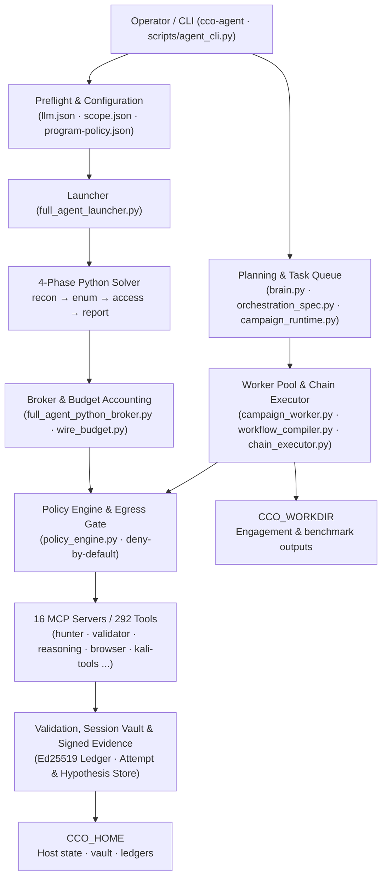

<div align="center">

# HackAgent (`kryon`)
### Policy-Supervised, Signed-Evidence Autonomous Python + LLM Security Operator

[](#installation)
[](#mcp-tool-ecosystem-16-servers--292-tools)
[](#why-hackagent-kryon)
[](#security-and-workspace-boundaries)

[🇹🇷 **Türkçe**](README.md) · 🇬🇧 **English**

**The model only produces data and hypotheses; the Python host layer enforces phase transitions, tool permissions, wire budgets, deterministic verification, and closure decisions.**

[Architecture](#architecture-and-control-flow) · [MCP Ecosystem](#mcp-tool-ecosystem-16-servers--292-tools) · [Installation](#installation) · [Quickstart](#quickstart) · [Verification Scorecard](#verification-and-quality-gates) · [Documentation](#documentation-map)

</div>

---

## Why HackAgent (`kryon`)?

In typical LLM-driven security agents, the model controls planning, tool execution, and even the *"finding confirmed"* verdict via unstructured text—creating risks of scope drift, budget overruns, and false positives.

**HackAgent (`kryon`)** runs as a standalone **Python 3.12+ + OpenAI-compatible LLM** runtime (requiring no external OpenCode/JS client) that puts deterministic host controls in charge:

- **Host Authority (Zero-Trust Model):** The LLM sees only a projected context and an explicit per-phase tool allowlist. Phase transitions (`recon → enum → access → report`), schema checks, time/token/HTTP caps, and closure remain host-enforced.
- **Signed & Deterministic Evidence Chain:** Model prose never verifies a finding. Findings require deterministic `validator` oracles, wire HTTP logs, Ed25519-signed receipts, and `closure.json` verification.
- **Deny-by-Default Policy Engine:** `policy_engine.py`, `.codex/scope.json`, and `.codex/program-policy.json` validate every invocation per request for scope, HTTP method, identity/session binding, and secret protection.
- **False-Positive Brakes & Negative Controls:** Any `CONFIRMED` verdict against hardened `/safe/*` control endpoints fails the check (`fp_rate: 0.0` required).
- **Durable Campaigns & Checkpointing:** Includes a persistent SQLite task queue (`campaign_runtime.py`), atomic checkpoint/resume, and read-only audit/benchmark tooling (`audit`, `benchmark`).

---

## Architecture and Control Flow



### Core Python Modules

| Layer | Key Modules | Responsibility |
| :--- | :--- | :--- |
| **CLI Entrypoint** | `scripts/agent_cli.py`, `./scripts/cco.sh`, `cco-agent` | Unified CLI (`plan`, `operations`, `preflight`, `run`, `audit`, `benchmark`, `campaign`, `worker`, `security`, `status`) |
| **LLM Loop & Broker** | `full_agent_python_solver.py`, `full_agent_python_broker.py`, `full_agent_broker.py`, `full_agent_budget.py` | OpenAI-compatible runtime, four-phase execution, context projection, session refs, schema checks, and budget accounting |
| **Planning & Orchestration** | `brain.py`, `orchestration_spec.py`, `task_spec.py` | `TaskSpec` scheduling, P5 hypothesis observation queue, and closure contracts |
| **Campaign & Workers** | `campaign_runtime.py`, `campaign_worker.py`, `worker_pool.py`, `workflow_compiler.py` | Persistent SQLite queue, claim/lease, retries, and bounded multi-step HTTP chain execution |
| **Policy & Safety** | `policy_engine.py`, `policy_gate_cli.py`, `wire_budget.py` | Scope enforcement, secret leak prevention, repeat/stuck brakes, and per-request egress gates |
| **Benchmark & Holdout** | `full_agent_holdout.py`, `full_agent_e6_benchmark.py` | Independent holdout scoring, E6 multi-family paired experiment freezing, replay/audit, and comparison |

---

## MCP Tool Ecosystem (16 Servers · 292 Tools)

> Tool counts come strictly from `python3 scripts/tool_counts.py`. Server inventories and profiles live in [config/mcp-servers.json](config/mcp-servers.json) and [config/profiles.json](config/profiles.json); the Python solver enforces its own explicit allowlisted tool catalog at runtime.

<details>
<summary><strong>All 16 MCP Servers and Capabilities (Click to expand)</strong></summary>

| Server | Tools | Focus & Highlighted Tools |
| :--- | :---: | :--- |
| `kali-tools` | **93** | Structured recon & scanning (`nmap_scan_structured`, `sqlmap_test_structured`, `ffuf`, `nuclei`, `hydra`, `interactsh_*`, `generate_exploit_poc`) |
| `web-advanced` | **30** | GraphQL, JWT, OAuth/SAML, HTTP smuggling, cache poisoning, prototype pollution, WebSocket fuzz, IDOR matrix |
| `validator` | **27** | Deterministic verification oracles (`validate_sqli`, `validate_ssti`, `validate_command_injection`, `validate_path_traversal`, `validate_xss_reflection`, `validate_open_redirect`, `validate_ssrf_oob`, `validate_xxe`, `validate_auth_bypass`, `validate_idor`) |
| `browser` | **20** | Playwright-based DOM/XSS/header/cookie/network capture and auditing |
| `reasoning` | **20** | Attack tree planning (`plan_attack_tree`), `deep_think`, `reason_reflexion` (actor↔critic), WAF fingerprinting/evasion, persistent lessons |
| `hunter` | **16** | High-value vulnerability hunting: `predict_vulnerabilities`, `build_authz_matrix` / `analyze_authz_result` (BOLA/BFLA/IDOR), `generate_abuse_cases`, `hunt_variants`, `coverage_report`, `auto_fanout_variants` |
| `memory-server` | **15** | Finding/credential/attack-path memory (`store_finding`, `query_attack_paths`, `suggest_next_action`) |
| `ctf-platform` | **14** | CTFd/HTB/THM integration and decoding/hashing helpers |
| `ad-tools` | **12** | Active Directory / Kerberos, SMB enumeration, NTLM, and BloodHound collection |
| `container-tools` | **10** | Container escape, Kubernetes RBAC, secret inspection, and Helm security analysis |
| `telemetry` | **10** | LLM/tool cost accounting, savings tracking, and metrics dashboard |
| `osint-tools` | **9** | `crtsh_subdomains`, DNS recon/zone transfers, Wayback, RDAP/WHOIS, GitHub code search |
| `rag-engine` | **7** | ChromaDB vector search over CVEs, ExploitDB, and writeups (`rag_search`, `rag_similar_exploits`) |
| `llm-security` | **6** | OWASP LLM Top 10: prompt injection, system prompt leak, and jailbreak probes |
| `agent-browse` | **2** | Guardrailed autonomous browser interaction |
| `otp` | **1** | Latest OTP retrieval over IMAP (`get_latest_otp`) |

</details>

---

## Installation

**Requirements:** Python `3.12+` (Playwright/Chromium, Kali tools, and optional MCP dependencies are installed separately as needed; `requirements.lock` locks core Python packages).

```bash
python3 -m venv .venv
source .venv/bin/activate
python3 -m pip install --require-hashes -r requirements.lock
python3 -m pip install --no-deps --no-build-isolation -e .
```

### Provider Configuration (`cco-llm/1`)

```bash
cp config/llm.example.json config/llm.json
python3 scripts/agent_cli.py check-config --provider-config config/llm.json
```

> **Credential Safety:** **Never store raw API keys** inside configuration files. Specify only the environment variable name (`api_key_env`, e.g. `CCO_LLM_API_KEY`). Provider URLs must use HTTPS or owned loopback addresses; `config/llm.json` is git-ignored.

---

## Quickstart

Once installed, invoke `cco-agent`, `./scripts/cco.sh`, or `python3 scripts/agent_cli.py`:

```bash
# 1. Validate configuration and inspect CLI options
python3 scripts/agent_cli.py --help
python3 scripts/agent_cli.py check-config --provider-config config/llm.example.json

# 2. Generate an offline plan and operations summary (0 network traffic)
python3 scripts/agent_cli.py plan --target https://example.invalid --workdir ~/cco-work/example
python3 scripts/agent_cli.py operations --workdir ~/cco-work/example

# 3. Lab run: preflight + signed execution (requires --execute to run)
python3 scripts/agent_cli.py preflight --baseline <baseline-dir> --provider-config config/llm.json --output-dir ~/cco-work/preflight
python3 scripts/agent_cli.py run --preflight ~/cco-work/preflight/<id>/preflight.json --seed 123456 --execute
python3 scripts/agent_cli.py run --resume ~/cco-work/runs/<run-dir> --execute

# 4. E6 multi-family benchmark contract (planning makes 0 network calls; live remote requires explicit consent)
python3 scripts/agent_cli.py benchmark plan --label e6-plan --baseline <baseline-dir> --output-dir ~/cco-work/e6-plan
```

Other subcommands: `audit`, `campaign`, `worker`, `security`, `status`.
Additional console entrypoints (`pyproject.toml`): `cco-operator`, `cco-campaign`, `cco-worker`, `cco-policy`, `cco-governance`, `cco-engagement`, `cco-release-check`.

---

## Security and Workspace Boundaries

- **Clean Repository / Isolated Outputs:** Source code stays in the repository; all engagement and run outputs stay under `CCO_WORKDIR` (default `~/cco-work`), while host signatures, ledgers, and vaults live under `CCO_HOME`.
- **Explicit Scope & Policy:** `plan` and `operations` send zero network traffic; `preflight`/`run` execute against frozen baselines and synthetic lab identities. Any live interaction requires `.codex/scope.json` (or `CCO_SCOPE_FILE`), `.codex/program-policy.json`, and explicit operator authorization.
- **Create an Engagement Workspace:**

```bash
python3 scripts/engagement_workspace.py \
  --id my-program \
  --scope .codex/scope.json \
  --policy .codex/program-policy.json
```

---

## Verification and Quality Gates

Reproducible verification runs target the intentionally vulnerable loopback lab (`scripts/lab/vuln_lab.py` on `127.0.0.1`) and local regression suites; they do not claim live program acceptance.

Latest recorded scorecard summary ([docs/benchmark-scorecard.md](docs/benchmark-scorecard.md), `2026-11-13`):

| Gate | Result | Scope |
| :--- | :--- | :--- |
| **Unit Test Suite** | `3365 passed, 37 skipped, 34 deselected` | `pytest -m 'not integration'` |
| **Loopback Lab Validation** | `48/48 passed` | Hunter + Authz + Business Logic + Variant + Validator oracles |
| **Negative Controls (FP Guard)** | `6/6 passed (fp_rate: 0.0)` | Hardened `/safe/*` control endpoints |
| **MCP Tool Inventory** | `16 servers, 292 tools` | `tool_counts.py` decorator audit |
| **Dependency Lock** | `103 packages verified` | `release_artifacts.py check-lock` |

### Running Local Quality Checks

```bash
python3 -m pytest tests -q -m 'not integration'
python3 scripts/lab-validate.py --skip-rag --quiet --json
python3 scripts/negative-control.py --rounds 1 --json
python3 scripts/check_repo_layout.py
python3 scripts/release_artifacts.py check-lock
python3 scripts/governance_audit.py --root scripts --format json --fail-on high
python3 scripts/release_check.py --list
```

---

## Documentation Map

> Note: Detailed internal guides under `docs/` are primarily written in Turkish.

| Topic | Document |
| :--- | :--- |
| Engine Status & E1–E9 Roadmap | [docs/PYTHON_ENGINE_GAPS.md](docs/PYTHON_ENGINE_GAPS.md) |
| Architecture & Data Boundaries | [docs/architecture.md](docs/architecture.md) |
| Operations, Safety & Campaigns | [docs/operations.md](docs/operations.md) |
| MCP Tool Catalog | [docs/mcp-reference.md](docs/mcp-reference.md) |
| Lab & Negative-Control Scorecard | [docs/benchmark-scorecard.md](docs/benchmark-scorecard.md) |
| P5–P9 Capability Guides | [docs/README.md](docs/README.md) (P5 Hypothesis Queue, P6 Web Experiments, P7 Business Logic, P8 Chaining, P9 Agent Integration) |
