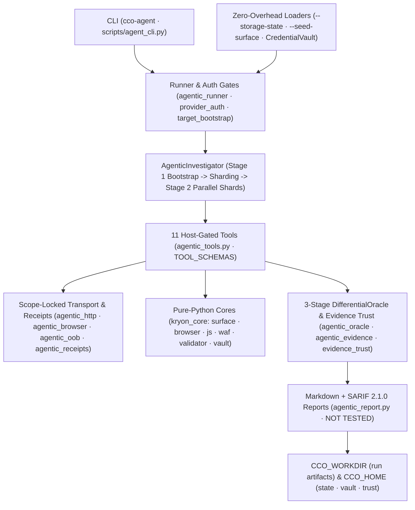

<div align="center">

# HackAgent (`kryon`)
### Sharded ReAct Security Investigator & Pure-Python Verification Engine

[](#installation)
[](LICENSE)
[](#key-capabilities)
[](#key-capabilities)
[](#security-scope-and-workspace-boundaries)

**English** · [Türkçe](README.tr.md)

**The model proposes; the Python host disposes.**

One standalone **Python 3.12+ + OpenAI-compatible LLM** runtime (`cco-agent agentic` + `kryon_core`) — zero external agent clients, zero JavaScript plugins, zero MCP server daemons.

[Capabilities](#key-capabilities) · [Architecture](#architecture) · [Installation](#installation) · [Quickstart](#quickstart) · [Repository Layout](#repository-layout) · [Security](#security-scope-and-workspace-boundaries) · [Verification](#verification-and-quality-gates) · [Docs](#documentation-map)

</div>

---

## Key Capabilities

HackAgent (`kryon`) separates LLM reasoning from host-enforced authorization, transport, verification, and reporting:

- **Sharded ReAct Investigator (`cco-agent agentic`):** Two-stage `--execution-mode sharded` workflow — Stage 1 discovery bootstrap (`--bootstrap-model`, `discovery_finish_gate` ensuring post-auth coverage before handoff) followed by `agentic_sharding.py` subsystem clustering and Stage 2 parallel shards with `80K` epoch compaction (`agentic_context.py`) and cached prompt-token accounting (`--cache-token-weight`).
- **11 Lean Host-Gated Tools (`TOOL_SCHEMAS`):** Closed catalog enforced by `scripts/agentic_tools.py` — `http_request`, `read_receipt`, `replay_as`, `extract_surface`, `notebook`, `callback_listener`, `concurrent_check`, `browser_crawl`, `analyze_token`, `record_finding`, `finish`.
- **Pure-Python `kryon_core` Library Suite (Zero MCP Daemons):**
  - `kryon_core.surface` — W3C HTML, JS, CSS, HTTP header, OpenAPI, GraphQL, Postman, `robots.txt`, and sitemap extraction, normalization, wordlists, and read-only crawl primitives.
  - `kryon_core.browser` — Playwright SPA / Shadow DOM crawl hooks plus read-only DOM/CSP request-interception policy.
  - `kryon_core.js` — JavaScript parser, route composition, source-map decoding, and client-logic mapping (`build_client_logic_map`).
  - `kryon_core.waf` — Passive WAF/CDN fingerprinting and HTTP block classification (`classify_http`).
  - `kryon_core.validator` — Offline JWT/opaque token analysis, serialization/deserialization inspection, and Ed25519-signed OOB event verification.
  - `kryon_core.vault` — Encrypted local `CredentialVault` and bounded IMAP OTP reader (`otp_core`).
- **Zero-Overhead Startup Loaders:** Import authenticated Playwright sessions with `--storage-state` (`agentic_auth_import.py` / `cco-agent save-auth`) and seed discovery offline from HAR, mitm, ZAP, ffuf, nuclei, or URL lists with `--seed-surface` and `--tech-hint` (`agentic_seed.py`) at zero runtime request cost.
- **Deterministic 3-Stage Verification & Circuit Breaker:** Findings require receipt-backed proof passing `DifferentialOracle` (**Control/Falsification -> Masked Diff -> Clean Replay**); unverified model prose never confirms a finding. `ServiceDegradationError` (`--max-degradation-streak`) stops runs gracefully on sustained `429/502/503/504` responses.
- **Actionable Reporting with `NOT TESTED` Transparency:** `cco-agent report` renders secret-redacted Markdown (`report.md`) and SARIF 2.1.0 (`report.sarif`) reports that explicitly list untested attack surface and coverage gaps.

---

## Architecture



For the full module breakdown and data-flow contract, see [docs/architecture.md](docs/architecture.md).

---

## Installation

**Requirements:** Python `3.12+` (`requirements.lock` pins verified hashes for all core dependencies; install Playwright browsers separately when using `browser_crawl` or `save-auth`).

```bash
python3 -m venv .venv
source .venv/bin/activate
python3 -m pip install --require-hashes -r requirements.lock
python3 -m pip install --no-deps --no-build-isolation -e .
```

### Provider Configuration (`cco-llm/1`)

```bash
cp config/llm.example.json config/llm.json
cco-agent check-config --provider-config config/llm.json
```

> **Credential Safety:** Never store raw API keys in configuration files. Reference only an environment variable name via `api_key_env` (for example `CCO_LLM_API_KEY`). `config/llm.json` is git-ignored.

---

## Quickstart

Invoke via the installed `cco-agent` entry point, `./scripts/cco.sh`, or `python3 scripts/agent_cli.py`:

```bash
# 1. Inspect CLI commands and validate provider schema offline (0 network calls)
cco-agent --help
cco-agent check-config --provider-config config/llm.example.json

# 2. Generate an offline assessment plan (writes agentic-plan.json; 0 target/LLM traffic)
cco-agent agentic \
  --target http://127.0.0.1:8000 \
  --provider-config config/llm.example.json \
  --output-dir ~/cco-work/demo-plan

# 3. Execute against an owned local loopback target with sharded mode + offline seeds
cco-agent agentic \
  --target http://127.0.0.1:8000 \
  --provider-config config/llm.json \
  --execution-mode sharded \
  --storage-state member=~/.cco/auth/demo-storage.json \
  --seed-surface ~/cco-work/seeds/traffic.har \
  --tech-hint nextjs \
  --output-dir ~/cco-work/demo-run \
  --execute

# 4. Authorized non-loopback engagement (requires explicit scope file + opt-in flags + operator approval)
cco-agent agentic \
  --target https://target.example.invalid \
  --scope-file .codex/scope.json \
  --allow-non-loopback \
  --provider-config config/llm.json \
  --authorize-live-provider \
  --live-authorization-reason "approved-engagement" \
  --execution-mode sharded \
  --output-dir ~/cco-work/target-run \
  --execute

# 5. Render Markdown + SARIF 2.1.0 reports from a run directory
cco-agent report ~/cco-work/demo-run --format all

# 6. Capture a Playwright storage_state.json once for authenticated targets
cco-agent save-auth \
  --program demo \
  --login-url https://auth.example.invalid/login \
  --user-selector '#username' \
  --pass-selector '#password' \
  --submit-selector 'button[type=submit]'

# 7. Run the full repository verification gate
python3 scripts/release_check.py
```

Installed console scripts (`pyproject.toml`): `cco-agent`, `cco-governance`, `cco-release-check`, `cco-release-artifacts`.

---

## Repository Layout

| Path | Role |
| :--- | :--- |
| [scripts/](scripts/) | CLI entry points (`agent_cli.py`, `cco.sh`), Sharded ReAct engine (`agentic_*.py`), provider/budget/scope/trust infrastructure, and release quality gates |
| [kryon_core/](kryon_core/) | Pure-Python libraries (`surface`, `browser`, `js`, `waf`, `validator`, `vault`) imported directly with zero MCP server overhead |
| [config/](config/) | Provider schema template ([llm.example.json](config/llm.example.json)) and program policy template ([bounty-program-policy.json](config/bounty-program-policy.json)) |
| [docs/](docs/) | Architecture guide ([docs/architecture.md](docs/architecture.md)) and documentation index ([docs/README.md](docs/README.md)) |
| [tests/](tests/) | Offline unit, security-boundary, sharding, oracle, reporting, and installed-runtime test suites |

---

## Security, Scope, and Workspace Boundaries

- **Fail-Closed Loopback Default:** Without `--execute`, `cco-agent agentic` only writes `agentic-plan.json` (0 traffic). Live non-loopback targets require explicit `--scope-file` (`.codex/scope.json`), `--allow-non-loopback`, and operator approval; remote LLM endpoints additionally require `--authorize-live-provider`.
- **Workspace Isolation:** Run artifacts write to `CCO_WORKDIR` (default `~/cco-work`); host state, encrypted `CredentialVault`, and trust bundles live under `CCO_HOME` (default `~/.cco`). Runtime files are forbidden in the repository root (`scripts/check_repo_layout.py`).
- **Safety & Secret Hygiene:** Scope, method allowlists, `SharedBudget` / `WireBudget`, and `ServiceDegradationError` guard every execution path. Receipts and PoCs automatically redact sensitive headers, cookies, tokens, and query parameters; never commit `.env` or `config/llm.json`.

---

## Verification and Quality Gates

Run all release checks at once via `python3 scripts/release_check.py`, or run individual gates:

```bash
python3 -m ruff check .
python3 -m mypy
python3 -m pytest tests -q
python3 scripts/release_artifacts.py check-lock
python3 scripts/agent_cli.py check-config --provider-config config/llm.example.json
python3 scripts/governance_audit.py --root scripts --format json --fail-on high
python3 scripts/governance_audit.py --root kryon_core --format json --fail-on high
python3 scripts/check_repo_layout.py
```

---

## Documentation Map

| Area | Document |
| :--- | :--- |
| Architecture & Module Map | [docs/architecture.md](docs/architecture.md) |
| Documentation Index | [docs/README.md](docs/README.md) |
| Agent Operating Rules & Safety | [AGENTS.md](AGENTS.md) |
| Turkish Overview | [README.tr.md](README.tr.md) |
| Provider Schema Template | [config/llm.example.json](config/llm.example.json) |
| Program Policy Template | [config/bounty-program-policy.json](config/bounty-program-policy.json) |

> **Legacy v1 Archive:** The retired v1 architecture (`PythonSolver`, 16 MCP servers, `skills/`, and legacy P1–P9 docs/tests) is preserved permanently at `git tag legacy-v1-archive`.

---

## License

Licensed under the **Apache License, Version 2.0** — see [LICENSE](LICENSE) for full terms.
