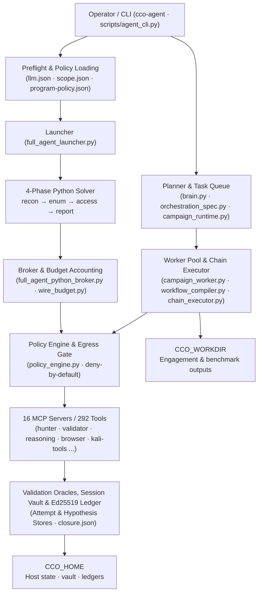

<div align="center">

# HackAgent (`kryon`)
### Policy-Supervised, Signed-Evidence Autonomous Python + LLM Security Operator

[](#installation)
[](#mcp-tool-ecosystem-16-servers--292-tools)
[](#core-design-guarantees)
[](#security-and-workspace-boundaries)

**English** · [Türkçe](README.tr.md)

**The model proposes; the Python host disposes.**

All phase transitions, tool allowlists, scope boundaries, wire budgets, deterministic oracles, and closure decisions are enforced in Python—never delegated to unverified model prose.

[Guarantees](#core-design-guarantees) · [Architecture](#architecture-and-execution-flow) · [MCP Ecosystem](#mcp-tool-ecosystem-16-servers--292-tools) · [Installation](#installation) · [Quickstart](#quickstart) · [Verification](#verification-and-quality-gates) · [Docs](#documentation-map)

</div>

---

## Core Design Guarantees

Conventional LLM security agents collapse planning, execution, and finding acceptance into a single unstructured text stream—inviting scope drift, budget blowups, and false positives.

**HackAgent (`kryon`)** runs as a standalone **Python 3.12+ + OpenAI-compatible LLM** engine (zero external OpenCode or JS plugin dependency) built around strict separation of authority:

| Guarantee | Mechanism |
| :--- | :--- |
| **Host-Owned Control Plane** | The model only receives a projected context view and per-phase tool allowlists across the four-phase lifecycle (`recon → enum → access → report`). |
| **Cryptographically Signed Evidence** | Findings are accepted only through deterministic `validator` oracles, wire HTTP transcripts, Ed25519-signed ledger receipts, and verified `closure.json` records. |
| **Deny-by-Default Policy Gate** | `policy_engine.py`, `.codex/scope.json`, and `.codex/program-policy.json` check every tool call per request for target scope, HTTP method, identity binding, and secret protection. |
| **Fail-Closed False-Positive Brake** | Hardened `/safe/*` negative-control endpoints must always return `UNCONFIRMED`; any `CONFIRMED` verdict fails the suite (`fp_rate: 0.0`). |
| **Isolated Runtime & Durable Queue** | Persistent SQLite task execution (`campaign_runtime.py`), atomic checkpoint/resume, and strict host-state isolation under `CCO_HOME` / `CCO_WORKDIR`. |

---

## Architecture and Execution Flow



### Core Runtime Layers

| Layer | Key Modules | Responsibility |
| :--- | :--- | :--- |
| **CLI & Entrypoints** | `scripts/agent_cli.py`, `./scripts/cco.sh`, `cco-agent` | Unified CLI (`plan`, `operations`, `preflight`, `run`, `audit`, `benchmark`, `campaign`, `worker`, `security`, `status`) |
| **LLM Solver & Broker** | `full_agent_python_solver.py`, `full_agent_python_broker.py`, `full_agent_broker.py`, `full_agent_budget.py` | OpenAI-compatible loop, context projection, identity/session scoping, schema validation, and token/HTTP/time enforcement |
| **Planning & Closure** | `brain.py`, `orchestration_spec.py`, `task_spec.py` | `TaskSpec` dependency scheduling, P5 hypothesis observation queues, and closure contracts |
| **Campaign & Execution** | `campaign_runtime.py`, `campaign_worker.py`, `worker_pool.py`, `workflow_compiler.py` | Persistent SQLite queue, claim/lease recovery, retries, and bounded multi-step HTTP chains |
| **Policy & Guardrails** | `policy_engine.py`, `policy_gate_cli.py`, `wire_budget.py` | Scope verification, secret-exfiltration guards, repeat/stuck brakes, and per-request egress gates |
| **Holdouts & E6 Benchmark** | `full_agent_holdout.py`, `full_agent_e6_benchmark.py` | Independent holdout scoring, paired multi-seed experiment manifests, read-only re-audits, and cohort comparisons |

---

## MCP Tool Ecosystem (16 Servers · 292 Tools)

> Tool counts are derived directly from `python3 scripts/tool_counts.py`. Server definitions and profiles live in [config/mcp-servers.json](config/mcp-servers.json) and [config/profiles.json](config/profiles.json); the Python solver enforces its own explicit allowlisted catalog at runtime.

<details>
<summary><strong>Explore all 16 MCP servers and tool counts</strong></summary>

| Server | Tools | Focus & Key Capabilities |
| :--- | :---: | :--- |
| `kali-tools` | **93** | Structured discovery & scanning (`nmap_scan_structured`, `sqlmap_test_structured`, `ffuf`, `nuclei`, `hydra`, `interactsh_*`, `generate_exploit_poc`) |
| `web-advanced` | **30** | GraphQL, JWT, OAuth/SAML, HTTP smuggling, cache poisoning, prototype pollution, WebSocket fuzzing, IDOR matrices |
| `validator` | **27** | Deterministic verification oracles (`validate_sqli`, `validate_ssti`, `validate_command_injection`, `validate_path_traversal`, `validate_xss_reflection`, `validate_open_redirect`, `validate_ssrf_oob`, `validate_xxe`, `validate_auth_bypass`, `validate_idor`) |
| `browser` | **20** | Playwright DOM/XSS/header/cookie/network capture and auditing |
| `reasoning` | **20** | Attack tree planning (`plan_attack_tree`), `deep_think`, `reason_reflexion` (actor↔critic), WAF fingerprinting/evasion, persistent lessons |
| `hunter` | **16** | High-impact bug-hunting: `predict_vulnerabilities`, `build_authz_matrix` / `analyze_authz_result` (BOLA/BFLA/IDOR), `generate_abuse_cases`, `hunt_variants`, `coverage_report`, `auto_fanout_variants` |
| `memory-server` | **15** | Finding/credential/attack-path memory (`store_finding`, `query_attack_paths`, `suggest_next_action`) |
| `ctf-platform` | **14** | CTFd/HTB/THM integrations and decode/hash utilities |
| `ad-tools` | **12** | Active Directory / Kerberos, SMB enumeration, NTLM, and BloodHound data collection |
| `container-tools` | **10** | Container escape detection, Kubernetes RBAC, secret inspection, and Helm checks |
| `telemetry` | **10** | LLM/tool usage accounting, cost tracking, and metrics reporting |
| `osint-tools` | **9** | `crtsh_subdomains`, DNS recon/zone transfers, Wayback Machine, RDAP/WHOIS, GitHub code search |
| `rag-engine` | **7** | ChromaDB vector search across CVEs, ExploitDB, and writeups (`rag_search`, `rag_similar_exploits`) |
| `llm-security` | **6** | OWASP LLM Top 10 probes: prompt injection, system prompt leaks, and jailbreak checks |
| `agent-browse` | **2** | Guardrailed autonomous browser interaction |
| `otp` | **1** | Latest OTP code retrieval via IMAP (`get_latest_otp`) |

</details>

---

## Installation

**Requirements:** Python `3.12+` (`requirements.lock` pins core dependencies; Playwright/Chromium, Kali binaries, and optional MCP extras are installed separately per enabled capability).

```bash
python3 -m venv .venv
source .venv/bin/activate
python3 -m pip install --require-hashes -r requirements.lock
python3 -m pip install --no-deps --no-build-isolation -e .
```

### Provider Configuration (`cco-llm/1`)

```bash
cp config/llm.example.json config/llm.json
python3 scripts/agent_cli.py check-config --provider-config config/llm.json
```

> **Credential Safety:** **Never place raw API keys** in config files. Reference only the environment variable name via `api_key_env` (for example `CCO_LLM_API_KEY`). Provider endpoints must use HTTPS or owned loopback URLs; `config/llm.json` is git-ignored.

---

## Quickstart

Once installed, run via `cco-agent`, `./scripts/cco.sh`, or `python3 scripts/agent_cli.py`:

```bash
# 1. Inspect CLI commands and validate provider schema offline
python3 scripts/agent_cli.py --help
python3 scripts/agent_cli.py check-config --provider-config config/llm.example.json

# 2. Generate an offline plan and operations summary (0 network requests)
python3 scripts/agent_cli.py plan --target https://example.invalid --workdir ~/cco-work/example
python3 scripts/agent_cli.py operations --workdir ~/cco-work/example

# 3. Controlled lab workflow: preflight + signed execution (--execute required to run)
python3 scripts/agent_cli.py preflight --baseline <baseline-dir> --provider-config config/llm.json --output-dir ~/cco-work/preflight
python3 scripts/agent_cli.py run --preflight ~/cco-work/preflight/<id>/preflight.json --seed 123456 --execute
python3 scripts/agent_cli.py run --resume ~/cco-work/runs/<run-dir> --execute

# 4. E6 multi-family benchmark freeze (planning sends 0 traffic; live remote calls require explicit consent)
python3 scripts/agent_cli.py benchmark plan --label e6-plan --baseline <baseline-dir> --output-dir ~/cco-work/e6-plan
```

Other subcommands: `audit`, `campaign`, `worker`, `security`, `status`.

Additional console entrypoints (`pyproject.toml`): `cco-operator`, `cco-campaign`, `cco-worker`, `cco-policy`, `cco-governance`, `cco-engagement`, `cco-release-check`.

---

## Security and Workspace Boundaries

- **Zero Runtime Artifacts in Git:** Source stays clean in the repository; engagement artifacts write to `CCO_WORKDIR` (default `~/cco-work`), while host state, ledgers, and credential vaults reside in `CCO_HOME`.
- **Fail-Closed Scope & Authorization:** `plan` and `operations` send zero network requests; `preflight`/`run` operate on frozen baselines and synthetic identities. Any live target run requires `.codex/scope.json` (or `CCO_SCOPE_FILE`), `.codex/program-policy.json`, and explicit operator approval.
- **Create an Isolated Engagement Workspace:**

```bash
python3 scripts/engagement_workspace.py \
  --id my-program \
  --scope .codex/scope.json \
  --policy .codex/program-policy.json
```

---

## Verification and Quality Gates

Reproducible verification targets the intentionally vulnerable local loopback lab (`scripts/lab/vuln_lab.py` on `127.0.0.1`) and offline regression suites; these checks do not claim production program acceptance.

Latest recorded scorecard ([docs/benchmark-scorecard.md](docs/benchmark-scorecard.md), `2026-11-13`):

| Gate | Result | Scope |
| :--- | :--- | :--- |
| **Unit Test Suite** | `3365 passed, 37 skipped, 34 deselected` | `pytest -m 'not integration'` |
| **Loopback Lab Validation** | `48/48 passed` | Hunter + Authz + Business Logic + Variant + Validator oracles |
| **Negative Controls (FP Guard)** | `6/6 passed (fp_rate: 0.0)` | Hardened `/safe/*` control endpoints |
| **MCP Tool Inventory** | `16 servers, 292 tools` | `tool_counts.py` decorator audit |
| **Dependency Lock** | `103 packages verified` | `release_artifacts.py check-lock` |

### Reproduce Locally

```bash
python3 -m pytest tests -q -m 'not integration'
python3 scripts/lab-validate.py --skip-rag --quiet --json
python3 scripts/negative-control.py --rounds 1 --json
python3 scripts/check_repo_layout.py
python3 scripts/release_artifacts.py check-lock
python3 scripts/governance_audit.py --root scripts --format json --fail-on high
python3 scripts/release_check.py --list
```

---

## Documentation Map

> Note: Detailed technical guides under `docs/` are primarily maintained in Turkish.

| Area | Document |
| :--- | :--- |
| Engine Status & E1–E9 Roadmap | [docs/PYTHON_ENGINE_GAPS.md](docs/PYTHON_ENGINE_GAPS.md) |
| Architecture & Data Boundaries | [docs/architecture.md](docs/architecture.md) |
| Operations, Safety & Campaigns | [docs/operations.md](docs/operations.md) |
| MCP Server & Tool Reference | [docs/mcp-reference.md](docs/mcp-reference.md) |
| Lab & Negative-Control Scorecard | [docs/benchmark-scorecard.md](docs/benchmark-scorecard.md) |
| P5–P9 Capability Guides | [docs/README.md](docs/README.md) (P5 Hypothesis Queue, P6 Web Experiments, P7 Business Logic, P8 Chaining, P9 Agent Integration) |
