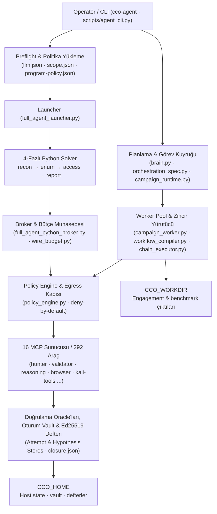

<div align="center">

# HackAgent (`kryon`)
### Politika Denetimli, İmzalı Kanıt Odaklı Otonom Python + LLM Güvenlik Motoru

[](#kurulum)
[](LICENSE)
[](#mcp-araç-ekosistemi-16-sunucu--292-araç)
[](#temel-tasarım-garantileri)
[](#güvenlik-ve-çalışma-sınırları)

[English](README.md) · **Türkçe**

**Model önerir; Python host katmanı karar verir.**

Tüm aşama geçişleri, araç izin listeleri, kapsam sınırları, wire bütçeleri, deterministik doğrulamalar ve kapanış kararları Python katmanında zorunlu kılınır; doğrulanmamış model metnine asla bırakılmaz.

[Garantiler](#temel-tasarım-garantileri) · [Mimari](#mimari-ve-yürütme-akışı) · [MCP Ekosistemi](#mcp-araç-ekosistemi-16-sunucu--292-araç) · [Kurulum](#kurulum) · [Hızlı Başlangıç](#hızlı-başlangıç) · [Doğrulama](#doğrulama-ve-kalite-kapıları) · [Dokümantasyon](#dokümantasyon-haritası)

</div>

---

## Temel Tasarım Garantileri

Geleneksel LLM tabanlı güvenlik ajanlarında planlama, araç yürütme ve bulgu kabulü tek bir serbest metin akışında birleşir; bu da kapsam dışına taşma, bütçe aşımı ve sahte pozitif (false-positive) riskini büyütür.

**HackAgent (`kryon`)**, harici bir OpenCode/JS istemcisine bağımlı kalmadan tamamen bağımsız bir **Python 3.12+ + OpenAI uyumlu LLM** motoru olarak katı yetki ayrımı üzerine kuruludur:

| Garanti | Uygulama Mekanizması |
| :--- | :--- |
| **Host Otoritesi (Zero-Trust)** | Model yalnızca projekte edilmiş bir bağlam görünümü ve dört aşamalı döngüde (`recon → enum → access → report`) faz bazlı izinli araç listesi alır. |
| **Kriptografik İmzalı Kanıt** | Bulgular yalnızca deterministik `validator` oracle'ları, wire HTTP kayıtları, Ed25519 imzalı defter makbuzları ve doğrulanmış `closure.json` ile kabul edilir. |
| **Deny-by-Default Politika Kapısı** | `policy_engine.py`, `.codex/scope.json` ve `.codex/program-policy.json` her çağrıyı istek bazında hedef kapsam, HTTP metodu, kimlik bağı ve secret koruması yönünden denetler. |
| **Fail-Closed Sahte Pozitif Freni** | Sertleştirilmiş `/safe/*` kontrol uç noktaları daima `UNCONFIRMED` dönmelidir; tek bir `CONFIRMED` sonucu dahi kontrolü başarısız kılar (`fp_rate: 0.0`). |
| **İzole Çalışma & Kalıcı Kuyruk** | SQLite tabanlı görev kuyruğu (`campaign_runtime.py`), atomik checkpoint/resume ve `CCO_HOME` / `CCO_WORKDIR` altında sıkı durum izolasyonu sunar. |

---

## Mimari ve Yürütme Akışı



### Temel Python Katmanları

| Katman | Ana Modüller | Sorumluluk |
| :--- | :--- | :--- |
| **CLI & Giriş** | `scripts/agent_cli.py`, `./scripts/cco.sh`, `cco-agent` | Birleşik CLI (`plan`, `operations`, `preflight`, `run`, `audit`, `benchmark`, `campaign`, `worker`, `security`, `status`) |
| **LLM Döngüsü & Broker** | `full_agent_python_solver.py`, `full_agent_python_broker.py`, `full_agent_broker.py`, `full_agent_budget.py` | OpenAI uyumlu döngü, bağlam projeksiyonu, kimlik/oturum kapsamı, şema doğrulama ve token/HTTP/süre muhasebesi |
| **Planlama & Kapanış** | `brain.py`, `orchestration_spec.py`, `task_spec.py` | `TaskSpec` bağımlılık planlaması, P5 hipotez gözlem kuyrukları ve kapanış sözleşmeleri |
| **Kampanya & Worker** | `campaign_runtime.py`, `campaign_worker.py`, `worker_pool.py`, `workflow_compiler.py` | Kalıcı SQLite kuyruğu, claim/lease kurtarma, tekrar deneme ve sınırlı çok-adımlı HTTP zincirleri |
| **Politika & Koruma** | `policy_engine.py`, `policy_gate_cli.py`, `wire_budget.py` | Scope doğrulama, secret sızıntı engeli, repeat/stuck freni ve istek bazında egress kapıları |
| **Holdout & E6 Benchmark** | `full_agent_holdout.py`, `full_agent_e6_benchmark.py` | Bağımsız holdout puanlama, E6 çok-aileli paired deney manifestleri, salt okunur denetim ve karşılaştırma |

---

## MCP Araç Ekosistemi (16 Sunucu · 292 Araç)

> Araç sayılarının tek kaynağı `python3 scripts/tool_counts.py` çıktısıdır. Envanter ve profiller [config/mcp-servers.json](config/mcp-servers.json) ve [config/profiles.json](config/profiles.json) içinde tanımlıdır; Python solver çalışma anında ayrıca kendi açık ve sınırlı araç kataloğunu uygular.

<details>
<summary><strong>Tüm 16 MCP sunucusunu ve araç sayılarını görüntüle</strong></summary>

| Sunucu | Araç | Odak Alanı & Öne Çıkan Yetenekler |
| :--- | :---: | :--- |
| `kali-tools` | **93** | Yapılandırılmış keşif & tarama (`nmap_scan_structured`, `sqlmap_test_structured`, `ffuf`, `nuclei`, `hydra`, `interactsh_*`, `generate_exploit_poc`) |
| `web-advanced` | **30** | GraphQL, JWT, OAuth/SAML, HTTP smuggling, cache poisoning, prototype pollution, WebSocket fuzz, IDOR matrix |
| `validator` | **27** | Deterministik exploit doğrulama oracle'ları (`validate_sqli`, `validate_ssti`, `validate_command_injection`, `validate_path_traversal`, `validate_xss_reflection`, `validate_open_redirect`, `validate_ssrf_oob`, `validate_xxe`, `validate_auth_bypass`, `validate_idor`) |
| `browser` | **20** | Playwright tabanlı DOM/XSS/header/cookie/network yakalama ve denetim |
| `reasoning` | **20** | Saldırı ağacı planlama (`plan_attack_tree`), `deep_think`, `reason_reflexion` (actor↔critic), WAF parmak izi/uyumlama, kalıcı dersler |
| `hunter` | **16** | Yüksek-ödüllü sınıf avcısı: `predict_vulnerabilities`, `build_authz_matrix` / `analyze_authz_result` (BOLA/BFLA/IDOR), `generate_abuse_cases`, `hunt_variants`, `coverage_report`, `auto_fanout_variants` |
| `memory-server` | **15** | Bulgu/kimlik/saldırı yolu belleği (`store_finding`, `query_attack_paths`, `suggest_next_action`) |
| `ctf-platform` | **14** | CTFd/HTB/THM entegrasyonu ve decode/hash yardımcıları |
| `ad-tools` | **12** | Active Directory / Kerberos, SMB enum, NTLM ve BloodHound veri toplama |
| `container-tools` | **10** | Container escape, Kubernetes RBAC, secret analizi ve Helm kontrolleri |
| `telemetry` | **10** | LLM/araç maliyet muhasebesi, tasarruf ve metrik raporlaması |
| `osint-tools` | **9** | `crtsh_subdomains`, DNS recon/zone transfer, Wayback, RDAP/WHOIS, GitHub kod arama |
| `rag-engine` | **7** | ChromaDB tabanlı CVE, ExploitDB ve writeup vektör araması (`rag_search`, `rag_similar_exploits`) |
| `llm-security` | **6** | OWASP LLM Top 10 yoklamaları: prompt injection, system prompt leak ve jailbreak testleri |
| `agent-browse` | **2** | Sınırlandırılmış otonom tarayıcı etkileşimi |
| `otp` | **1** | IMAP üzerinden son OTP kodunu alma (`get_latest_otp`) |

</details>

---

## Kurulum

**Gereksinimler:** Python `3.12+` (`requirements.lock` ana Python bağımlılıklarını sabitler; Playwright/Chromium, Kali araçları ve opsiyonel MCP paketleri kullanılacak özelliklere göre ayrıca kurulur).

```bash
python3 -m venv .venv
source .venv/bin/activate
python3 -m pip install --require-hashes -r requirements.lock
python3 -m pip install --no-deps --no-build-isolation -e .
```

### Sağlayıcı Yapılandırması (`cco-llm/1`)

```bash
cp config/llm.example.json config/llm.json
python3 scripts/agent_cli.py check-config --provider-config config/llm.json
```

> **Gizlilik Kuralı:** Yapılandırma dosyasına **asla ham API anahtarı yazmayın**. Yalnızca ortam değişkeni adını (`api_key_env`, örnek: `CCO_LLM_API_KEY`) belirtin. Sağlayıcı URL'si HTTPS veya sahip olunan loopback olmalıdır; `config/llm.json` Git tarafından yok sayılır.

---

## Hızlı Başlangıç

Kurulum sonrasında `cco-agent`, `./scripts/cco.sh` veya `python3 scripts/agent_cli.py` kullanılabilir:

```bash
# 1. CLI seçeneklerini ve sağlayıcı şemasını çevrimdışı doğrulayın
python3 scripts/agent_cli.py --help
python3 scripts/agent_cli.py check-config --provider-config config/llm.example.json

# 2. Çevrimdışı plan ve operasyon özeti üretin (0 ağ isteği)
python3 scripts/agent_cli.py plan --target https://example.invalid --workdir ~/cco-work/example
python3 scripts/agent_cli.py operations --workdir ~/cco-work/example

# 3. Kontrollü lab akışı: preflight + imzalı koşu (çalıştırmak için --execute gerekir)
python3 scripts/agent_cli.py preflight --baseline <baseline-dir> --provider-config config/llm.json --output-dir ~/cco-work/preflight
python3 scripts/agent_cli.py run --preflight ~/cco-work/preflight/<id>/preflight.json --seed 123456 --execute
python3 scripts/agent_cli.py run --resume ~/cco-work/runs/<run-dir> --execute

# 4. E6 çok-aileli benchmark dondurma (plan 0 trafik üretir; canlı uzak çağrı açık onay ister)
python3 scripts/agent_cli.py benchmark plan --label e6-plan --baseline <baseline-dir> --output-dir ~/cco-work/e6-plan
```

Diğer alt komutlar: `audit`, `campaign`, `worker`, `security`, `status`.

Ek CLI giriş noktaları (`pyproject.toml`): `cco-operator`, `cco-campaign`, `cco-worker`, `cco-policy`, `cco-governance`, `cco-engagement`, `cco-release-check`.

---

## Güvenlik ve Çalışma Sınırları

- **Repoda Sıfır Çalışma Çıktısı:** Kod repoda kalır; engagement ve koşu verileri `CCO_WORKDIR` (varsayılan `~/cco-work`), host imza/vault/ledger kayıtları ise `CCO_HOME` altında tutulur.
- **Fail-Closed Kapsam & Onay:** `plan` ve `operations` ağ trafiği oluşturmaz; `preflight`/`run` dondurulmuş baseline ve sentetik kimliklerle çalışır. Canlı hedef etkileşimi öncesinde `.codex/scope.json` (veya `CCO_SCOPE_FILE`), `.codex/program-policy.json` ve açık operatör onayı zorunludur.
- **İzole Engagement Workspace Oluşturma:**

```bash
python3 scripts/engagement_workspace.py \
  --id my-program \
  --scope .codex/scope.json \
  --policy .codex/program-policy.json
```

---

## Doğrulama ve Kalite Kapıları

Tekrarlanabilir doğrulamalar yalnızca `127.0.0.1` üzerindeki kasıtlı-zafiyetli loopback laboratuvarına (`scripts/lab/vuln_lab.py`) ve çevrimdışı regresyon paketlerine karşı yürütülür; gerçek program kabulü iddiası taşımaz.

Son doğrulanmış kart özeti ([docs/benchmark-scorecard.md](docs/benchmark-scorecard.md), `2026-11-13`):

| Kapı | Sonuç | Kapsam |
| :--- | :--- | :--- |
| **Birim Test Paketi** | `3365 passed, 37 skipped, 34 deselected` | `pytest -m 'not integration'` |
| **Loopback Lab Doğrulaması** | `48/48 passed` | Hunter + Authz + Business Logic + Variant + Validator oracle'ları |
| **Negatif Kontrol (FP Koruması)** | `6/6 passed (fp_rate: 0.0)` | `/safe/*` sertleştirilmiş kontrol uç noktaları |
| **MCP Kapsam Denetimi** | `16 server, 292 tool` | `tool_counts.py` kaynak taraması |
| **Bağımlılık Kilidi** | `103 paket doğrulandı` | `release_artifacts.py check-lock` |

### Yerel Kalite Kontrollerini Çalıştırma

```bash
python3 -m pytest tests -q -m 'not integration'
python3 scripts/lab-validate.py --skip-rag --quiet --json
python3 scripts/negative-control.py --rounds 1 --json
python3 scripts/check_repo_layout.py
python3 scripts/release_artifacts.py check-lock
python3 scripts/governance_audit.py --root scripts --format json --fail-on high
python3 scripts/release_check.py --list
```

---

## Dokümantasyon Haritası

| Konu | Belge |
| :--- | :--- |
| Motor Durumu ve E1–E9 Yol Haritası | [docs/PYTHON_ENGINE_GAPS.md](docs/PYTHON_ENGINE_GAPS.md) |
| Mimari ve Veri Sınırları | [docs/architecture.md](docs/architecture.md) |
| Operasyon, Güvenlik ve Kampanyalar | [docs/operations.md](docs/operations.md) |
| MCP Araç Kataloğu | [docs/mcp-reference.md](docs/mcp-reference.md) |
| Lab ve Negatif Kontrol Kartı | [docs/benchmark-scorecard.md](docs/benchmark-scorecard.md) |
| P5–P9 Yetenek Belgeleri | [docs/README.md](docs/README.md) (P5 Hypothesis Queue, P6 Web Experiments, P7 Business Logic, P8 Chaining, P9 Agent Integration) |

---

## Lisans

**Apache License, Version 2.0** ile lisanslanmıştır — tüm koşullar için [LICENSE](LICENSE) dosyasına bakın.
