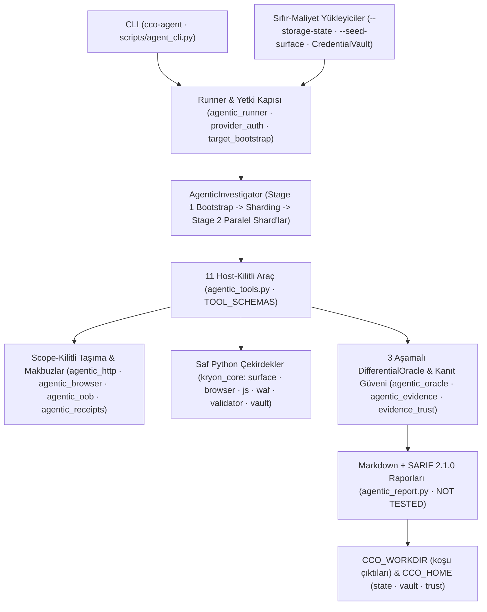

<div align="center">

# HackAgent (`kryon`)
### Sharded ReAct Güvenlik Araştırmacısı ve Saf Python Doğrulama Motoru

[](#kurulum)
[](LICENSE)
[](#temel-yetenekler)
[](#temel-yetenekler)
[](#güvenlik-kapsam-ve-çalışma-sınırları)

[English](README.md) · **Türkçe**

**Model önerir; Python host katmanı karar verir.**

Tek ve bağımsız bir **Python 3.12+ + OpenAI uyumlu LLM** çalışma zamanı (`cco-agent agentic` + `kryon_core`) — harici ajan istemcisi yok, JavaScript eklentisi yok, MCP sunucu daemon'ı yok.

[Yetenekler](#temel-yetenekler) · [Mimari](#mimari) · [Kurulum](#kurulum) · [Hızlı Başlangıç](#hızlı-başlangıç) · [Repo Yapısı](#repo-yapısı) · [Güvenlik](#güvenlik-kapsam-ve-çalışma-sınırları) · [Doğrulama](#doğrulama-ve-kalite-kapıları) · [Dokümantasyon](#dokümantasyon-haritası)

</div>

---

## Temel Yetenekler

HackAgent (`kryon`), LLM muhakemesini host tarafından zorunlu kılınan yetkilendirme, taşıma, doğrulama ve raporlamadan katı biçimde ayırır:

- **Sharded ReAct Araştırmacısı (`cco-agent agentic`):** İki aşamalı `--execution-mode sharded` akışı — Stage 1 keşif bootstrap'i (`--bootstrap-model`, kimlik sonrası kapsamı zorunlu kılan `discovery_finish_gate`) ardından `agentic_sharding.py` alt-sistem kümeleme ve Stage 2 paralel shard yürütmesi (`80K` epoch sıkıştırma `agentic_context.py` + `--cache-token-weight` önbellekli prompt token muhasebesi).
- **11 Yalın Host-Kilitli Araç (`TOOL_SCHEMAS`):** `scripts/agentic_tools.py` tarafından zorunlu kılınan kapalı katalog — `http_request`, `read_receipt`, `replay_as`, `extract_surface`, `notebook`, `callback_listener`, `concurrent_check`, `browser_crawl`, `analyze_token`, `record_finding`, `finish`.
- **Saf Python `kryon_core` Kütüphane Paketi (Sıfır MCP Daemon Maliyeti):**
  - `kryon_core.surface` — W3C HTML, JS, CSS, HTTP başlık, OpenAPI, GraphQL, Postman, `robots.txt` ve sitemap çıkarımı, normalleştirme, wordlist ve salt-okunur tarama çekirdeği.
  - `kryon_core.browser` — Playwright SPA / Shadow DOM tarama kancaları ve salt-okunur DOM/CSP istek engelleme politikası.
  - `kryon_core.js` — JavaScript parser, rota birleştirme, source map çözümleme ve istemci mantık haritası (`build_client_logic_map`).
  - `kryon_core.waf` — Pasif WAF/CDN parmak izi ve HTTP blok sınıflandırması (`classify_http`).
  - `kryon_core.validator` — Çevrimdışı JWT/opaque token analizi, serileştirme/deserileştirme incelemesi ve Ed25519 imzalı OOB olay doğrulaması.
  - `kryon_core.vault` — Şifreli yerel `CredentialVault` ve sınırlı IMAP OTP okuyucusu (`otp_core`).
- **Sıfır-Maliyetli Başlangıç Yükleyicileri:** Kimliği doğrulanmış Playwright oturumlarını `--storage-state` (`agentic_auth_import.py` / `cco-agent save-auth`) ile içe aktarın; HAR, mitm, ZAP, ffuf, nuclei veya URL listelerinden çevrimdışı yüzey tohumlamasını `--seed-surface` ve `--tech-hint` (`agentic_seed.py`) ile sıfır ağ isteğiyle yükleyin.
- **3 Aşamalı Deterministik Doğrulama & Devre Kesici:** Bulgular makbuz kanıtlı `DifferentialOracle` (**Control/Falsification -> Masked Diff -> Clean Replay**) onayından geçer; doğrulanmamış model metni tek başına bulgu onaylamaz. `ServiceDegradationError` (`--max-degradation-streak`), ardışık `429/502/503/504` yanıtlarında koşuyu zarif biçimde durdurur.
- **`NOT TESTED` Şeffaflığı ile Raporlama:** `cco-agent report`, gizli değerleri maskelenmiş Markdown (`report.md`) ve SARIF 2.1.0 (`report.sarif`) raporları üretir ve test edilmeyen yüzeyleri açıkça raporlar.

---

## Mimari



Ayrıntılı modül haritası ve veri sınırları için [docs/architecture.md](docs/architecture.md) belgesine bakın.

---

## Kurulum

**Gereksinimler:** Python `3.12+` (`requirements.lock` tüm ana bağımlılıkların doğrulanmış hash'lerini sabitler; `browser_crawl` veya `save-auth` için Playwright tarayıcıları ayrıca kurulur).

```bash
python3 -m venv .venv
source .venv/bin/activate
python3 -m pip install --require-hashes -r requirements.lock
python3 -m pip install --no-deps --no-build-isolation -e .
```

### Sağlayıcı Yapılandırması (`cco-llm/1`)

```bash
cp config/llm.example.json config/llm.json
cco-agent check-config --provider-config config/llm.json
```

> **Gizlilik Kuralı:** Yapılandırma dosyalarına asla ham API anahtarı yazmayın. Yalnızca `api_key_env` üzerinden ortam değişkeni adını belirtin (örneğin `CCO_LLM_API_KEY`). `config/llm.json` Git tarafından yok sayılır.

---

## Hızlı Başlangıç

Kurulumdan sonra `cco-agent`, `./scripts/cco.sh` veya `python3 scripts/agent_cli.py` komutlarıyla çalıştırın:

```bash
# 1. CLI komutlarını inceleyin ve sağlayıcı şemasını çevrimdışı doğrulayın (0 ağ isteği)
cco-agent --help
cco-agent check-config --provider-config config/llm.example.json

# 2. Çevrimdışı değerlendirme planı üretin (agentic-plan.json yazar; 0 hedef/LLM trafiği)
cco-agent agentic \
  --target http://127.0.0.1:8000 \
  --provider-config config/llm.example.json \
  --output-dir ~/cco-work/demo-plan

# 3. Sahip olunan yerel loopback hedefte sharded mod + çevrimdışı seed ile yürütün
cco-agent agentic \
  --target http://127.0.0.1:8000 \
  --provider-config config/llm.json \
  --execution-mode sharded \
  --storage-state member=~/.cco/auth/demo-storage.json \
  --seed-surface ~/cco-work/seeds/traffic.har \
  --tech-hint nextjs \
  --output-dir ~/cco-work/demo-run \
  --execute

# 4. Yetkili non-loopback hedef (açık scope dosyası + opt-in bayrakları + operatör onayı gerekir)
cco-agent agentic \
  --target https://target.example.invalid \
  --scope-file .codex/scope.json \
  --allow-non-loopback \
  --provider-config config/llm.json \
  --authorize-live-provider \
  --live-authorization-reason "approved-engagement" \
  --execution-mode sharded \
  --output-dir ~/cco-work/target-run \
  --execute

# 5. Tamamlanmış koşu dizininden Markdown + SARIF 2.1.0 raporu üretin
cco-agent report ~/cco-work/demo-run --format all

# 6. Kimliği doğrulanmış hedefler için bir kez Playwright storage_state.json kaydedin
cco-agent save-auth \
  --program demo \
  --login-url https://auth.example.invalid/login \
  --user-selector '#username' \
  --pass-selector '#password' \
  --submit-selector 'button[type=submit]'

# 7. Tüm depo doğrulama ve kalite kapılarını çalıştırın
python3 scripts/release_check.py
```

Kurulu CLI giriş noktaları (`pyproject.toml`): `cco-agent`, `cco-governance`, `cco-release-check`, `cco-release-artifacts`.

---

## Repo Yapısı

| Dizin | Görev |
| :--- | :--- |
| [scripts/](scripts/) | CLI giriş noktaları (`agent_cli.py`, `cco.sh`), Sharded ReAct motoru (`agentic_*.py`), sağlayıcı/bütçe/kapsam/güven altyapısı ve sürüm kapıları |
| [kryon_core/](kryon_core/) | Sıfır MCP sunucu yüküyle doğrudan import edilen saf Python kütüphaneleri (`surface`, `browser`, `js`, `waf`, `validator`, `vault`) |
| [config/](config/) | Sağlayıcı şema şablonu ([llm.example.json](config/llm.example.json)) ve program politikası şablonu ([bounty-program-policy.json](config/bounty-program-policy.json)) |
| [docs/](docs/) | Mimari rehber ([docs/architecture.md](docs/architecture.md)) ve dokümantasyon dizini ([docs/README.md](docs/README.md)) |
| [tests/](tests/) | Çevrimdışı birim, güvenlik sınırı, sharding, oracle, raporlama ve kurulu paket testleri |

---

## Güvenlik, Kapsam ve Çalışma Sınırları

- **Fail-Closed Loopback Varsayılanı:** `--execute` verilmeden `cco-agent agentic` yalnızca `agentic-plan.json` üretir (0 trafik). Canlı non-loopback hedefler için açık `--scope-file` (`.codex/scope.json`), `--allow-non-loopback` ve operatör onayı zorunludur; uzak LLM sağlayıcıları ayrıca `--authorize-live-provider` ister.
- **Çalışma Alanı İzolasyonu:** Koşu çıktıları `CCO_WORKDIR` (varsayılan `~/cco-work`), host state, şifreli `CredentialVault` ve güven anahtarları ise `CCO_HOME` (varsayılan `~/.cco`) altında tutulur. Repo kökünde çalışma dosyaları yasaktır (`scripts/check_repo_layout.py`).
- **Güvenlik ve Gizlilik Hijyeni:** Kapsam, metot izin listesi, `SharedBudget` / `WireBudget` ve `ServiceDegradationError` tüm yürütme yollarını korur. Makbuzlar ve PoC çıktıları hassas başlık, çerez, token ve sorgu parametrelerini otomatik maskeler; `.env` veya `config/llm.json` asla commit edilmez.

---

## Doğrulama ve Kalite Kapıları

Tüm kalite kapılarını tek seferde `python3 scripts/release_check.py` ile veya tekil olarak çalıştırın:

```bash
python3 -m ruff check .
python3 -m mypy
python3 -m pytest tests -q
python3 scripts/release_artifacts.py check-lock
python3 scripts/agent_cli.py check-config --provider-config config/llm.example.json
python3 scripts/governance_audit.py --root scripts --format json --fail-on high
python3 scripts/governance_audit.py --root kryon_core --format json --fail-on high
python3 scripts/check_repo_layout.py
```

---

## Dokümantasyon Haritası

| Konu | Belge |
| :--- | :--- |
| Mimari ve Modül Haritası | [docs/architecture.md](docs/architecture.md) |
| Dokümantasyon Dizini | [docs/README.md](docs/README.md) |
| Ajan Çalışma Kuralları ve Güvenlik | [AGENTS.md](AGENTS.md) |
| İngilizce Özet | [README.md](README.md) |
| Sağlayıcı Şema Şablonu | [config/llm.example.json](config/llm.example.json) |
| Program Politikası Şablonu | [config/bounty-program-policy.json](config/bounty-program-policy.json) |

> **Eski v1 Arşivi:** Emekliye ayrılan v1 mimarisi (`PythonSolver`, 16 MCP sunucusu, `skills/` ve eski P1–P9 belge/testleri) kalıcı olarak `git tag legacy-v1-archive` etiketinde korunmaktadır.

---

## Lisans

**Apache License, Version 2.0** ile lisanslanmıştır — tüm koşullar için [LICENSE](LICENSE) dosyasına bakın.
