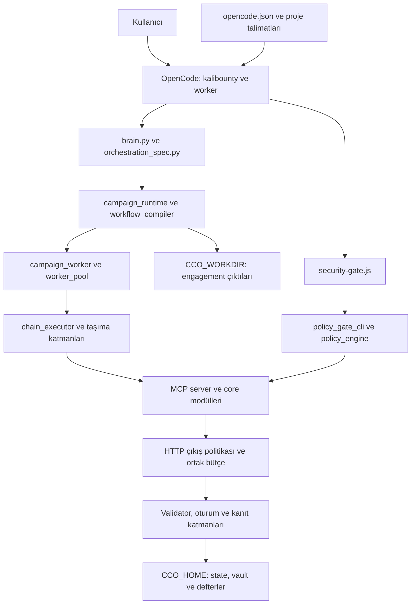

# Mimari

Güncel OpenCode yapısının bileşen özeti. Ayrıntılı kaynak eşlemesi
[Mermaid görünümlerinde](system-architecture-mermaid.md), görev yaşam döngüsü
[güncel sistem taslağında](system-architecture-current-2026-11-02.md) açıklanır.

## Görev ve güvenlik akışı

Şema ana bağlantıları gösterir; her araç çağrısı bütün kutulardan geçmez.
Güvenlik plugin'i, host/worker izolasyonu, son HTTP gönderimi ve kanıt doğrulama
farklı katmanların sözleşmeleridir.

## Bileşenlerin kaynakları

| Alan | Kaynaklar | Sözleşme |
| --- | --- | --- |
| Runtime | `opencode.json`, `.opencode/agents/`, `commands/`, `plugins/`, `tui/` | Aktif agent/komut/plugin/TUI keşfi; sağlayıcı seçimi |
| Metodoloji | `AGENTS.md`, `CLAUDE.md`, `.claude/skills/`, `rules/` | OpenCode uyarlaması, skill ve scope kuralları |
| Planlama | `brain.py`, `orchestration_spec.py`, `task_spec.py` | TaskSpec, araç bütçesi, worker prompt'u ve summary doğrulaması |
| Kampanya | `campaign_runtime.py`, `campaign_worker.py`, `worker_pool.py`, `live_run.py` | Claim/lease, retry, checkpoint ve işçi havuzu |
| Yürütme | `workflow_compiler.py`, `chain_executor.py`, `chain_transport.py` | Planı izinli yürütme/taşıma yoluna çevirme |
| Güvenlik | `policy_engine.py`, `policy_gate_cli.py`, egress/izolasyon/watchdog modülleri | Approval, scope, deny-by-default, çıkış ve bütçe |
| Envanter | `mcp_inventory.py`, `tool_counts.py`, `config/mcp-core-tools.json` | MCP bildirimleri ve 29 araçlık çekirdek |
| State/kanıt | Session, target/object identity, attempt/hypothesis ledger ve evidence modülleri | Hedef/oturum bağları ve doğrulanabilir kayıt |
| MCP | `mcp-servers/mcp-*/server.py`, `cco_*_core/` | Araç adları/imzaları ve bağlı core importları |
| Dağıtım | `pyproject.toml`, `MANIFEST.in`, `requirements.lock`, release araçları ve CI | Kurulu CLI/runtime dosyaları, bağımlılık ve paket denetimi |

Python kaynakları tabloda aksi belirtilmedikçe `scripts/` altındadır. Büyük
server facade'larıyla core modülleri birlikte değerlendirilir; bir core dosyasını
ayrı paket sayıp kaldırmak standalone server başlangıcını bozabilir.

## Profil ve model seçimi

MCP profil kaynağı `.opencode/profiles.json`; kayıtların etkinliği `opencode.json`
içinde tutulur. 16 sunucunun tümü desteklenen envanterde bulunur. AD/container/CTF
sunucularının belirli bir oturumda kapalı olması kullanım dışı oldukları anlamına
gelmez. Araç toplamı `python3 scripts/tool_counts.py` üzerinden alınır.

Session modeli ve provider OpenCode yapılandırması/agent seçimine aittir.
Bazı MCP araçları ayrı LLM çağrıları yapabilir; bunlar session modelinden ayrı
ayar ve davranışlardır. Claude Code'a özel model ifadeleri, `AGENTS.md` runtime
çevirisinin yerine geçmez.

## Veri ve dosya sınırları

- `CCO_HOME`: state, vault, oturum ve kanıt depoları. Başlatıcı varsayılanı
  ignore edilmiş repo `.cco/` dizinidir.
- `CCO_WORKDIR`: engagement çalışma çıktıları; varsayılan `~/cco-work`.
- `.codex/scope.json`, `.codex/program-policy.json`: aktif operatör ayarları.
- `config/program-profiles/`: dağıtıma dahil yeniden kullanılabilir presetler.
- `.claude/skills/` ve `skills` symlink'i: OpenCode'ın kullandığı skill kaynağı.
- `.opencode/tui/`: TUI eklentileri; server plugin dizinine taşınmaz.

Yeni çalışma verisini köke yazmak düzen kapısını kırar. Mevcut taşınma bekleyen
veri ayrı gösterilir ve taşınma doğrulaması yapılmadan silinmez.

## Uyumluluk ve tarihsel kaynaklar

`security_middleware.py` ve `rag-bootstrap.py` küçük uyumluluk girişleridir.
`swarm_orchestrator.py` ve `recon_daemon.py` MCP tarafından kullanılan ek
execution yollarıdır. `site_crawler.py`/`vdp_radar.py` manuel workflow
araçlarıdır; yalnız ana import zincirine bakarak kullanım dışı sayılamazlar.

Önceki ASCII mimari, model routing ve dosya ağacı
[tarihsel arşivde](history/architecture-before-cleanup.md) korunur. Diğer tarihli
incelemeler ve devam eden işler [dokümantasyon dizininde](README.md) listelenir.

## Kontroller

Modül sınırları: `tests/test_module_boundaries.py`. Soğuk Hunter başlangıcı ayrı
süreç ve repo dışı çalışma diziniyle sınanır. Kurulu paket yolu
`tests/test_installed_runtime.py`, yeni çalışma çıktıları `tests/test_repo_layout.py`
ile korunur. Operasyon ve kanıt ayrıntıları [operasyon rehberinde](operations.md)
ve [MCP referansında](mcp-reference.md) bulunur.
