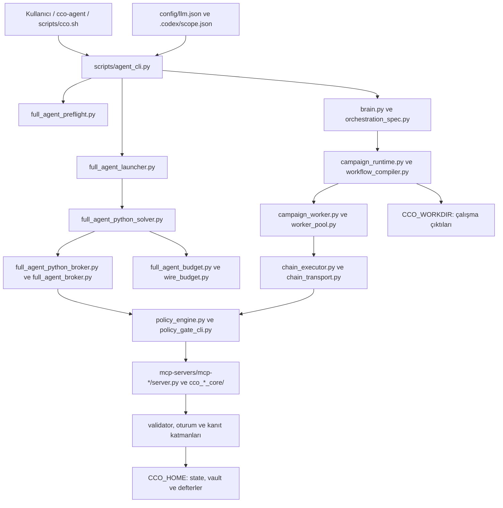

# Mimari

HackAgent artık bağımsız **Python + OpenAI uyumlu LLM** çalışma zamanı
üzerinde çalışır; harici OpenCode istemcisi veya JavaScript eklentisi gerektirmez.
Aşama durumu ve P1–P9 sınırları [PYTHON_ENGINE_GAPS.md](PYTHON_ENGINE_GAPS.md)
içinde tutulur.

## Görev ve güvenlik akışı

Şema ana katmanları gösterir; her çağrı bütün kutulardan geçmez.
Model yalnızca bağlam projeksiyonu ve faz bazlı kabul edilen araç listesiyle
çalışır; faz geçişleri, özet doğrulama, bütçe, kapsam ve kapanış host tarafından
denetlenir. Model metni tek başına bulgu doğrulamaz.

## Bileşenlerin kaynakları

| Alan | Kaynaklar | Sözleşme |
| --- | --- | --- |
| Giriş | `scripts/agent_cli.py`, `scripts/cco.sh`, `cco-agent` | Birleşik Python CLI (`plan`, `operations`, `preflight`, `run`, `audit`, `benchmark`, `campaign`, `worker`, `security`, `status`, `check-config`) |
| LLM motoru | `scripts/full_agent_python_solver.py`, `full_agent_python_broker.py`, `full_agent_broker.py`, `full_agent_budget.py`, `llm_config.py` | OpenAI uyumlu sağlayıcı, dört fazlı döngü, şema doğrulama, ölçülen kullanım muhasebesi |
| Metodoloji | `AGENTS.md`, `CLAUDE.md`, `.claude/skills/`, `rules/` | Scope, program politikası, skill kataloğu ve çalışma sınırları |
| Planlama | `scripts/brain.py`, `orchestration_spec.py`, `task_spec.py` | TaskSpec, araç bütçesi ve summary doğrulaması |
| Kampanya | `scripts/campaign_runtime.py`, `campaign_worker.py`, `worker_pool.py`, `live_run.py` | Kalıcı SQLite kuyruğu, claim/lease, retry, checkpoint ve işçi havuzu |
| Yürütme | `scripts/workflow_compiler.py`, `chain_executor.py`, `chain_transport.py` | İzinli çok-adımlı yürütme ve ortak HTTP taşıma |
| Güvenlik | `scripts/policy_engine.py`, `policy_gate_cli.py`, `wire_budget.py`, egress/izolasyon modülleri | Onay, scope, deny-by-default, çıkış ve wire bütçesi |
| Envanter | `config/mcp-servers.json`, `config/profiles.json`, `config/mcp-core-tools.json`, `scripts/mcp_inventory.py`, `scripts/tool_counts.py` | 16 MCP sunucusu, profil tanımları ve araç sayımı |
| State/kanıt | Session, target/object identity, attempt/hypothesis ledger ve evidence modülleri | Hedef/oturum bağları ve imzalı doğrulama kayıtları |
| MCP | `mcp-servers/mcp-*/server.py`, `cco_*_core/` | Araç adları/imzaları ve bağlı core modülleri |
| Dağıtım | `pyproject.toml`, `MANIFEST.in`, `requirements.lock`, `scripts/release_artifacts.py`, `.github/` | Kurulu `cco-agent` paketi, imzalı/reproducible release ve CI |

## Konfigürasyon ve veri sınırları

- Sağlayıcı şeması: [config/llm.example.json](../config/llm.example.json) (`schema: "cco-llm/1"`). Yerel ayar `config/llm.json` (Git tarafından yok sayılır) veya `CCO_LLM_CONFIG` ile verilir; dosyada yalnızca `api_key_env` değişken adı tutulur.
- MCP envanteri ve profiller: [config/mcp-servers.json](../config/mcp-servers.json) ve [config/profiles.json](../config/profiles.json). Çalışan Python solver'ı ayrıca kendi açık, sınırlı araç kataloğunu kullanır; envanter profilini değiştirmek çalışan solver'a kendiliğinden yeni araç eklemez.
- `CCO_HOME`: host state, credential vault, oturum ve kanıt depoları (varsayılan ignore edilmiş `.cco/` veya `~/.cco`).
- `CCO_WORKDIR`: engagement çalışma çıktıları (varsayılan `~/cco-work`). Repo köküne çalışma verisi yazılmaz.
- `.codex/scope.json`, `.codex/program-policy.json`: aktif hedef ve program politikası sınırları.

## Kontroller

- Modül sınırları: `tests/test_module_boundaries.py`
- Kurulu paket yolu: `tests/test_installed_runtime.py`
- Repo düzeni: `python3 scripts/check_repo_layout.py` ve `tests/test_repo_layout.py`
- Operasyon ve araç ayrıntıları: [operations.md](operations.md) ve [mcp-reference.md](mcp-reference.md)
