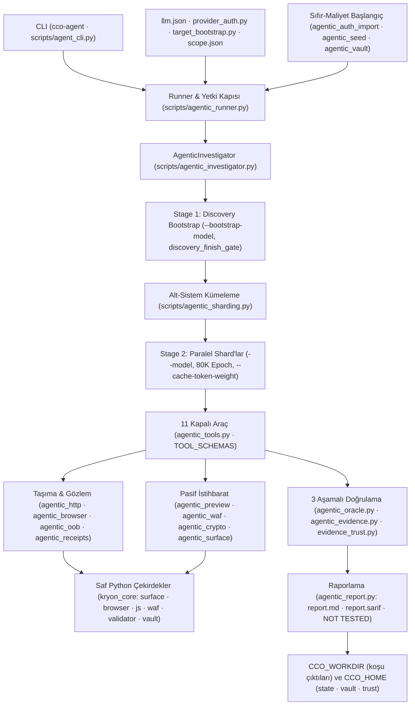

# Mimari

HackAgent (`kryon`), harici OpenCode istemcisi, JavaScript eklentisi veya MCP sunucu daemon'ı gerektirmeyen bağımsız bir **Python 3.12+ + OpenAI uyumlu LLM** güvenlik motorudur. Repo tek ve sade bir üretim mimarisi etrafında örgütlenir: **`cco-agent agentic` (Sharded ReAct Motoru)** ve saf Python **`kryon_core`** çekirdek kütüphaneleri.

> **Arşiv notu:** Emekliye ayrılan v1 çoklu-MCP / dört fazlı Python Engine mimarisi (`PythonSolver`, `Brain`, `CampaignRuntime`, 16 `mcp-servers/*` sunucusu ve eski testler) kalıcı olarak `git tag legacy-v1-archive` etiketinde saklanır.

---

## 1. Yürütme Akışı (`cco-agent agentic` + `kryon_core`)



Yürütme katı **host otoritesi** (*model önerir, Python host karar verir*) ilkesini uygular:

1. **Giriş, Kapsam ve Sağlayıcı Kapısı:** `cco-agent agentic` (`scripts/agent_cli.py` -> `scripts/agentic_runner.py`), `provider_auth.py:authorize_provider` ve `target_bootstrap.py:resolve_target_origin` denetimlerini çalıştırır. Varsayılan olarak yalnızca loopback origin kabul edilir; non-loopback hedefler için açık `--scope-file` ve `--allow-non-loopback` zorunludur. `--execute` verilmeden yalnızca çevrimdışı `agentic-plan.json` üretilir; ağ veya model çağrısı yapılmaz. Canlı uzak LLM sağlayıcısı ayrıca `--authorize-live-provider` gerektirir.
2. **Sıfır-Maliyetli Başlangıç Yükleyicileri:** Çalışma öncesinde `agentic_auth_import.py` (`--storage-state` ile Playwright oturum aktarımı), `agentic_seed.py` (`--seed-surface` ile çevrimdışı HAR/mitm/ZAP/ffuf/nuclei/URL tohumlama ve `--tech-hint` rota zenginleştirme) ve `agentic_vault.py` (`--vault-home` + `--vault-key-name` ile şifreli kimlik yükleme) sıfır ağ isteğiyle ilk bağlamı hazırlar.
3. **Stage 1 Discovery Bootstrap:** `AgenticInvestigator` (`--execution-mode sharded`), önce `--bootstrap-model` (veya ana `--model`) ile hedef yüzeyi keşfeder. `discovery_finish_gate`, kimlik duvarı veya yazma uç noktası görüldüğünde en az bir yetkili post-auth `GET 2xx` taraması olmadan `finish` çağrısını engeller; keşif-only modda `record_finding` kapalıdır.
4. **Alt-Sistem Kümeleme & Stage 2 Paralel Shard'lar:** `agentic_sharding.py` (`cluster_discovered_surface`), `SurfaceFrontierTracker` tarafından pasif olarak toplanan rotaları, yazma operasyonlarını, nesne ID'lerini ve parametreleri dengeli alt-sistem kümelerine ayırır (tek küme veya düşük kalan token bütçesinde monolitik devam geri dönüşü uygulanır). Her shard `--model` ile paralel yürür; bağlam `80K` karakter epoch sınırında `agentic_context.py` ile sıkıştırılır, HTTP 400 bağlam/şema hataları otomatik temizlenir ve `MeteredProviderTransport` önbellekli prompt token'larını `--cache-token-weight` (varsayılan `0.10`) ile muhasebeleştirir. Ardışık `429/502/503/504` yanıtlarında `ServiceDegradationError` devre kesicisi (`--max-degradation-streak`, varsayılan `5`) koşuyu güvenli şekilde durdurur.
5. **11 Kapalı Host Aracı & Saf Python Çekirdekler:** `ToolDispatcher` (`agentic_tools.py`), yalnızca 11 araçlık `TOOL_SCHEMAS` kataloğunu sunar (`http_request`, `read_receipt`, `replay_as`, `extract_surface`, `notebook`, `callback_listener`, `concurrent_check`, `browser_crawl`, `analyze_token`, `record_finding`, `finish`). Tüm HTTP çağrıları scope-kilitli `AgenticHTTPClient` (`agentic_http.py`), OOB geri çağrıları salt-loopback `LoopbackCallbackServer` (`agentic_oob.py`) ve tarama/analiz işlemleri doğrudan import edilen `kryon_core` modülleri üzerinden yürür.
6. **3 Aşamalı Doğrulama & Raporlama:** `DifferentialOracle` (`agentic_oracle.py`: Control/Falsification -> Masked Diff -> Clean Replay) ve `agentic_evidence.py` (`canonicalize_and_deduplicate_findings`) bulguları makbuz kanıtlarına bağlar; model metni tek başına bulgu onaylamaz. `agentic_report.py`, gizli değerleri maskelenmiş PoC komutları içeren `report.md`, SARIF 2.1.0 uyumlu `report.sarif` ve kapsanmamış alanları görünür tutan `NOT TESTED` özetini üretir.

---

## 2. Modül Haritası

### 2.1 `scripts/` — Orkestrasyon, Taşıma ve Raporlama

| Katman | Modüller | Sorumluluk |
| :--- | :--- | :--- |
| **CLI & Runner** | `scripts/agent_cli.py`, `scripts/cco.sh`, `scripts/agentic_runner.py`, `scripts/provider_auth.py`, `scripts/target_bootstrap.py` | Birleşik CLI (`agentic`, `report`, `save-auth`, `governance`, `check-config`), çevrimdışı planlama ve koşu yaşam döngüsü, merkezi `authorize_provider`, loopback varsayılanı ve `ScopeGuard` |
| **Oturum, Seed & Vault** | `scripts/agentic_auth_import.py`, `scripts/save_browser_auth.py`, `scripts/agentic_seed.py`, `scripts/tech_routes.py`, `scripts/agentic_vault.py` | Playwright `storage_state` yakalama/içe aktarma, sıfır ağ maliyetli `--seed-surface`/`--tech-hint` yükleyici, teknoloji-bilinçli rota listeleri ve şifreli `CredentialVault`/OTP/Ed25519 OOB köprüsü |
| **Döngü, Sharding & Bağlam** | `scripts/agentic_investigator.py`, `scripts/agentic_sharding.py`, `scripts/agentic_context.py`, `scripts/agentic_bsag.py`, `scripts/agentic_scheduler.py` | `AgenticInvestigator` (`sharded` / `monolithic` / opt-in `ephemeral`), `ServiceDegradationError` devre kesici, alt-sistem shard'lama, `80K` epoch sıkıştırma / HTTP 400 kurtarma ve isteğe bağlı BSAG/UCB zamanlayıcı |
| **Araçlar, Taşıma & İstihbarat** | `scripts/agentic_tools.py`, `scripts/agentic_http.py`, `scripts/agentic_browser.py`, `scripts/agentic_oob.py`, `scripts/agentic_preview.py`, `scripts/agentic_waf.py`, `scripts/agentic_crypto.py`, `scripts/agentic_surface.py`, `scripts/agentic_receipts.py` | Kapalı 11 araçlık `TOOL_SCHEMAS`, scope/metot/bütçe kilitli HTTP istemcisi, salt-okunur Playwright SPA/Shadow DOM tarama ve DOM/CSP denetimi, loopback OOB dinleyici, HTML/JS/OpenAPI/GraphQL/Postman önizleme, pasif WAF blok teşhisi, offline token/serileştirme analizi, `SurfaceFrontierTracker` ve maskelenmiş `ReceiptStore` |
| **Doğrulama, Kanıt & Rapor** | `scripts/agentic_oracle.py`, `scripts/agentic_evidence.py`, `scripts/evidence_trust.py`, `scripts/agentic_report.py`, `scripts/agentic_telemetry.py` | 3 aşamalı `DifferentialOracle`, kanıt seçimi ve bulgu tekilleştirme, Ed25519 host imza/doğrulama, `report.md` / `report.sarif` (`NOT TESTED` görünürlüğü) ve telemetri metrikleri |
| **Paylaşılan Altyapı & Kalite** | `scripts/full_agent_provider.py`, `scripts/full_agent_budget.py`, `scripts/wire_budget.py`, `scripts/llm_config.py`, `scripts/runtime_paths.py`, `scripts/governance_audit.py`, `scripts/check_repo_layout.py`, `scripts/release_artifacts.py`, `scripts/release_check.py` | `MeteredProviderTransport` & `SessionGate`, atomik `SharedBudget`, `WireBudget`, `cco-llm/1` yapılandırma doğrulama, paket/kök yol çözümleyici, secret/PII yönetişim denetimi ve sürüm kalite kapıları |

### 2.2 `kryon_core/` — Saf Python Çekirdek Kütüphaneleri

MCP sunucusu başlatılmadan doğrudan import edilen bağımsız kütüphane paketi:

| Alt Paket | Modüller | Yetenekler |
| :--- | :--- | :--- |
| **`kryon_core.surface`** | `extract.py`, `crawl.py`, `crawl_auth.py`, `feature_crawl.py`, `frontier.py`, `normalize.py`, `openapi.py`, `operation.py`, `parsers.py`, `serialization.py`, `wordlist.py` | W3C HTML/JS/CSS/HTTP header/OpenAPI/GraphQL/Postman/robots/sitemap çıkarımı, URL/şema normalleştirme, öncelikli yüzey sınırı ve salt-okunur tarama çekirdeği |
| **`kryon_core.browser`** | `hooks.py`, `policy.py` | Salt-okunur Playwright çalışma zamanı kancaları (`fetch`/XHR/route gözlemi) ve istek düzeyinde salt-okunur engelleme politikası |
| **`kryon_core.js`** | `client_logic.py`, `compose.py`, `parsers.py`, `sourcemap.py` | JS AST/parser rota birleştirme, source map çözümleme ve istemci tarafı mantık haritası (`build_client_logic_map`) |
| **`kryon_core.waf`** | `waf_profiles.py` | Çevrimdışı WAF/CDN parmak izi imzaları, IP/CIDR eşleştirme ve pasif HTTP blok sınıflandırması (`classify_http`, `fingerprint`) |
| **`kryon_core.validator`** | `crypto_token.py`, `deser.py`, `oob_collector.py` | Çevrimdışı JWT/opaque token ve serileştirme/deserileştirme analizi; Ed25519 imzalı OOB olay doğrulayıcı (`verify_collector_event`) |
| **`kryon_core.vault`** | `credential_vault.py`, `otp_core.py` | Şifreli yerel `CredentialVault` deposu ve sınırlı IMAP OTP okuyucusu (`fetch_latest_otp`) |

---

## 3. Konfigürasyon ve Veri Sınırları

- **Sağlayıcı şeması:** [config/llm.example.json](../config/llm.example.json) (`schema: "cco-llm/1"`). Yerel yapılandırma `config/llm.json` (Git tarafından yok sayılır) veya `CCO_LLM_CONFIG` ile verilir; dosyada yalnızca `api_key_env` değişken adı tutulur, ham anahtar saklanmaz.
- **Program politikası şablonu:** [config/bounty-program-policy.json](../config/bounty-program-policy.json) varsayılan metot/yol/hız sınırları referansı sunar.
- **Kapsam dosyası:** Non-loopback hedefler için `--scope-file` (tipik olarak `.codex/scope.json` veya `~/.codex/data/scope.json`) ve `--allow-non-loopback` birlikte zorunludur.
- **`CCO_HOME`:** Host state, şifreli `CredentialVault`, tarayıcı oturum kayıtları ve Ed25519 doğrulama anahtarları (varsayılan `~/.cco`).
- **`CCO_WORKDIR`:** Engagement ve koşu çıktıları (varsayılan `~/cco-work`). Repo köküne çalışma çıktısı yazılmaz.

---

## 4. Doğrulama Kapıları

Tüm mimari ve kalite kapıları tek komutla doğrulanır:

```bash
python3 scripts/release_check.py
```

Tekil kapılar (`python3 scripts/release_check.py --list`):
- Statik analiz ve tip kontrolü: `python3 -m ruff check .` ve `python3 -m mypy`
- Birim ve entegrasyon testleri: `python3 -m pytest tests -q` (`tests/test_installed_runtime.py`, `tests/test_repo_layout.py` ve `test_agentic_*` / `kryon_core` paketleri dahil)
- Bağımlılık ve şema doğrulaması: `python3 scripts/release_artifacts.py check-lock` ve `python3 scripts/agent_cli.py check-config --provider-config config/llm.example.json`
- Yönetişim ve repo düzeni: `python3 scripts/governance_audit.py --root scripts --format json --fail-on high`, `python3 scripts/governance_audit.py --root kryon_core --format json --fail-on high`, `python3 scripts/check_repo_layout.py`
