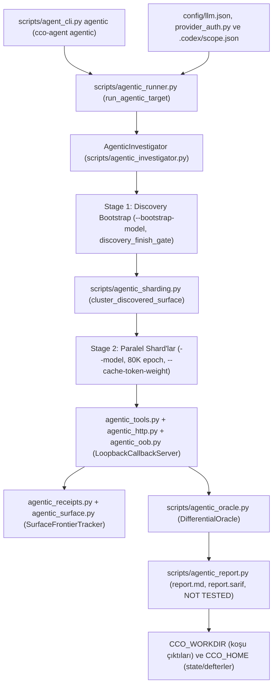

# Mimari

HackAgent (`kryon`) bağımsız **Python 3.12+ + OpenAI uyumlu LLM** çalışma zamanı
üzerinde çalışır; harici OpenCode istemcisi veya JavaScript eklentisi gerektirmez.
Güncel üretim motoru **`cco-agent agentic` (Sharded ReAct Motoru)** olup,
eski P1–P9 / dört fazlı Python Engine katmanı ve pasif deney modlarından açıkça
ayrılır.

---

## 1. Güncel Üretim Mimarisi (`cco-agent agentic` / Sharded ReAct Motoru)

Yürütme akışı katı **host otoritesi** ilkesiyle çalışır:

1. **Giriş & Yetki Kapısı:** `cco-agent agentic` (`scripts/agent_cli.py`),
   `scripts/agentic_runner.py` üzerinden `provider_auth.py:authorize_provider` ve
   `external_target_runner.py` kontrollerini çalıştırır. `--execute` verilmeden
   yalnızca çevrimdışı `agentic-plan.json` üretilir; ağ veya model çağrısı yapılmaz.
2. **Stage 1 Discovery Bootstrap:** `AgenticInvestigator` (`--execution-mode sharded`)
   önce `--bootstrap-model` (veya ana `--model`) ile hedef yüzeyi tarar.
   `discovery_finish_gate`, kimlik doğrulama duvarları veya yazma uç noktaları
   görüldüğünde en az bir yetkili post-auth `GET 2xx` taraması yapılmadan
   `finish` çağrısını engeller; `bootstrap_discovery_only` modunda `record_finding`
   devre dışıdır.
3. **Alt-Sistem Kümeleme & Stage 2 Paralel Shard'lar:** `agentic_sharding.py`
   (`cluster_discovered_surface`), `SurfaceFrontierTracker` tarafından pasif olarak
   çıkarılan rotaları, yazma operasyonlarını, nesne ID'lerini ve parametreleri dengeli
   `SubsystemCluster` birimlerine böler (tek küme veya düşük kalan token bütçesinde
   monolitik devam geri dönüşü vardır). Stage 2'de her shard `--model` ile paralel
   çalışır; bağlam `80K` karakter (`_EPOCH_HARD_CHAR_LIMIT`) epoch sınırında
   `agentic_context.py` ile sıkıştırılır ve `MeteredProviderTransport` cached prompt
   token'larını `--cache-token-weight` (varsayılan `0.10`) oranında muhasebeleştirir.
4. **Araçlar, Taşıma & Doğrulama:** `ToolDispatcher` (`agentic_tools.py`),
   scope-kilitli `AgenticHTTPClient` (`agentic_http.py`), salt-loopback
   `LoopbackCallbackServer` (`agentic_oob.py`) ve 3 aşamalı `DifferentialOracle`
   (`agentic_oracle.py`: Control/Falsification -> Masked Diff -> Clean Replay)
   üzerinden bulguları doğrular. Model metni tek başına bulgu onaylamaz.
5. **Raporlama:** `agentic_report.py`, maskelenmiş PoC komutları içeren
   `report.md`, SARIF 2.1.0 uyumlu `report.sarif` ve kapsanmamış alanları görünür
   tutan `NOT TESTED` bölümünü üretir.

---

## 2. Güncel `agentic` Modül Haritası

| Katman | Modüller | Sorumluluk |
| --- | --- | --- |
| **CLI & Runner** | `scripts/agent_cli.py`, `scripts/agentic_runner.py`, `scripts/provider_auth.py` | Birleşik CLI yönlendirmesi (`agentic`, `report`, `check-config`), koşu yaşam döngüsü, bütçe/aktör başlatma ve merkezi `authorize_provider` canlı sağlayıcı yetki kapısı |
| **Döngü & Bağlam** | `scripts/agentic_investigator.py`, `scripts/agentic_context.py`, `scripts/agentic_sharding.py` | `AgenticInvestigator` (`_run_sharded`, `_run_monolithic`, `_execute_monolithic_loop`), `80K` epoch bağlam sıkıştırma / HTTP 400 mesaj sanitizasyonu ve `cluster_discovered_surface` alt-sistem shard'lama |
| **Araçlar, Taşıma & Gözlem** | `scripts/agentic_tools.py`, `scripts/agentic_preview.py`, `scripts/agentic_http.py`, `scripts/agentic_receipts.py`, `scripts/agentic_surface.py`, `scripts/agentic_oob.py` | `ToolDispatcher` ve `TOOL_SCHEMAS`, sınırlı yanıt önizleme biçimlendirme, scope-kilitli `AgenticHTTPClient` ve `ActorManager`, gizli-bilgi maskeli `ReceiptStore` (`receipts/req-NNNN.json`), 0-maliyetli `SurfaceFrontierTracker` ve loopback `LoopbackCallbackServer` |
| **Doğrulama & Raporlama** | `scripts/agentic_oracle.py`, `scripts/agentic_evidence.py`, `scripts/agentic_report.py`, `scripts/agentic_telemetry.py` | `DifferentialOracle`, kanıt çıkarımı ve `canonicalize_and_deduplicate_findings`, `report.md` / `report.sarif` (`NOT TESTED` görünürlüğü) üretimi ve `TelemetryLogger` / `compute_process_metrics` |
| **Paylaşılan Çekirdek Altyapı** | `scripts/full_agent_provider.py`, `scripts/full_agent_budget.py`, `scripts/wire_budget.py`, `scripts/llm_config.py`, `scripts/external_target_runner.py`, `mcp-servers/mcp-memory-server/cco_surface_core/{extract.py, crawl.py, openapi.py}` | `MeteredProviderTransport` ve `SessionGate`, atomik `SharedBudget`, `WireBudget` istek sayacı, `cco-llm/1` yapılandırma doğrulama, loopback origin/kimlik yardımcıları ve HTML/JS/CSS/HTTP-header/OpenAPI/Shadow DOM tarama çekirdeği |

---

## 3. Eski / Pasif veya Uyumluluk Katmanları

Bu katmanlar güncel `cco-agent agentic` Sharded ReAct akışından ayrıdır; geriye
dönük uyumluluk, araştırma karşılaştırmaları ve sözleşme testleri için korunur:

- **`agentic_investigator.py` içindeki pasif modlar:**
  - `execution_mode="ephemeral"`, `scripts/agentic_bsag.py` (`BeliefStateAttackGraph`),
    `scripts/agentic_scheduler.py` (`ucb` / `round_robin` zamanlayıcı ve müdahale
    izleyicisi) ile iki aşamalı `--scout-model` el değiştirme modu güncel üretim
    varsayılanı değildir; yalnızca açık bayrak verildiğinde veya ilgili deney/regresyon
    testlerinde çalışır.
- **Eski P1–P9 / Python Engine katmanı:**
  - `scripts/full_agent_python_solver.py`, `scripts/full_agent_python_broker.py`,
    `scripts/full_agent_e6_benchmark.py`, `scripts/brain.py`,
    `scripts/campaign_runtime.py`, `scripts/campaign_worker.py` ve `mcp-servers/*`
    sunucuları **`agentic` komutu tarafından kullanılmaz**; eski CLI alt komutları
    (`plan`, `run`, `campaign`, `audit`, `benchmark`) ve sözleşme testleri
    (`tests/test_python_engine.py`, `tests/test_p9_integration.py`,
    `tests/test_module_boundaries.py`) için korunur.
  - Eski Python Engine aşama durumu ve P1–P9 sınırları
    [PYTHON_ENGINE_GAPS.md](PYTHON_ENGINE_GAPS.md) içinde tutulur.

---

## 4. Konfigürasyon ve Veri Sınırları

- **Sağlayıcı şeması:** [config/llm.example.json](../config/llm.example.json) (`schema: "cco-llm/1"`). Yerel ayar `config/llm.json` (Git tarafından yok sayılır) veya `CCO_LLM_CONFIG` ile verilir; dosyada yalnızca `api_key_env` değişken adı tutulur, ham anahtar saklanmaz.
- **MCP envanteri ve profiller:** [config/mcp-servers.json](../config/mcp-servers.json) ve [config/profiles.json](../config/profiles.json) eski Python Engine ve `mcp-servers/*` katmanlarını tanımlar. `agentic` motoru kendi kapalı `TOOL_SCHEMAS` kataloğunu kullanır; MCP envanter profilini değiştirmek `agentic` döngüsüne veya çalışan solver'a kendiliğinden araç eklemez.
- **`CCO_HOME`:** Host state, credential vault, oturum ve kanıt depoları (varsayılan ignore edilmiş `.cco/` veya `~/.cco`).
- **`CCO_WORKDIR`:** Engagement ve koşu çalışma çıktıları (varsayılan `~/cco-work`). Repo köküne çalışma verisi yazılmaz.
- **`.codex/scope.json` ve `.codex/program-policy.json`:** Aktif hedef kapsamı ve program politikası sınırları.

---

## 5. Kontroller

- Modül sınırları: `tests/test_module_boundaries.py`
- Kurulu paket yolu: `tests/test_installed_runtime.py`
- Repo düzeni: `python3 scripts/check_repo_layout.py` ve `tests/test_repo_layout.py`
- Operasyon ve araç ayrıntıları: [operations.md](operations.md) ve [mcp-reference.md](mcp-reference.md)
