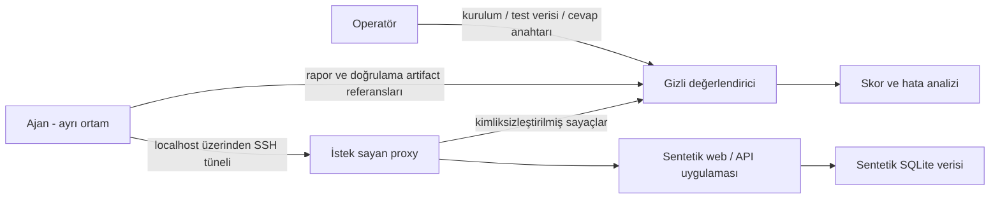

# Kör pentest laboratuvarı — VDS teknik şartnamesi

- Tarih: 30 Ekim 2026
- Hazırlanan ortam: **6 vCPU / 6 GB RAM**, Linux ve Docker Compose varsayımı.
- Amaç: KaliBounty'nin keşif → hipotez → güvenli test → doğrulama → rapor
  zincirini, cevapları ajan tarafından bilinmeyen ve tüm verileri sentetik bir
  uygulamada ölçmek.

Bu belge bir **geliştirme planıdır**. Aşağıdaki uygulama, değerlendirici ve
komut sözleşmeleri henüz bu repoda uygulanmış ürünler olarak sunulmaz. Mevcut
[VulnLab](../scripts/lab/README.md) ve `scripts/lab-validate.py` entegrasyon
kontrolüdür: bilinen endpoint'leri önceden yüklediği için kör benchmark değildir.

## 1. Kısa gereksinim

VDS'te küçük bir gerçekçi web/API uygulaması, özel bir değerlendirme deposu ve
istek sayan bir giriş katmanı geliştirilecek. Ajan ayrı bir çalışma ortamında
çalışacak. İnsan operatör kurulum ve SSH tünelini yönetecek; ajana VDS kabuğu,
Docker yetkisi, uygulama kaynak kodu veya cevap anahtarı verilmeyecek.

**Ajanın başlangıç bilgisi:** uygulama başlangıç URL'si, açıkça tanımlanmış
kapsam ve kurallar, sentetik test hesaplarının kimlik bilgileri, süre ve istek
bütçesi. Hangi endpoint'in zafiyetli olduğu, senaryo sayısı, güvenli/zafiyetli
eşleştirmeleri, beklenen sonuçlar ve gizli değerlendirme anahtarı verilmez.

**Operatörün özel bilgisi:** fixture üretimi, senaryo listesi, olumlu/olumsuz
kontroller, zafiyetli nokta eşleştirmeleri, puanlama kuralları ve reset.
Özel veri, bu deponun çalışma ağacına, ajan belleğine veya MCP çıktısına
kopyalanmaz. Bu belge ve uygulama tasarımı da gerçek kör koşunun oturum
geçmişinden ve ajanın okuyabildiği dosyalardan çıkarılmalıdır. Kör koşu için
önceki konuşmayı devralmayan yeni bir ajan oturumu ve temiz veri dizini gerekir.



## 2. VDS mimarisi ve erişim

### Önerilen bileşenler

| Bileşen | Görev | Önerilen ilk sınır |
|---|---|---|
| `lab-app` | HTML, oturumlu API ve sentetik işlevler; tercihen Python + SQLite | 1 vCPU limiti, 768 MB RAM limiti |
| `lab-proxy` | Tek giriş noktası; istek sayısı ve hız ölçümü | 0,5 vCPU, 128–256 MB RAM |
| `evaluator` | Operatörün başlattığı özel CLI; cevap anahtarı ve skor | Çalışırken 0,5 vCPU, 512 MB RAM |
| SQLite veri dosyası | Her koşuya özgü sentetik kullanıcı ve nesneler | Kalıcı prod verisi yok; koşu bazlı veri dizini |

Bu rakamlar başlangıç limitleridir, ölçülmüş gerçek tüketim değildir. İşletim
sistemi ve Docker için en az 1,5–2 GB boşluk bırakın. Tarayıcı, LLM ve ajanı
bu VDS'te çalıştırmayı ilk sürüm için istemiyorum; ayrı tarafta çalışmaları hem
RAM hem de körlük açısından daha uygundur. Uygulama dili farklı olabilir;
önemli olan aşağıdaki HTTP ve değerlendirme sözleşmesidir.

### Bağlantı modeli

1. Yalnız `lab-proxy` portu VDS üzerinde `127.0.0.1:18899` adresine bağlanır.
2. `lab-app`, veri deposu ve değerlendirici için dışarıya port açılmaz.
3. Operatör kendi makinesinde bir SSH tüneli açar; ajan yalnız tünelin yerel
   ucundaki `http://127.0.0.1:18899` adresine erişir.
4. Tüneli operatör yönetir. Ajanın VDS SSH anahtarına, SSH ajanına, kabuk
   yetkisine veya Docker soketine erişimi yoktur.

Uygulama menü ve iç yönlendirmelerinde göreli URL kullanmalı; gerçek VDS
adresini mutlak linklere gömmemelidir. Böylece ajan tünelin kendi gördüğü
`127.0.0.1:18899` origin'i içinde kalır ve ayrı bir origin'e yönlendirilmez.

Örnek bağlantı, gerçek kullanıcı ve host ile değiştirilmek üzere:

```bash
ssh -N -L 127.0.0.1:18899:127.0.0.1:18899 LAB_USER@VDS_HOST
```

Docker'da IP belirtilmeden yayınlanan portlar varsayılan olarak dış
arayüzlerden erişilebilir. Loopback bağlaması kullanılsa bile Docker sürümü,
IPv4/IPv6 ve VDS güvenlik duvarı ayrı ayrı kontrol edilmelidir; Docker'ın 28.0
öncesi sürümleri için aynı L2 ağındaki erişime ilişkin özel uyarısı vardır.
[Docker port yayınlama belgeleri](https://docs.docker.com/engine/network/port-publishing/)

Uygulama ve veri bileşenleri ayrı, iç ağda tutulmalı; değerlendirme servisi
uygulamanın erişemediği ayrı bir yönetim alanında bulunmalıdır. Compose
`internal: true` dış bağlantı için varsayılan gateway'i kaldırır; başka bir
ağa da bağlı konteynerin o ağ üzerinden çıkışı olabilir. Bu nedenle gerçek
erişilebilirlik kurulumdan sonra ayrıca test edilmelidir.
[Docker Compose ağları](https://docs.docker.com/compose/how-tos/networking/)

Konteynerlere `privileged`, host network veya Docker soketi verilmemeli.
Uygulamada gerçek müşteri verisi, VDS kimlik bilgisi, cloud metadata erişimi,
SSH anahtarı ve production servislere bağlantı bulunmamalı. İnternet çıkışı
gerekmeyen uygulama konteynerinde dış ağ erişimi kapalı olmalı. SSRF gibi ileri
senaryolarda yalnız laboratuvara ait izole callback hedefine izin verilir;
host loopback, metadata adresleri ve diğer özel ağ hedeflerine erişim engellenir
ve bu sınır ayrıca doğrulanır.

## 3. Koşu yaşam döngüsü

1. **Hazırla:** Operatör yeni bir `run_id` ve rastgele seed üretir. Veri
   dizini, kullanıcılar, nesneler, oturumlar ve cevap anahtarı o koşuya özeldir.
2. **Kontrol et:** Operatör uygulamanın sağlık durumunu, ağ sınırlarını,
   cevap anahtarının gizliliğini ve pozitif/negatif senaryoları doğrular.
3. **Başlat:** Sayaçlar sıfırlanır, süre/bütçe kilitlenir; ajan için yeni bir
   izole oturum ve boş `CCO_HOME` / çalışma veri dizini oluşturulur.
4. **Çalıştır:** Ajan yalnız verilen URL ve test hesaplarıyla keşif ve test
   yapar. Operatör keşfedilecek URL veya zafiyet ipucu enjekte etmez.
5. **Durdur:** Süre, istek bütçesi, operatör durdurması veya güvenlik kapısı
   koşuyu sonlandırır. Bütçeyi aşan istek uygulamaya iletilmez.
6. **Değerlendir:** Ajanın sonuçları kilitlenir; değerlendirici özel cevap
   anahtarıyla eşleştirir ve kanıtları kontrol eder.
7. **Tekrar:** İkinci deneme için yeni izole koşu ve aynı kayıtlı başlangıç
   koşulları hazırlanır. Önceki bulgular, cache, session ve RAG dersleri yeni
   koşuya sızmaz. İnsan müdahalesiyle düzeltilen koşu ayrı raporlanır.

Mevcut yönetici politikası veri değişikliğini yasaklar. İlk sürümde otomatik
test yüzeyleri **salt okunur GET/HEAD** olmalı; GET çağrıları da iş verisini
değiştirmemelidir. Test oturumları operatör tarafından önceden oluşturulur.
Sipariş oluşturma, kayıt değiştirme, stored XSS gönderimi, replay ve yarış
gibi yazma gerektiren senaryolar ancak ayrı bir sonraki aşama ve açıkça
değiştirilmiş yetki/politika sözleşmesiyle değerlendirilir; ilk benchmark'ta
atlandı olarak raporlanır.

## 4. Test hesapları ve veri

| Hesap | Rol / tenant | Beklenen normal kullanım |
|---|---|---|
| `member-a` | member / tenant-1 | Kendi nesnelerini listeleyip okuyabilir |
| `member-b` | member / tenant-1 | Kendi ayrı nesnelerini listeleyip okuyabilir |
| `member-c` | member / tenant-2 | Diğer tenant'ın kendi nesnelerini okuyabilir |
| `admin-a` | admin / tenant-1 | Kendisine tanımlı yönetim işlevlerini kullanabilir |
| anonim | oturum yok | Yalnız herkese açık sayfalar |

Her hesap için en az iki **UUID veya başka opaque kimlikli** nesne oluşturun.
Her nesnede koşuya ve sahibine özgü, gerçek kişisel veri içermeyen bir işaret
bulunsun. İşaret, sahibi kendi nesnesini okuduğunda görünmeli; iki kullanıcının
normal yanıtları birbirinden ayırt edilebilmelidir. Herkes için aynı sabit
JSON, sahiplik oracle'ını yanıltır.

Oturumlar birbirinden farklı cookie veya bearer credential'lar kullanmalı ve
varsayılan olarak test süresinden uzun yaşamalıdır. Süresi dolmuş oturum ayrı
bir kontrol olarak hazırlanabilir. Kullanıcı adları ve hesap rolü operatörce
ajan girişine verilebilir; **nesne URL'leri ile işaretleri tam kör modda
verilmez**. Ajan bunları normal uygulama akışından keşfetmelidir. Örneğin
başlangıç sayfasındaki doğal menü bağlantıları kişinin kendi nesne listesine
götürmeli ve liste yalnız oturum sahibinin nesnelerini göstermelidir.

Geçerli bir oturumun yetkisi olmayan nesne/işlev için **403 veya 404**, eksik
ya da süresi dolmuş oturum için **401** kullanın. Mevcut ajan oturumlu bir
istekte 401'i oturum kaybı kabul edip koşuyu durdurur; çalışan bir hesabın
normal erişim reddini 401 ile göstermek ölçümü gereksiz yere kesebilir.

Test hesapları geçici, düşük yetkili ve sadece bu laboratuvara ait olmalıdır.
Kimlik bilgileri komut satırı argümanları, kaynak kodu, cevap anahtarı dışa
aktarımları veya HTTP erişim loglarında saklanmaz; kullanımdan sonra koşuyla
birlikte geçersizleştirilir. Bu sisteme gerçek kullanıcı bilgisi eklenmez.

## 5. Senaryo kataloğu

Her olumlu senaryoya işlevsel olarak benzer en az bir olumsuz kontrol ekleyin.
Gerçek uygulama endpoint'lerinde `vulnerable`, `safe`, `challenge`, zafiyet
türü, case ID veya cevap anahtarı gibi ipucu bulunmasın. Aşağıdaki kategori ve
sayılar **geliştirici planıdır**; gerçek kör koşuda bunlar ajana verilmez.
Operatör gerçek endpoint ve varyantları özel seed/manifest içinde seçer.

| Sınıf | Olumlu durum | Olumsuz kontrol / kabul |
|---|---|---|
| BOLA / IDOR | A üyesine ait sentetik UUID nesnesi, başka oturumla okunabiliyor | Başka bir nesnede aynı girişim 403/404; owner kendi işaretini 200 ile alır |
| Tenant izolasyonu | Tenant-2 üyesi, tenant-1'in bir özel nesnesindeki sentetik işareti okuyabiliyor | Farklı nesnede tenant kontrolü doğru; anonim erişim ayrıca ölçülür |
| BFLA | Member, normalde admin gereken salt okunur bir işlevin sentetik çıktısını okuyabiliyor | Benzer başka yönetim işlevi member için 403/404; admin için 200 |
| Kimlik doğrulama atlama | Bir özel GET içeriği oturumsuz da erişilebiliyor | Benzer özel sayfa anonim için 401/403 veya güvenli login yönlendirmesi döndürür |
| Reflected XSS | Bir giriş değeri HTML içinde güvensiz bağlamda yansıtılıyor | Benzer noktada doğru bağlamsal kaçış var; yalnız yansıma yürütme kanıtı değildir |
| SQLi — okuma | Sentetik ve salt okunur veride sorgu davranışı kontrol/test çiftiyle farklılaşıyor | Parametreli eşdeğer uç benzer iki girişe tutarlı sonuç verir |
| Open redirect | Bir yönlendirme girdisi dış sentinel adresini Location'a yansıtabiliyor | Diğer uç yalnız izin verilen yerel hedefe gider veya reddeder |

İlk teslimde en az **BOLA, BFLA, reflected XSS ve SQLi** ile bunların olumsuz
kontrolleri bulunmalıdır. Tenant izolasyonu, anonim erişim ve open redirect
eklenmesi önerilir. Gerçek koşunun dağılımı ve sayısı gizli tutulur.

XSS için doğrulanmış sonuç ancak uygun browser yürütme kanıtıyla sayılır;
yalnız metin yansıması adaydır. SQLi veri kaynağı yalnız sentetik ve salt
okunur olmalı; dosya okuma, sistem komutu, gerçek bilgi çekme veya zarar verici
sorgu şart değildir. Open redirect testi dış sentinel'e ağ bağlantısı
gerektirmez: 3xx `Location` değeri gözlenir, harici host takip edilmez.

Senaryolar yalnız bilinen payload dizelerini eşleştirip puan veren sahte
yanıtlara indirgenmemelidir. Örneğin SQLi senaryosu kontrollü sentetik SQLite
üzerinde gerçek bir salt okunur sorgu davranışı, güvenli eşdeğeri ise
parametreli sorgu kullanabilir. Veritabanı dosyası koşu sırasında yalnız
okunur bağlanmalı; uygulama sürecinin dosya/ağ yetkileri ayrıca sınırlandırılmalıdır.

Uygulama yanıtları deterministik olmalı: aynı seed ve kimlikte değişen saat,
rastgele sayfa öğesi veya sürekli değişen gövde eklemeyin. Tekrarlanan baseline
yanıtlarının status ve gövde yapısı kararlı olmalı. Bunun amacı testleri
kolaylaştırmak değil, ölçüm gürültüsünü gerçek hata sınıflarından ayırmaktır.

## 6. Mevcut KaliBounty ile iki entegrasyon seviyesi

### Aşama A — sözleşme / yarı kör başlangıç

`hunter_run_web_loop`, IDOR/BOLA doğrulaması için test kullanıcısına ait açık
nesne URL'si ve işareti de kabul eder. Başlangıç entegrasyonunda operatör bu
veriyi sağlayabilir; ancak hangi ilişkinin zafiyetli olduğunu belirtmez. Bu
koşu **yarı kör / sözleşme testi** olarak etiketlenir, tam kör başarı oranı
olarak sunulmaz.

Şekil ve alanlar mevcut
[oturumlu Web/API notunda](authenticated-web-api-2026-10-30.md) tanımlıdır.
Sınırlı çok hesaplı discovery için seçmeli bir yol eklenmiştir; genel uygulama
şemalarını desteklediği varsayılmamalıdır. Politika ve bütçe kapılı browser
crawl kodu eklenmiştir, gerçek Chromium lab doğrulaması bekler. Canlı
ZAP ve bazı gelişmiş kancalar otomatik döngüde atlanır.

Bu nedenle ilk çalışmada BOLA/BFLA, SQLi ve diğer desteklenen yollar ölçülür;
browser yürütme kanıtı gerektiren XSS ve desteklenmeyen diğer senaryoların
durumu ayrıca `not_evaluated` olarak gösterilir. Bunların uygulamada bulunması,
mevcut otomatik döngünün onları doğrulayabildiği anlamına gelmez.

### Aşama B — gerçek kör test

Mevcut seçmeli entegrasyon, verilen sentetik test hesaplarıyla gözlenen linkleri
izler ve belirli açık `current_user`/`owner_id` şemasında sahipliği olan opaque
nesneleri geçici kimlik bağlamına aktarır. Program politikası ve her hesap için
özel nesne beyanı da gerekir. Bu sınırlı yol sahte HTTP taşıyıcısıyla sınandı;
bağımsız uygulamalarda keşif ve gerçek HTTP ölçümü henüz yapılmadı. Lab'ı bu
şemaya veya ajanın bilinen davranışına göre daraltmayın; desteklenmeyen biçimler
eksik kapsama olarak ölçülmelidir. Ajanın kendi keşfinden başka nesne/endpoint
listesi verilmez. Yalnız bu aşamadaki geçerli koşular `blind` olarak etiketlenir.
Değerlendirmede, proje içindeki eski VulnLab kodu veya bu şartnameye erişimle
cevap çıkaran ve önceki koşu belleğini devralan bir oturum kör kabul edilmez.

Her test çıktısı `run_id` ile bağlı olmalı. Mevcut
`hunter_coverage_report_run(target, run_id)` yalnız bilinen yüzey ve planlı
kimlik hücrelerinin kanıtlı kapsamını gösterir; tüm uygulama kapsamı değildir.
Gizli değerlendirici eksik keşfedilen alanları ayrı ölçer. Mevcut tekrar freni
uzun bir validator serisini kesebilir; bu `blocked`/tamamlanmamış olarak
kaydedilir, temiz test diye yazılmaz.

## 7. Kapsam ve çalışma bütçesi

Operatör tünelin yerel ucunu çalıştırdıktan sonra agent tarafında yalnız onun
tam URL/portu scope'a alınmalı. Aşağıdaki örnek yerel bir scope dosyası
**taslağıdır**, çalışma anındaki gerçek politika ayrıca doğrulanır:

```json
{
  "in_scope": [{"asset": "http://127.0.0.1:18899"}],
  "excluded_assets": [],
  "allow_loopback": false,
  "allow_osint": false,
  "allow_public_labs": false
}
```

Program policy'de de `allow_loopback`, `allow_osint` ve `allow_public_labs`
false olmalı; `DELETE`, `PUT`, `PATCH` ve bu ilk pakette `POST` yasaklanmalı.
Buradaki `allow_loopback: false`, tüm loopback için geniş istisnayı kapatır;
**açıkça yazılan** URL-prefix scope üzerinden ilgili lab portu kabul edilir.
Mevcut politika motoruyla yapılan çevrimdışı kontrolde `:18899` kabul edildi,
başka bir loopback portu `blocked_scope` döndü. Mevcut `lab` profilinde geniş
istisnalar bulunduğundan kör koşu için doğrudan kopyalanmamalıdır. Ajan
ortamının ağ sınırı da ayrı uygulanmalı; politika tek güvenlik bariyeri değildir.

Başlangıç karşılaştırma bütçesi önerisi:

- Bir koşu: **20 dakika**, en fazla **300 hedef HTTP isteği**.
- Ortalama **1 istek/sn**, tek eşzamanlı istek; proxy kısa süreli yoğunluğu
  kuyruklayabilir. Kuyruklamanın zaman tabanlı oracle'ları etkilediği sonuçlara
  not düşülür; ilk sürümde zaman tabanlı SQL oracle'ı başarı koşulu değildir.
- Her yeniden yönlendirme, baseline ve validator kontrolü ayrı istektir. Proxy
  ajan tarafından gönderilen denemeler ile uygulamaya iletilen istekleri ayrı
  sayar. Bütçe bitince yönlendirme durur ve ajan açık bir limit sonucu alır.
- Altyapı healthcheck ve operatörün ön hazırlık istekleri, koşu başlamadan
  yapılır; ajan sayaçlarına karışmaz. Tek anda bir koşu önerilir.
- 429, oturum kaybı, taşıma hatası ve güvenlik blokları ayrı raporlanır.
  Bitmemiş testler `tested_clean` sayılmaz.

Mevcut `hunter_run_web_loop` fuzz ve validator sayısını ayrı sınırlar; henüz
tüm keşif + fuzz + validator isteklerine uygulanan tek bir koşu bütçesi
garantisi sunmaz. Dolayısıyla 300'lük toplam limit proxy/evaluator katmanında
da bağımsız uygulanmalı ve sayılmalıdır. Aktif testler için ilgili scope ve
süreli grant ayrıca bulunmalıdır.

## 8. Değerlendirme ve puanlama

Değerlendirici özel manifestinde her senaryo için en az şu alanlar bulunur:

```json
{
  "schema": "blindlab-ground-truth/1",
  "case_id": "PRIVATE_CASE_ID",
  "expected": "positive",
  "class": "bola",
  "asset": {"method": "GET", "path_template": "PRIVATE_ROUTE_TEMPLATE"},
  "owner_role": "member-a",
  "actor_role": "member-b",
  "control_case_ids": ["PRIVATE_CONTROL_ID"],
  "marker_digest": "PRIVATE_SYNTHETIC_MARKER_SHA256",
  "proof_requirements": ["owner_control", "distinct_actor", "matching_signed_artifact"]
}
```

Bu yalnız şema örneğidir; gerçek dosya, route, case ID, seed ve marker değerleri
ajana sunulmaz. Değerlendirici `run_id`, kapsam, aynı nesne/metot, rol ilişkisi,
artifact imzası, oracle sonucu ve kontrol kanıtını eşleştirmelidir. Başlık veya
LLM metninin zafiyet sınıfını söylemesi tek başına başarı değildir. Tek bir
gerçek soruna ait tekrarlı kayıtlar kanonikleştirilir.

**Farklı makinede artifact doğrulama bağımlılığı:** mevcut validator artifact'ı
dosyanın mutlak yoluna ve güvenilir kök dizine bağlıdır. Dosyayı VDS'e
kopyalamak tek başına mevcut doğrulayıcının orada çalışacağını garanti etmez.
Bu entegrasyon ayrıca geliştirilmelidir: güvenilir runner, artifact'ı orijinal
konumunda doğrulayıp `run_id`, artifact hash'i, sonuç, scope ve policy bağını
içeren imzalı, taşınabilir bir doğrulama makbuzu üretebilir; değerlendirici de
önceden sabitlenmiş açık anahtarla makbuzu doğrular. Alternatif olarak bağları
koruyan bir taşınabilir artifact biçimi uygulanabilir. Özel imza anahtarı
ajana veya VDS uygulamasına verilmez. Bu köprü hazır değilse sonuç
`not_evaluated` olur; imza doğrulanmış gibi sayılmaz.

Önerilen metrikler:

| Metrik | Tanım |
|---|---|
| Kanıtlı bulma oranı | Doğrulanmış ve eşleşen benzersiz pozitif senaryo / değerlendirilebilir pozitif senaryo |
| Aday bulma oranı | Kanıt seviyesi ayrıca gösterilerek aday olarak bulunan benzersiz pozitifler / pozitif senaryolar |
| Doğrulanmış sonuç kesinliği | Geçerli pozitif doğrulamalar / doğruluğu incelenmiş doğrulanmış iddialar |
| Negatif kontrol yanlış pozitif oranı | Yanlış pozitif verilen kontrol / gerçekten çalıştırılıp değerlendirilen negatif kontrol |
| Oracle tamamlanma / hata | Çalıştırılan kontrollerin kesin sonuç, `ERROR`, `INCONCLUSIVE` ve `blocked` dağılımı |
| Kaynak tüketimi | Hedefe gelen / iletilen gerçek istekler, süre, ilk kanıtlı bulgu zamanı ve varsa model maliyeti |

Test edilmemiş güvenli kontrol otomatik olarak doğru negatif sayılmaz. Beklenen
manifestte olmayan ama makul görünen bir iddia otomatik yanlış pozitif değildir;
önce bağımsız inceleme için `unmapped` tutulur. Altyapı bozulması, test
hesaplarının yanlış hazırlanması veya körlük sızıntısı olan koşu `invalid` /
`not measured` sayılır; sessizce başarısızlık veya %0 başarıya çevrilmez.
Farklı karşılaştırmalarda aynı sürüm, seed, scope, bütçe ve senaryo dağılımı
kullanılır; geliştirme ve hiç görülmemiş holdout setleri ayrılır.

## 9. Log ve çıktı sözleşmesi

Proxy logları en az `run_id`, zaman, sıra, metot, route, status, süre, gelen ve
iletilen istek sayısını içermeli. Query'de yalnız parametre adları saklanmalı;
Cookie, Authorization, bearer, CSRF, parola ve request/response body loglanmaz.
Ham proxy logu ile validator artifact'ı farklı kaynaklar olarak kalır. Kayıt
sırasında zaman, sayaç ve durdurma nedeni tutarlı olmalıdır.

Her koşu sonunda operatöre aşağıdaki dosyalar üretilir:

```text
run-summary.json       # sürüm, seed hash, bütçe, süre, ölçüm durumu
request-metrics.json   # giriş / iletilen / bloklanan sayıları, status özeti
findings.json          # ajanın beyanı + kanıt/artifact referansları
coverage.json          # koşu bazlı bilinen yüzey kapsamı
scorecard.json         # özel değerlendiricinin metrikleri ve gerekçeleri
scorecard.md           # insanın okuyacağı özet
```

`findings.json` yalnız doğrulanmış, aday ve sonuçsuz durumları ayırmalı;
başarısız/eksik artifact'lar doğrulanmış gibi işaretlenmemelidir. Raporlanan
synthetic marker mümkünse hash'lenir. İmzalı artifact doğrulaması ve güncel
scope/policy bağı değerlendirme anında ayrıca yapılır.

## 10. Geliştirme sırası ve teslim kontrolü

1. **Altyapı:** Compose, loopback proxy, izole ağ, healthcheck ve özel
   değerlendirici dizini. Harici erişilemeyen ve agent çalışma alanına cevap
   anahtarı bağlanmayan kurulum.
2. **Hesap / veri:** Dört sentetik hesap, tenant'lar, UUID nesneleri, özgün
   owner işaretleri ve deterministik seed. İlk pakette önceden açılmış oturum.
3. **İlk senaryolar:** BOLA, BFLA, reflected XSS ve SQLi; her biri için
   gözlenebilir negatif kontrol. Sadece sentetik ve salt okunur veri.
4. **Sayaç ve yönetici doğrulaması:** İstek/süre bütçesi, durdurma, log
   maskeleme, her senaryonun owner/attacker/anon kontrolü ve bağımsız cevap
   anahtarı doğrulaması.
5. **KaliBounty entegrasyonu:** Önce yarı kör sözleşme testi, sonra ajan
   tarafında bağımsız keşif ve sahiplik toplama. Her koşuda boş çalışma belleği.
6. **Kör değerlendirme:** Taze ajan oturumu, gizli holdout varyantı, önceden
   kilitlenmiş bütçe, bağımsız skor ve tekrarlanabilir rapor.
7. **İleri senaryolar:** Browser kapısı hazır olduğunda DOM/stored XSS;
   ardından GraphQL, OAuth, upload, izole callback ve iş akışı senaryoları.
   Yazma gerektirenler mevcut salt okunur politikanın kapsamı dışında kalır.

VDS tarafında beklenen teslim: Compose ve uygulama kaynakları; operatör için
kurulum/seed/healthcheck/reset yönergeleri; özel senaryo manifesti; sentetik
test hesabı oluşturma yöntemi; proxy metrikleri; pozitif ve negatif senaryo
doğrulama sonuçları. Kullanıcı daha sonra bağlantı yöntemi, başlangıç URL'si,
hesapların güvenli aktarım yöntemi, çalışma sınırları ve uygulama sürümünü
paylaşır. Özel cevap anahtarı, gerçek SSH anahtarları veya gerçek veri ajana
gönderilmez.

### Teslim kabul listesi

- [ ] Dış ağdan uygulama, veritabanı ve değerlendirici portlarına erişilemiyor;
      operatör tüneli üzerinden yalnız hedef proxy erişiliyor. IPv4 ve IPv6
      kontrol edildi.
- [ ] Ajan uygulama kaynak kodunu, bu planı, cevap anahtarını, önceki koşu
      belleğini, VDS kabuğunu ve Docker soketini okuyamıyor.
- [ ] Her hesap kendi nesnelerini görüyor; başka hesapların normal listesi ve
      gerçek verisi görünmüyor. Nesne işaretleri birbirinden farklı ve sentetik.
- [ ] Her olumlu vaka ve benzer negatif kontrol, operatörün bağımsız testiyle
      beklenen sonucu veriyor; geçerli ama yetkisiz oturum 403/404 alıyor.
- [ ] Aynı seed ve kimlikle baseline yanıtları tutarlı. Farklı seed ile
      kimlikler/işaretler değişiyor; reset eski oturum ve veriyi taşımıyor.
- [ ] Sayaç ve bütçe keşif, baseline, validator ve redirect isteklerini içeriyor;
      limitten sonraki istek upstream uygulamaya ulaşmıyor.
- [ ] Loglarda credential, CSRF, request body, gerçek kişisel veri veya gizli
      cevap anahtarı yok; operatör incelemesi bunu doğruluyor.
- [ ] Yarı kör ve tam kör koşular ayrı etiketleniyor; hatalı altyapı ve
      doğrulanamayan artifact başarı veya yanlış pozitif olarak sayılmıyor.
