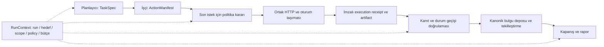

# Proje incelemesi — 29 Ekim 2026

30 Ekim devam durumu ve açık kalan sınırlar: [eksik kapatma ilerlemesi](gap-closure-progress-2026-10-30.md).

Uygulama güncellemesi: R01/R02 [ilk dilimde](p0-gap-closure-2026-10-29.md),
R03/R04 [ikinci dilimde](ledger-integrity-2026-10-29.md) regresyon ve tam
paket testleriyle kapatıldı. R09, [oturumlu Web/API diliminde](authenticated-web-api-2026-10-30.md)
hata ve belirsiz oracle sonuçlarını reddedecek biçimde düzeltildi. Önceki tam
paket sürümünde **1.121 test geçti**; son dilimin doğrulama sınırı bağlantıdaki
belgededir. **14 maddenin 5'i kapalı, 9'u açık.** Aşağıdaki sorun açıklamaları ve ilk
doğrulama tablosu inceleme anındaki durumu kaydeder; geçiş notları ve güncel
sonuçlar ilgili dilim belgelerindedir.

Projenin temel eksikliği, araç sayısından çok bileşenler arasındaki sözleşmelerde. Planlayıcı, işçi, güvenlik kapısı, HTTP oturumu, kanıt deposu ve kapanış ayrı ayrı gelişmiş; aynı hedefi, yetkiyi ve sonucu her katman aynı biçimde değerlendirmiyor. Test paketi güçlü, fakat bu sınırlar arasındaki bazı hatalar mevcut testlerden geçiyor.

İnceleme, mevcut çalışma ağacını ve commit edilmemiş değişiklikleri kapsar. Kaynak kodda düzeltme yapılmadı. Canlı hedeflere istek gönderilmedi; yeniden üretimler sahte HTTP göndericileri ve geçici depolarla, entegrasyon kontrolleri gömülü `127.0.0.1` laboratuvarıyla yapıldı. Ortam: Python 3.13.14; CI Python 3.12 kullanıyor.

Buradaki P0/P1/P2 değerleri geliştirme önceliğidir; harici bir hedef için CVSS veya bug bounty önem derecesi değildir.

## Doğrulama sonuçları

| Kontrol | Sonuç | Sınırı |
|---|---|---|
| `system-health-check` | 7/7 geçti | Dosya/binary/DB erişimi ve MCP listeleme; her MCP sunucusuna gerçek bağlantı testi değil |
| Tam pytest, başlangıçtan itibaren izole ortam | **1.054 geçti**, hata/başarısız/atlanmış test yok | Kaynak ağaçta; kurulu wheel davranışını garanti etmiyor |
| İlk, dışarıdan izolasyonsuz pytest | Toplama aşamasında hata | `test_memory_summary` gerçek `~/.cco` yoluna erişmeye çalıştı; sandbox engelledi |
| Gömülü lab | **48/48 geçti** | Sunucu fonksiyonlarını doğrudan yükler; OpenCode plugin → işçi → kapanış zincirinin tamamı değil |
| Negatif kontrol bataryası | **6/6 UNCONFIRMED**, gözlenen yanlış pozitif yok | Bataryanın hata durumlarını kabul etmesinde ayrıca sorun var: R09 |
| Sentetik worker soak | 16/16 tamamlandı; 2 eski claim kurtarıldı | Sentetik executor; HTTP ve imzalı JSONL defteri için eşzamanlılık garantisi değil |
| Ruff, engelleyici kurallar | Tüm `scripts` ve `mcp-servers` üzerinde temiz | Kurallar: `E9,F63,F7,F82`; kapsamlı tip denetimi değil |
| JS sözdizimi, bağımlılık kilidi, repo düzeni | Geçti | Davranışsal uyumluluk kontrolü değil |
| Governance, `scripts` | 0 high / 31 medium | Bu 31 kayıt ayrı incelenmeli; tamamının gerçek sır sızıntısı olduğu doğrulanmadı |
| Wheel oluşturma ve geçici venv kurulumu | Oluşturma/kurulum geçti; çalışma zamanı hataları doğrulandı | R06 |
| Ek çevrimdışı senaryolar | **15 tanısal senaryo çalıştırıldı** | Mevcut testlerin dışındaki sınır koşullarını gösterir; bir başarı skoru değildir |

Bu sonuçlar birlikte okunmalı: pozitif labın geçmesi, kapanışın kanıta bağlı olması veya bütün istek yollarının aynı politikadan geçmesi anlamına gelmiyor.

## Öncelik sırası

| ID | Öncelik | Durum | Sorun |
|---|---|---|---|
| R01 | **P0** | Kapalı | HTTP zinciri, gerçek istek bağlamını kapıya taşımıyor; oturum yenileme ayrı ağ yolu açıyor |
| R02 | **P0** | Kapalı | Kanıtsız `confirmed` durumuna imzalı kapanış verilebiliyor |
| R03 | P1 | Kapalı | Eşzamanlı append, imzalı deneme zincirini bozuyor |
| R04 | P1 | Kapalı | MCP ve sandbox arasında imza doğrulaması için ortak güven protokolü eksik |
| R05 | P1 | Açık | UUID/opaque kimlikler havuz → deneme → kapsam zincirinde korunmuyor |
| R06 | P1 | Açık | Kurulan wheel, kaynak ağacın yeteneklerini taşımıyor; bazı CLI yolları yanlış |
| R07 | P1 | Açık | Hedef kimliği ve bulgu tekilleştirmesi depo boyunca ortak değil |
| R08 | P1 | Açık | Kanıttaki scope/policy bağı, güncel raporlanabilirlikte uygulanmıyor |
| R09 | P1 | Kapalı | Negatif kontroller tamamen `ERROR` olsa da yeşil sonuç verebiliyor |
| R10 | P1 | Açık | Pytest izolasyonu modül yükleme yan etkilerinden sonra başlıyor |
| R11 | P1 | Açık | Üretilen TaskSpec ile işçinin zorunlu protokolü uyuşmuyor |
| R12 | P1 | Açık | Ayrı kapsam ayrıştırıcıları farklı kararlar veriyor |
| R13 | P2 | Açık | MCP profil/envanter belgeleri gerçek kayıtlarla senkron değil |
| R14 | P2 | Açık | Yeni browser fallback, oturum/başlık ve bağımlılık davranışını korumuyor |

## Kanıtlı sorunlar

### R01 — Güvenlik kapısı gerçek isteği görmüyor

Kaynak: [ChainExecutor._gate](../scripts/chain_executor.py#L630), [HTTP gönderimi](../scripts/chain_executor.py#L963), [SessionRuntime._login](../scripts/chain_executor.py#L230), [başlık denetimi](../scripts/policy_engine.py#L1948).

`_gate`, politika motoruna yalnızca `{"url": url}` veriyor. Gerçek metot ve başlıklar sonradan oluşturuluyor. `SessionRuntime._login` ise kendi göndericisini çağırıyor; bu ek istek için aynı kapı çağrısı yapılmıyor.

Çevrimdışı yeniden üretimde:

- Politikaya `PATCH` yasağı konuldu. Metot açıkça verildiğinde politika `blocked_http_method` döndürdü; aynı metot manifest üzerinden sahte göndericiye ulaştı ve zincir başarılı sayıldı.
- Zorunlu araştırmacı başlığı olmadan gönderim gerçekleşti. Başlık kontrolü ayrıca yalnızca bash/curl yüzeylerini denetliyor.
- Kapsam içindeki isteğin 401 dönmesi üzerine, kapsamda olmayan sentetik login URL'si sahte göndericiye ulaştı.
- `max_requests=2` iken ilk GET + login POST + tekrar GET olmak üzere **3** gönderim yapıldı; sonuç **2** istek bildirdi.

**Düzeltme:** ağ çıkışının hemen önünde çalışan ortak taşıma katmanı oluşturulmalı. Nihai URL, metot, başlıklar, kimlik, amaç ve bütçe bu katmanda denetlenmeli. Login, tekrar deneme, yansıma sonrası tekrar ve yönlendirmeler aynı yol ve sayaçtan geçmeli. Sadece plan/görev başlangıcını onaylamak yeterli değil.

**Kabul ölçütü:** yasak metot veya kapsam dışı login için gönderici hiç çağrılmamalı; raporlanan istek sayısı bütün gerçek gönderimlerle eşleşmeli.

### R02 — İmzalı kapanış, kanıtsız confirmed durumunu mühürlüyor

Kaynak: [hypotheses mark](../scripts/brain.py#L474), [check/closure akışı](../scripts/brain.py#L1584), [closure verify](../scripts/brain.py#L1139).

Normal özet işleme yolunda `_validator_confirmation` kontrolü var. Ancak `hypotheses mark --status confirmed` bu yoldan geçmiyor. Sonraki kapanış kontrolü terminal durumu kabul ediyor; `confirmed` için validator kaydı istemiyor.

Yeniden üretim sonucu:

```text
hypotheses mark: exit 0
check --closure: exit 0
closure verify: exit 0
hypothesis status: confirmed
attempt records: 0
validation artifacts: []
```

Bu, kapanış mührünün yanlış bir durumu kabul ettiğini gösterir. Bulguyu raporlayan diğer bileşenlerin ayrı artifact kontrolünün de aşıldığı gösterilmedi.

**Düzeltme:** bütün durum değişiklikleri ortak bir geçiş doğrulayıcısından geçmeli. Kapanış, her confirmed kaydını hedef/tür/koşu/kanıt bağıyla yeniden doğrulamalı. İmzanın doğruluğu ile payload içindeki iddiaların doğruluğu ayrı denetlenmeli. Eksik faz özetleri ve değişen havuz/hipotez durumları da kapanış bağının parçası olmalı.

**Kabul ölçütü:** validator olmadan CLI üzerinden confirmed işaretlemek veya bu durumdan kapanış üretmek reddedilmeli.

### R03 — Deneme defterinde eşzamanlı yazım işlemi atomik değil

Kaynak: [append_record](../scripts/attempt_ledger.py#L257).

İşlem mevcut dosyayı okuyor, son hash/sıra numarasını hesaplıyor, ardından append yapıyor. Bu adımların tamamını kapsayan süreçler arası kilit yok. İki yazar aynı başlığı okuduğunda ikisi de aynı sırayı üretebilir.

İmza anahtarı önceden oluşturulmuş geçici bir depoda iki yazar aynı noktada senkronize edildi: sıra numaraları **`[1, 1]`**, doğrulama sonucu **`record 2: sequence mismatch`** oldu. Sonraki doğru kayıtlar da bozuk zincire eklenemiyor.

**Düzeltme:** okuma–doğrulama–sıra ayırma–yazma tek kilit/transaction altında yapılmalı. Tercihen SQLite olay tablosu kanonik depo, JSONL dışa aktarım olmalı. Dosya kalacaksa süreçler arası kilit ve crash recovery tasarlanmalı.

**Kabul ölçütü:** en az iki ayrı süreç aynı koşuya yazarken sıralar benzersiz ve kesintisiz kalmalı; yarıda kalan yazım güvenilir kaydı bozmamalı.

### R04 — İmza anahtarının saklanmasıyla doğrulama yolu uyuşmuyor

Kaynak: [attempt signing key](../scripts/attempt_ledger.py#L122), [sandbox maskeleri](../.opencode/plugins/security-gate.js), [işçinin kayıt kuralı](../.opencode/agents/worker.md).

Kayıtlar `CCO_HOME` altındaki HMAC anahtarıyla imzalanıyor. Aynı kayıt ikinci geçici `CCO_HOME` altında doğrulandığında `signature mismatch` alındı. Bu, kriptografinin beklenen davranışı; eksik olan, anahtarı göremeyen sandbox'ın aynı kanıt hakkında nasıl güvenilir karar vereceği.

İşçi talimatı kayıtları MCP üzerinden yazdırarak anahtarı koruyor; beyin/handoff/kapanış tarafındaki yerel doğrulama hâlâ anahtara bağlı. Önceki geniş kapatma planındaki receipt maddesi bu nedenle hâlâ gerekli.

**Düzeltme:** imzalama ve yetkili doğrulama aynı custody servisinde kalmalı. Sandbox'a anahtarı açmak yerine doğrulanabilir receipt veya açık anahtarla doğrulanabilen imza sağlanmalı. Anahtar üretimi de eşzamanlı başlangıçlara karşı atomik olmalı.

**Kabul ölçütü:** MCP'nin yazdığı aynı kayıt, farklı çalışma ortamlarından aynı güven sonucunu vermeli; özel anahtar korunan alanda kalmalı.

### R05 — UUID desteği yalnızca bazı katmanlarda mevcut

Kaynak: [kimlik dönüştürme](../scripts/hypothesis_ledger.py#L117), [attempt şeması](../scripts/attempt_ledger.py#L55), [handoff](../scripts/brain.py#L888), [coverage kapısı](../scripts/brain.py#L1017).

Gözlenmiş UUID bir own-id olarak verildiğinde aday üretimi boş liste döndürüyor. Attempt şeması UUID adayı `must be an integer` hatasıyla reddediyor. UUID içeren hazır havuz verilirse handoff ve coverage yalnızca `int` adayları alıp UUID'yi düşürüyor: `untried=[]` ve kontrol kaydı varsa coverage engeli yok.

Son kapanışta ayrıca boş integer havuzu için engel var; dolayısıyla her UUID koşusunun başarıyla kapanacağı iddia edilmiyor. Sorun, katmanların aynı UUID havuzunu farklı görmesi ve doğru tamamlamanın mümkün olmaması.

**Düzeltme:** adaylar `{family, format, value}` biçiminde uçtan uca taşınmalı. `int`, `uuid` ve opaque değerler için ayrı üretim/kapsam kuralları olmalı; UUID parçaları sayısal komşuluk tohumu olarak yorumlanmamalı.

**Kabul ölçütü:** sahip olunan UUID, havuzdan imzalı kayda ve kapanışa kadar aynı değerle izlenmeli; denenmemiş UUID açıkça untried kalmalı.

### R06 — Dağıtım paketi kaynak ağaçla eşdeğer değil

Kaynak: [wheel veri dosyaları](../pyproject.toml#L40), [release_check kökü](../scripts/release_check.py#L13), [paket testleri](../tests/test_release_package.py).

Release aracının kendi staging yöntemiyle wheel oluşturuldu ve kaynak ağaç dışında geçici bir venv'e kuruldu. Arşivde `cco_surface_core`, `cco_browser_core`, `cco_js_core`, `cco_postex_core`, `cco_telemetry_core`, `mcp-agent-browse/server.py` ve `mcp-otp/server.py` yok.

Kurulu paket üzerinde:

- Memory server importu: **`ModuleNotFoundError: cco_surface_core`**.
- Kali tools: `HAS_SURFACE=False`, `HAS_JS_CORE=False`, `HAS_POSTEX=False`.
- Browser: session/runtime-hooks/fallback/surface desteği kapalı.
- Telemetry: `HAS_OTEL=False`.
- `cco-release-check --list`, `site-packages/pyproject.toml` arayıp `FileNotFoundError` verdi. Dosya aslında kurulumun share alanında bulunuyor.

**Düzeltme:** çalışma zamanı dosyaları tek paket manifestinden üretilmeli; kaynak/kurulum kaynaklarını bulan ortak bir resolver kullanılmalı. Eksik zorunlu modül sessizce opsiyonel yetenek kaybına çevrilmemeli.

**Kabul ölçütü:** CI wheel'i kurup repo dışından tüm CLI girişlerini ve MCP import/list_tools kontrollerini çalıştırmalı; gerekli feature flag'ler kaynak ağaçla eşleşmeli. İmzalı ZIP üretmek tek başına yeterli değil.

### R07 — Hedef kimliği ve bulgu tekilleştirmesi ortak değil

Kaynak: [target_identity](../scripts/target_identity.py), [validator canonical_target](../mcp-servers/mcp-validator/cco_validator_core/evidence.py#L121), [finding insert](../mcp-servers/mcp-memory-server/server.py#L1258), [memory lookup](../mcp-servers/mcp-memory-server/server.py#L1757).

Ortak `target_key`, `https://review.test` ve açık `:443` biçimini eşit görüyor. Validator'ın kendi normalizasyonu aynı kanıtı ilk biçimde kabul edip ikinci biçimde reddediyor. Memory kaydı/sorgusu ise ham hedef metnini kullanıyor.

Sentetik aynı kayıt iki kez yazıldığında iki ID üretildi: **1 ve 2**. Tam URL sorgusu iki kayıt, aynı hedefin yalın host sorgusu sıfır bulgu döndürdü. Mevcut hedef filtresi var; eksik olan eşdeğer yazımların ortak kimlik kullanması ve tekrar kaydın idempotent olması.

**Düzeltme:** program/koşu bağlamı ve origin kimliği ortak modülde tanımlanmalı; bulgu tekilleştirmesi depo katmanında transaction ve unique key ile zorunlu olmalı. Kimlik normalizasyonu, URL kapsamındaki yol sınırlarını silmemeli. Tarihsel kayıtlar için migration ve alias eşleştirmesi gerekli.

**Kabul ölçütü:** eşdeğer hedef yazımları aynı kayda ulaşmalı; aynı bulguyu yeniden göndermek yeni satır yerine kanonik kaydı güncellemeli.

### R08 — Kanıttaki scope/policy bağı denetlenmeden verified kalabiliyor

Kaynak: [artifact_is_valid](../mcp-servers/mcp-validator/cco_validator_core/evidence.py#L467), [memory doğrulaması](../mcp-servers/mcp-memory-server/server.py#L1138), [rapor artifact kontrolü](../mcp-servers/mcp-kali-tools/server.py#L3280).

Artifact scope revision ve policy hash içeriyor. Ancak doğrulayıcı bunları yalnızca beklenen değer açıkça verilirse karşılaştırıyor; ana tüketiciler bu değerleri vermiyor.

Scope/policy sürümü değiştirilen çevrimdışı senaryoda varsayılan kontrol `True`, güncel sürümler açıkça verilen kontrol `False` döndü. Memory aynı kanıtı **`verified`, `reportable=1`** olarak değerlendirdi.

Tarihsel kanıtın imzasının geçerli kalması normaldir. Eksik ayrım, “bu kanıt o tarihte geçerliydi” ile “bu koşunun güncel politikasıyla raporlanabilir” arasındadır.

**Düzeltme:** tarihsel doğrulama ve güncel raporlanabilirlik için açık iki mod tanımlanmalı. Güncel mod, koşunun sabitlenmiş scope/policy/target/type bağını zorunlu istemeli.

### R09 — Negatif kontrol, hata veren oracle'ları başarı sayıyor

Kaynak: [negative-control sonucu](../scripts/negative-control.py#L97).

Başarı yalnızca `fp == 0` ile hesaplanıyor. Bütün oracle'lar sahte olarak `ERROR` döndürdüğünde **6/6 ERROR, `passed=True`, yanlış pozitif=0** sonucu üretildi.

**Düzeltme:** oracle tamamlanma oranı, ERROR/INCONCLUSIVE sayısı ve yanlış pozitif oranı ayrı hesaplanmalı. Beklenen kontroller tamamlanmadan gate geçmemeli; FP paydasına yalnızca geçerli ölçümler girmeli.

**Kabul ölçütü:** tek oracle hatası bile ayrı hata/eksik ölçüm sonucu üretmeli; altı ERROR hiçbir durumda yeşil olamamalı.

### R10 — Test izolasyonu import yan etkilerinden sonra başlıyor

Kaynak: [session fixture](../tests/conftest.py#L17), [toplama zamanında import](../tests/test_memory_summary.py#L19), [memory backend oluşturma](../mcp-servers/mcp-memory-server/server.py#L887).

`autouse` session fixture test çalıştırılmadan önce devreye giriyor; test modülü import edilmeden önce değil. `test_memory_summary` modül düzeyinde memory server yüklediği için gerçek varsayılan veri dizinine ulaşabiliyor. İlk test çalıştırmasındaki hata bunu doğrudan gösterdi.

**Düzeltme:** test ortamı pytest collection başlamadan kurulmalı; sunucu importları fixture içine taşınmalı. Üretim modülleri import edilirken DB/graph başlatmak yerine açık startup/lazy initialization kullanmalı.

**Kabul ölçütü:** temiz shell'den düz pytest komutu gerçek `~/.cco` altında hiçbir okuma/yazma gerektirmeden çalışmalı.

### R11 — TaskSpec ile işçi protokolü birbirini tamamlamıyor

Kaynak: [görev şablonları](../scripts/brain.py), [render_task_prompt](../scripts/orchestration_spec.py#L266), [işçi kuralları](../.opencode/agents/worker.md), [delegasyon kapısı](../scripts/policy_engine.py#L1702).

Üretilen access/CSRF görevi `validate_spec` kontrolünden geçiyor. Ancak Tools listesinde işçinin zorunlu defter kayıt aracı ve hemen kayıt için gereken finding aracı yok; render edilmiş metinde işçinin zorunlu tuttuğu scope referansı da yok. İşçi hem yalnızca listelenen araçları kullanmak hem bu eksik araçlarla kayıt yapmak zorunda bırakılıyor.

Delegasyon kapısı da TaskSpec doğrulayıcısıyla aynı kuralları kullanmıyor: kayıtlı olmayan `kali-tools_nonexistent_review_tool` ve gerekçesiz `Tools: bash` için ihlal döndürmedi. Çağrı anındaki unknown-tool kontrolü ayrı olarak kalır; bu bulgu onun aşıldığını göstermez.

**Düzeltme:** kayıt/saklama araçları her spec'e protokol bağımlılığı olarak eklenmeli. Scope referansı, grant, artifact alanı, özet şeması ve bütçe tek sözleşmeden üretilmeli. Prompt gate, `validate_spec` ile aynı doğrulayıcıyı kullanmalı.

29 çekirdek araç bulunması tek başına sorun değil: gerekçeli opt-in kodda artık mevcut. Açık kalan sorun, görevlerin kendi zorunlu protokollerini karşılamaması.

### R12 — Kapsamı ayrı ayrıştıran giriş kapıları aynı kararı vermiyor

Kaynak: [live_run kapsam ayrıştırması](../scripts/live_run.py#L35), [browser scope yardımcıları](../mcp-servers/mcp-browser/server.py#L136), [merkezî scope denetimi](../scripts/policy_engine.py#L1567).

`live_run.gate_target` yalnızca host kümesi çıkarıyor. URL-prefix yolu ve excluded asset bilgisi bu kararda kayboluyor. Sentetik kapsam dosyasında yalnızca `/allowed/` tanımlıyken ve host ayrıca excluded iken `/disallowed/` girişine host kabulü verdi.

Bu, tek başına gerçek isteğin çıktığını göstermiyor; sonraki merkezî kapı reddedebilir. Giriş kapısının “in scope” kararı yine de yanıltıcı ve farklı giriş noktalarının davranışı tutarsız.

**Düzeltme:** bütün giriş noktaları ortak, saf bir scope resolver kullanmalı. Host, wildcard, CIDR, port, URL-prefix ve exclusion önceliği aynı test matrisiyle doğrulanmalı.

### R13 — Profil ve belge envanteri geriden geliyor

Kaynak: [profiles.json](../.opencode/profiles.json), [bilinen sunucular](../scripts/profile_manager.py#L74), [mimari belgesi](architecture.md), [tool_counts](../scripts/tool_counts.py).

Gerçek dekoratör envanteri **16 sunucu / 287 araç**. Mimari belgesi hâlâ 275 ve eski sunucu başına sayıları kullanıyor. Profildeki `full` listesinde yeni `agent-browse` ve `otp` yok.

Bu iki sunucu açıkken `min` profili uygulanan sentetik config, **4 enabled** bildirdi ama gerçekte **6 sunucuyu** açık bıraktı; `current` yine `min` dedi. Bunlar kullanıcıya ait özel sunucu gibi korunuyor.

**Düzeltme:** birinci taraf sunucu envanteri tek yerden üretilmeli; profiller, capability eşleşmeleri, paket manifesti ve belgeler buna bağlanmalı. Bildirilen sayaçlar sonuç config'den hesaplanmalı.

### R14 — Yeni fallback'in bütünleşme sözleşmesi eksik

Kaynak: [HTTP fallback](../mcp-servers/mcp-browser/server.py#L374), [browser_extract_links](../mcp-servers/mcp-browser/server.py#L392), [mevcut fallback testi](../tests/test_browser_fallback.py).

Playwright kurulu değilken fonksiyon fallback'e ulaşmadan hata dönüyor. Sahte urlopen ile fallback çalıştırıldığında araştırmacı handle'ı ayarlı olsa bile yalnızca User-Agent gönderildi; browser context'in araştırmacı başlıkları, oturumu ve proxy yolu kullanılmadı. Mevcut test yalnızca HTML ayrıştırıcısını kapsıyor.

**Düzeltme:** browser ve HTTP fallback aynı istek/oturum/politika bağlamını kullanmalı. Hangi yeteneklerin kaybolduğu çıktıda açık olmalı; eksik bağımlılık ve timeout yolları ayrı test edilmeli. R06'daki paketleme eksikliği de bu yeni modülü etkiliyor.

## Önerilen ortak sözleşme



`RunContext` değiştirilebilir global ortam değişkenleri yerine koşu oluşturulurken sabitlenen bağlam olmalı. İşçinin serbest metni yeni yetki yaratmamalı; taşıma katmanı her gönderim için bu bağlamı ve kalan bütçeyi kullanmalı. Artifact aynı bağlamın kimliğini taşımalı, kapanış da bu bağları yeniden değerlendirmeli.

## Uygulama sırası ve geliştirilecek teknikler

| Dilim | İçerik | Bitti sayma ölçütü |
|---|---|---|
| 1 — Yetki ve kanıt | R01, R02, R08 | Yasak metot/login çıkmıyor; validatorsız confirmed kapanmıyor; güncel ve tarihsel kanıt ayrımı testli |
| 2 — Güvenilir kayıt | R03, R04, R07 | Süreçler arası atomik kayıt; MCP/sandbox aynı receipt'i doğruluyor; tekrar bulgu tek kayıtta birleşiyor |
| 3 — Görev ve kimlik | R05, R11, R12 | UUID/opaque akışı tamamlanıyor; üretilen görev işçi protokolünü karşılıyor; bütün scope girişleri aynı kararı veriyor |
| 4 — Ölçüm ve dağıtım | R06, R09, R10 | Kurulu wheel smoke testi; oracle hatasında kırmızı gate; collection öncesi izolasyon |
| 5 — Bakım ve fallback | R13, R14 | Gerçek sayaçlar; üretilen envanter; fallback'te oturum/başlık sözleşmesi |

Yeni araç eklemeden önce şu teknikler daha çok değer sağlar:

1. **Sözleşme matrisi:** aynı sentetik RequestIntent'i native MCP, chain, session recovery ve browser fallback üzerinden geçir; izin kararı, başlık, hedef ve maliyet eşitliğini karşılaştır.
2. **Durumlu test senaryoları:** login → işlem → bekleme → geri okuma akışının hangi adımda kaldığı kalıcı olsun. Süreç yeniden başladığında önceki adımı kanıtsız tekrar etmek yerine receipt'ten devam edilsin.
3. **Docs'tan kanıt bağlantılı görev üretimi:** gözlenmiş endpoint, parametre, kimlik biçimi ve durum önkoşulu doğrudan TaskSpec'e bağlansın. Sadece anahtar kelimeyle vektör sıralamak yerine her önerinin kaynak artifact'i bulunsun.
4. **Ölçülebilir model eskalasyonu:** aynı şema hatasının iki kez tekrarı, geçersiz özet veya çok adımlı durum gereksinimi üst seviye incelemeyi tetiklesin. Model adı yerine rol/yetenek kontratı kullanılsın; üst model de aynı izin ve bütçeye tabi olsun.
5. **Kesinti ve tekrar oynatma testleri:** kayıt sırasında süreç sonlandırma, artifact dosyasının kaybolması, DB kilidi, claim süresinin dolması ve oturumun yenilenmesi ayrı senaryolar olsun. Başarı, sadece zincirin bitmesiyle değil kanıtın korunmasıyla ölçülsün.
6. **Ayrı kalite göstergeleri:** yanlış pozitif oranı, tamamlanan oracle oranı, denenmeyen yüzey, geçersiz receipt sayısı, validatorsız confirmed sayısı, gerçek istek maliyeti ve kapanış başarısı ayrı raporlansın. Tek bir “all passed” sayısına toplanmasın.

Önceki `gap-closure-broad` planının receipt ve UUID maddeleri bu incelemede de doğrulandı. Yeni öncelik, bunların önüne R01 ve R02'deki yetki/kanıt sözleşmelerini koymak. Ek yetenek ve model kıyasları, ölçüm ve kapanış güvenilir olduktan sonra daha anlamlı sonuç verir.

## Kanıtların yeri ve yeniden çalıştırma

Bu oturumun çalışma dosyaları repo dışında `/tmp/cco-review-20261029/` altında tutuldu:

- `reproduce_review.py`: 15 çevrimdışı senaryonun çalıştırılabilir yeniden üretimi.
- `offline-reproductions.json`: bütün senaryoların ham karar/sayaç sonuçları.
- `pytest-isolated.xml`, `pytest-isolated.log`: 1.054 testin sonuçları.
- `lab-validation.json`, `negative-control.json`, `worker-soak.json`: entegrasyon sonuçları.
- `wheel-inventory.json`, `installed-server-imports.json`: kurulu paket farkları.
- `wheel-build.log`, `wheel-install.log`, `ruff-all.json`, `governance.json`: diğer doğrulamalar.

```bash
python3 /tmp/cco-review-20261029/reproduce_review.py
CCO_HOME=/tmp/cco-review-20261029/test-home CCO_GRAPH_BACKEND=networkx \
  python3 -m pytest tests -q
python3 scripts/lab-validate.py --skip-rag --quiet --json
```

Yeniden üretim betiği yalnızca geçici dosyalar ve sahte HTTP göndericileri kullanır. `/tmp` kanıtları bu ortamın ömrüne bağlıdır; kalıcı teşhis, kaynak konumları ve gözlenen çıktılar bu belgededir. OpenCode'da gerçek modelle tam kampanya, Docker/cgroup üretim kurulumu ve her MCP sunucusu için stdio bağlantısı bu incelemede uçtan uca doğrulanmış sayılmamalı.
