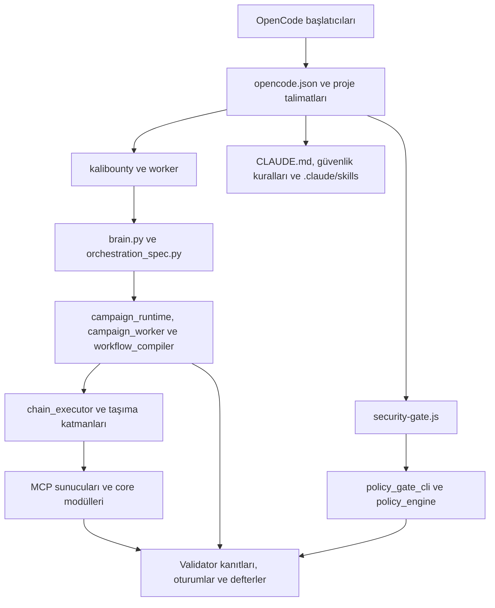

# Repo incelemesi ve mevcut yapıyı koruyan temizlik planı

Tarih: 2 Kasım 2026. Durum: **ilk güvenli temizlik dilimi ve kullanıcı isteğiyle çalışma verisi arşivlemesi tamamlandı**.
Uygulanan işler, doğrulamalar ve kalan sınırlar bölüm 8'de kayıtlıdır.

## Sonuç

Repo tamamen kullanılmayan kodla dolmuş değil. Çalışan ürün, eski Claude Code anlatımı, yeni OpenCode uygulaması, tarihsel tasarım belgeleri ve yerel çalışma çıktıları aynı görünümde birikmiş. Önce bu sınırları netleştirmek gerekiyor. Dosya adı, yaşı veya Git'te henüz izlenmemesi silme gerekçesi olamaz.

Önerilen sıra: mevcut geliştirmeleri koru → başlangıç sorununu gider → yerel çıktıları ayır → dokümantasyonu tek girişten okunur hale getir → uyumluluk yollarını netleştir → yalnız bağlantısı ve dış kullanımı doğrulanmış kodu kaldır.

İlk analiz sırasında kaynak kod, yapılandırma, scope, bağımlılık veya mevcut belge değiştirilmedi; yalnız bu plan eklendi. Sonraki onaylı uygulama bölüm 8'de açıklanır. Hiçbir canlı hedefe istek gönderilmedi.

## 1. İncelemenin dayanağı ve sınırları

Başlangıç Git durumu:

| Ölçü | Sonuç |
| --- | --- |
| Dal | `main` |
| HEAD | `e839e23548f5ea9b6a4a60f22620678f3fda8a78` |
| İzlenen dosya | 379 |
| Değişmiş izlenen kayıt | 92 |
| İzlenmeyen durum kaydı | 102; dizin kayıtları da var, dosya sayısıyla aynı değil |
| Bildirilen MCP sunucusu / aracı | 16 / 291; `scripts/tool_counts.py` çıktısı |
| Yapılandırmada etkin / kapalı sunucu | 13 / 3 |
| Çekirdek araç listesi | 29; `config/mcp-core-tools.json:core_tools` |

İnceleme; Git envanteri, giriş noktaları, Python importları, dosya yolu referansları, OpenCode yapılandırması, paketleme listeleri, CI ve mevcut testler üzerinden yapıldı. Derleme kopyaları ile paket metaverisi gerçek kod çağrısı sayılmadı. Dinamik MCP kaydı, profil seçimi ve elle kullanılan CLI'lar ayrıca dikkate alındı.

"Bağlantısı var" ifadesi depo içindeki bir çağrıyı veya yapılandırma bağlantısını gösterir; yakın zamanda gerçekten çalıştırıldığı anlamına gelmez. "Çağıran bulunamadı" ifadesi de dışarıdaki cron, shell alias veya operatör kullanımının yokluğunu kanıtlamaz. Bu nedenle belirsiz CLI'lar kaldırılacak dosya değil, kullanım kararı bekleyen adaylardır.

`.env`, kimlik bilgisi dosyaları, credential vault, `.aws`, `.cco` içeriği, oturum dökümleri ve gerçek engagement verisinin içeriği incelenmedi. Yerel çıktıların yalnız dosya/dizin metaverisi kullanıldı. Yapılandırmada karşılaşılan anahtar değerleri plana ve kanıt dosyalarına alınmadı; sonraki yapılandırma okumalarında ham değerler çıktıya verilmedi.

## 2. Bugünkü çalışan yapının haritası



Bu şema ana bağlantıları özetler; her çağrı bu zincirin tüm düğümlerinden geçmez. Güvenlik kapısı, HTTP gönderim politikası, araç bütçesi ve kanıt doğrulaması birden çok katmanda uygulanıyor. Aynı kavramın farklı dosyalarda görünmesi tek başına tekrar kod olduğu anlamına gelmez.

| Alan | Kullanım durumu ve kanıt | Temizlik kararı |
| --- | --- | --- |
| `opencode.json` | Ana runtime yapılandırması; `default_agent=kalibounty`; MCP komutları burada | Koru; sağlayıcı kimlik bilgilerini ayrı iş olarak düzelt |
| `.opencode/agents/kalibounty.md`, `worker.md` | Ana orkestratör ve execution worker sözleşmeleri | Koru; ilk temizlikte prompt davranışını değiştirme |
| `.opencode/plugins/security-gate.js` | Yapılandırmada açık plugin; `policy_gate_cli.py` üzerinden kapıya bağlı | Koru; konumu ve export biçimi sözleşme |
| `.opencode/plugins/bai-provider.js` | Sağlayıcı auth plugin'i; yalnız `plugin` dizisine bakıp kullanılmıyor deneme, proje plugin keşfi var | Etkin yüklenme doğrulanana kadar koru |
| `.opencode/tui/kb-hud.tui.js`, `themes/`, `tui.json` | HUD ve tema; `tui_snapshot.py` veri sağlar | Koru; TUI dosyasını server plugin dizinine taşıma |
| `.opencode/profiles.json` | `profile_manager.py`, başlatıcı ve setup tarafından kullanılan profil kaynağı | Koru |
| `scripts/opencode-cco.sh`, `opencode-optimized.sh` | Kullanıcı girişleri; setup/profile/security/campaign/worker yönlendirmeleri var | Koru |
| `CLAUDE.md`, `.claude/skills/` | `opencode.json:instructions` ve `AGENTS.md` bunları mevcut metodoloji/skill kaynağı sayıyor; 24 skill var | Eski isimlerine rağmen aktif; silme veya yeniden adlandırma |
| `skills` | Geçerli symlink: `.claude/skills` | Koru |
| `rules/scope-guard.md`, `safety-rules.md` | Yapılandırmada doğrudan instructions olarak yükleniyor | Koru |
| `scripts/brain.py`, `orchestration_spec.py` | Ajanlar, MCP ve campaign tarafından çağrılan deterministik planlama/kanıt sözleşmesi | Koru |
| `campaign_runtime.py`, `campaign_worker.py`, `worker_pool.py`, `live_run.py`, `workflow_compiler.py`, `chain_executor.py` | CLI, importlar ve testlerle bağlı kampanya/işçi/taşıma yolları | Adları benzer diye birleştirme |
| `scripts/task_spec.py` | `worker_pool`, `swarm_orchestrator`, policy ve testler tarafından kullanılıyor | `orchestration_spec.py` ile otomatik tekrar sayma |
| `policy_engine.py`, `policy_gate_cli.py`, `egress_policy.py`, izolasyon ve watchdog modülleri | Aktif güvenlik ve yürütme sınırları | İlk temizlikte refactor etme |
| `attempt_ledger.py`, `hypothesis_ledger.py`, `target_identity.py`, `session_store.py` | Brain/MCP/worker çağrıları; kanıt, hedef ve oturum bağları | Koru; şema değişimi ayrı migrasyon |
| Yeni `runtime_paths.py`, `mcp_inventory.py`, `wire_budget.py`, `chain_transport.py`, `object_identity.py`, `evidence_trust.py`, `member_login.py` | Henüz izlenmeyen dosyalar olmasına rağmen çekirdek kod bunları import ediyor | WIP'in zorunlu parçaları; kesinlikle artık dosya sayma |
| Yeni `engagement_workspace.py`, `finding_migration.py` | `pyproject.toml` içinde `cco-engagement` ve `cco-finding-migration` girişleri var | Import edilmemeleri kullanılmadıkları anlamına gelmiyor |
| `mcp-servers/` ve `cco_*_core/` | Yapılandırma, MCP kayıtları ve paketleme üzerinden aktif modüler yapı | Koru; core dosyalarını standalone server'dan koparma |
| `mcp-ad-tools`, `mcp-container-tools`, `mcp-ctf-platform` | Şu anda kapalı; `ad`, `ctf` ve `full` profillerinde var | Opsiyonel destek; kullanılmayan kod diye silme |
| `tests/` | 136 test dosyası; 38'i başlangıçta izlenmiyor ve mevcut yeni özelliklere ait | Tarihsel/faz isimlerine bakarak kaldırma |
| `pyproject.toml`, `MANIFEST.in`, `requirements.lock`, sunucu `requirements.txt` dosyaları | Kurulum, dağıtım, kilit ve release sözleşmeleri | Eş zamanlı doğrulama olmadan birleştirme |
| `.github/workflows/` | Aktif kalite ve imzalı release akışları | Koru |
| `.codex/scope.json`, `program-policy.json` | Aktif operatör güvenlik ayarı; scope ayrıca değişmiş durumda | İlk temizlikte yerini veya içeriğini değiştirme |
| Diğer `.codex/scope.*`, policy/goal dosyaları; `config/program-profiles/` | Program ayarları, presetler ve tarihsel yedekler karışık | Aktif ayar/preset/yedek olarak ayır; tarih veya isim tek başına yeterli değil |
| `.cco` ile `CCO_WORKDIR` | `CCO_HOME` state/vault kökü, `CCO_WORKDIR` engagement çalışma alanı; başlatıcılar repo `.cco` varsayılanını kullanıyor | İki kökü aynı şey sanma; `.cco` taşıması ayrıca migrasyon gerektirir |

## 3. Gerçek temizlik adayları

### 3.1. Kod davranışını değiştirmeden düzenlenebilenler

| Aday | Kanıt | Önerilen işlem ve sınır |
| --- | --- | --- |
| `skills~master` | Git'te normal dosya; içeriği geçerli `skills` symlink hedef metniyle aynı; aktif referans bulunamadı | Yedek/merge kalıntısı olarak ayrı küçük değişiklikte kaldır; `skills` symlink'ine dokunma |
| Kökteki 3 `codex-session-*.md` | İzlenmiyor; toplam 11.824.074 bayt; içerikleri okunmadı | `CCO_WORKDIR` altında özel oturum arşivine taşı; Git'e ekleme; hash ve dosya sayısını karşılaştır |
| `.tmp_runD_summary.md` | İzlenmeyen kısa run özeti | İlgili run arşivine taşı; önce devam eden handoff olup olmadığını kontrol et |
| `.worker/` | İzlenmeyen 2 dosya; depo kodunda literal `.worker/` çağrı yolu bulunamadı | Worker/handoff sahibini belirle; etkin dosya değilse run arşivine taşı; otomatik silme |
| `build/` | İzlenmeyen build çıktısı; 38 karşılaştırılabilir kopyanın 23'ü aynı, 15'i kaynaktan farklı | Build/import süreci kullanmıyorsa temizle ve sonraki build'de üret; kaynak kopyalarını birleştirme |
| `.pytest_cache`, `.ruff_cache`, `.mypy_cache`, `__pycache__` | Araçların ürettiği ve zaten ignore edilen önbellekler | İlgili işlem çalışmıyorken temizlenebilir; ürün temizliğiyle aynı commit'e girmez |
| `hackagent_opencode.egg-info/` | Üretilmiş ve ignore edilmiş paket metaverisi | Editable kurulumun metadata/entrypoint ihtiyacını kontrol et; gerekirse yeniden kurarak üret, körlemesine silme |
| Kökteki `agent_memory.db` | 0 bayt; içerik açılmadı; MCP varsayılanları `CCO_HOME` altına yöneliyor | Dış tüketici olmadığı doğrulanınca yetim artefakt olarak kaldır |
| `hepsiburada-bb/` | Yerel engagement dizini; 45 dosya; bu çalışma ağacında `git ls-files` altında hiç kayıt yok | Gerçek veri olarak özel çalışma alanına taşı; içerik ve sırları Git'e alma |

`.venv`, `.opencode/node_modules`, `.env`, `.aws` ve `.cco` bu listeye toplu temizleme hedefi olarak dahil edilmez. Bunlar kurulu ortam veya hassas/aktif state olabilir.

### 3.2. Kullanım kararı bekleyen kod ve eski çalışma yüzeyleri

| Dosya/grup | Analiz | Karar |
| --- | --- | --- |
| `.opencode/agents/archive/{brain_glm,brain_sol,brainstorm}.md` | Arşiv README'si 24 Ekim'de emekliye ayrıldıklarını söylüyor; dosyalarda hâlâ agent frontmatter var | Tarihsel aday. Etkin OpenCode agent keşfi doğrulanmadan "kesin yüklenmiyor" veya "silmek güvenli" sonucu çıkarma |
| `rules/brain-routing.md` | Emekli ajan adlarıyla zorunlu review istiyor; mevcut `instructions` listesinde yok, incelenen aktif talimatlardan doğrudan dosya referansı bulunamadı | Güncel yönlendirme/kanıt politikasına göre düzenle veya tarihsel belge olarak işaretle |
| `install-cco.sh` | Claude/global kurulum yolu; `OPENCODE.md:93` bu clone için gerekmediğini açıkça belirtiyor; README hâlâ bunu ana kurulum olarak sunuyor | İlk aşamada belgele; Claude desteğinin sürdürülmesi kararı sonrası legacy alana taşı |
| `scripts/cco-profile.sh`, `token-estimate.py` | Eski Claude profil yolu; token aracı shell profil dosyasını kullanıyor, `--current` global Claude config'ini okuyor | OpenCode profil komutundan ayrı, açıkça legacy/uyumluluk olarak tut; çağıranları güncellemeden silme |
| `system_prompt.md`, `memory/PRD.md`, `yapılacaklar.txt` | Referans/PRD/backlog belgeleri; güncel runtime anlatımıyla karışmış | Açık işleri güncel backlog'a aktar; kalanları tarihsel statüyle indeksle |
| `.claude/settings.json`, `.claude/commands/` | Claude runtime yüzeyi; komut anlatımı `CLAUDE.md` içinde hâlâ var | `.claude/skills` ile topluca silme; destek ve komut çözümlemesi doğrulandıktan sonra karar ver |
| `scripts/lazy_loader.py` | Standalone CLI; başlatıcı/plugin/test çağıranı bulunamadı. `lazy_loading` ayarları mevcut, loader'a bağlantı gösterilemiyor | Entegre mi, manuel araç mı, emekli mi kararını ver; mevcut startup davranışı ölçülmeden lazy loading sağladığını varsayma |
| `scripts/attack_planner.py` | Standalone CLI; mimari belgesi de orphan/opsiyonel diye tanımlıyor; aktif kod/test bağlantısı bulunamadı | Manuel kullanım yoksa tools/legacy alana taşıma adayı |
| `_summarize_artifact.py`, `seed_blind01_lessons.py` | Tek görev/lab yardımcıları; aktif çağıran veya test bağlantısı bulunamadı | İlgili run/lab altında arşivleme adayı; genel ürün script'i gibi sunma |
| `grant-program.sh`, `rapyd_session_keeper.py` | Operatör/program yardımcıları; repo içi otomatik çağıran bulunamadı | Shell/cron kullanımını kontrol et; kaldırmak yerine önce sahiplik ve destek durumu belirt |
| `exploits/xmlrpc_bruteforce.py`, `_v2.py` | İki standalone PoC; aktif kod/test/config referansı bulunamadı; çalıştırılmadı | Ürün paketinden ayrı PoC/lab arşivi adayı; v2 adına bakarak ilkinin eşdeğerliğini varsayma |
| `.emergent/`, `.gitconfig` | Ana OpenCode/CI/paket yollarında bağlantı gösterilemedi | Ortam/kurulum kalıntısı adayı; dış platform kullanımını doğrula |

### 3.3. Silinmemesi gereken küçük veya benzer isimli dosyalar

- `security_middleware.py` yalnız 8 satır ama `policy_gate_cli.main` için geriye uyumlu giriş; setup ekranı bu yolu gösteriyor.
- `rag-bootstrap.py`, `rag_bootstrap.py` için çalıştırılabilir uyumluluk girişidir. Shell wrapper ve RAG bileşenleriyle bağlantısı var.
- `swarm_orchestrator.py` ve `recon_daemon.py`, `mcp-kali-tools/server.py` tarafından sırasıyla import ediliyor/başlatılıyor; eski mimari belgesinde görünmeleri kullanılmadıkları anlamına gelmiyor.
- `site_crawler.py` ve `vdp_radar.py`, `workflows/vdp-hunter.md` içindeki manuel akışın araçlarıdır.
- `mitm_scope.py` belgesinde `mitm_rapyd.py` ile birlikte çalıştırma örneği var; program adı geçen helper'ın kullanım bağını kesmeden kaldırma.
- Aynı içerikli `mcp-container-tools/requirements.txt` ve `mcp-ctf-platform/requirements.txt`, ayrı sunucuların kurulum sınırlarına ait. Hash eşitliği tek dosyayı kaldırmak için yeterli değil.
- `.codex/scope.lanlab.json` ile tarihli yedeği içerikçe aynı. Bu, aktif scope dosyasını kaldırmak için gerekçe değil; yalnız yedek tutma politikasına konu olur.

## 4. Temizlikten önce veya onunla birlikte çözülmesi gereken somut sorunlar

### R1 — Başlangıç/test bağımlılığı sorunu

Seçili 79 testte **77 başarılı, 2 başarısız** sonuç alındı. Her iki hata Hunter yüklenirken `ModuleNotFoundError: No module named 'cco_surface_core'` oluşmasından kaynaklanıyor. Tek Hunter testi ayrı süreçte de aynı hatayı verdi.

Bağlantı: `mcp-hunter/server.py:102`, `blind_discovery` import ediyor. Bu dosya `cco_hunter_core/blind_discovery.py:16` üzerinden `cco_surface_core.normalize` istiyor. Memory/surface arama yolu ancak `server.py:116`–`118` bölümünde ekleniyor. Test sırası daha önce bu yolu eklemişse sorun gizlenebilir; bu yüzden ayrı süreçte doğrulama gerekli.

Bu sorun temizliğin sonucu değil, başlangıç çalışma ağacında zaten mevcut. Plan: bağımlılık çözümlemesini ayrı küçük düzeltmede ele al; çalışma dizini, standalone server ve kurulu paket yollarını koru. Ardından aynı test seçimini yeşile getir. İlk analizde düzeltme yapılmadı; uygulanmış düzeltme bölüm 8'de kayıtlıdır.

### R2 — Yapılandırmada sabit kimlik bilgileri

`opencode.json` içinde 5 sağlayıcı alanında sabit `apiKey` bulundu; bunların 4'ü anahtar biçiminde, diğerinin geçerliliği bilinmiyor. Aynı alanlar HEAD sürümünde de var. Geçerliliklerini sınamak için dış servise istek gönderilmedi.

`start-mimo-auto.sh:9` ve `:11` içinde sabit anahtar biçiminde credential exportları, ayrıca `CCO_AUTO_APPROVE=true` ayarı var. Bu değişkenin etkili bir onay bypass'ı oluşturduğu bu incelemede doğrulanmadı; alternatif başlatma yolu olarak güvenlik ve sağlayıcı yapılandırmasıyla birlikte gözden geçirilmeli.

Plan: gerçek anahtarları sağlayıcı tarafında yenile/iptal et; OpenCode credential store veya desteklenen environment referansına geç; başlatma davranışını koruyan geçişi doğrula. Sırları ordinary WIP commit'e, patch'e, arşive veya rapora alma. Git geçmişini yeniden yazma, ayrıca kararlaştırılacak bir iş; dosyadan çıkarmak eski commit'teki değeri ortadan kaldırmaz.

### R3 — Kullanım kılavuzları bugünkü ürünle çelişiyor

- README başlığı ve ilk kurulum yolu Claude Code merkezli; "Python orkestrasyon kodu 0" anlatımı aktif `brain`/campaign/worker yapısıyla uyuşmuyor.
- `OPENCODE.md:34` ve `:38` 14 sunucu/tümü etkin diyor; bugünkü yapılandırma 16 sunucu ve 13 etkin kayıt içeriyor.
- README, `docs/architecture.md` ve `docs/mcp-reference.md` 289 araç anlatıyor; kaynak envanteri 291 bildiriyor. Etkin profil/araç grupları nedeniyle bu toplam, oturumda yüklenen araç sayısı olarak sunulmamalı.
- Arşivlenmiş brain adları `rules/brain-routing.md` içinde zorunlu kabul ediliyor; güncel ve tarihsel talimatlar ayrılmalı.
- `install-cco.sh:19` eski `system_prompt.md` kopyalama adımını anlatıyor, mevcut kurulum bölümü yalnız `CLAUDE.md` varlığını kontrol ediyor.

Plan: README OpenCode için tek giriş olsun; kanonik mimari/operasyon/MCP belgeleri güncellensin. `CLAUDE.md` metodoloji olarak korunsun; runtime/model/başlatma ayrımı açıkça belirtilecek. Prompt değişikliği belge taşıma işiyle birleştirilmeyecek.

### R4 — Tarihli belgeler otomatik arşivlenemez

`docs/` altında 20 belge var; 16'sı başlangıçta izlenmiyor. Bazıları tarihsel inceleme, bazıları mevcut özelliklerin tek teknik kaynağı. Örneğin `docs/operations.md` ve `mcp-reference.md`, tarihli campaign bridge ve authenticated API belgelerine aktif bağlantı veriyor.

Plan: her belgeye güncel/tasarım/tarihsel statüsü ver. Önce güncel özellik bilgisini kanonik belgeye aktar; sonra tamamlanmış incelemeleri `docs/history/` altında topla ve tüm bağlantıları düzelt. Kasım tarihli yeni mimari belgelerini de sırf izlenmiyor diye silme. Açık maddeler tek backlog'da tutulacak, handoff belgeleri kapanmadan arşivlenmeyecek.

### R5 — Düzen kapısı eksikleri gizliyor

`check_repo_layout.py` bugün başarılı, fakat `codex-session-*.md`, `.worker` ve scratch çıktıları yasak desenlerde yok. Ayrıca `hepsiburada-bb` hâlâ `KNOWN_PENDING` istisnası; `.gitignore` yorumu 44 izlenen dosyadan söz ediyor, bu çalışma ağacında o dizinde izlenen kayıt yok.

Plan: veriyi taşıdıktan sonra bayat yorum/istisnayı kaldır; yeni çıktı desenleri için hedefli kontrol ekle. Çıktıları ignore etmek düzen kontrolü yerine geçmez. Bu sınır denetimini CI'ye gerçek bir adım olarak ekle: pyproject kalite listesinde var, mevcut CI YAML doğrudan çalıştırmıyor; CI'deki release smoke ise yalnız gate listesini gösteriyor.

### R6 — Yeni presetlerin paketleme desteği belirsiz

`strict-bounty-clear.json` ve `strict-bounty-livenation.json` kaynak ağacında mevcut, ancak `pyproject.toml` data-files ve `MANIFEST.in` içindeki açık preset listelerinde yok.

Plan: bunların ürün preset'i mi kişisel program ayarı mı olduğunu belirle. Ürün preset'i ise wheel/sdist listelerini birlikte güncelle ve paket içeriğinde kontrol et; kişisel ayar ise desteklenen çalışma alanında tut. Kaynak checkout'ta bulunmaları kurulu pakette bulunmalarını garanti etmez.

## 5. Aşamalı uygulama planı

Her aşama küçük ve geri alınabilir değişiklikler olarak ele alınır. İlgisiz mevcut WIP değişiklikleri aynı commit'e eklenmeyecek. Aşağıdaki tablo hedef plandır; uygulanmış kısmı bölüm 8 gösterir. Bu oturumda commit oluşturulmadı.

| Aşama | Yapılacak iş | Kapsam | Tamamlanma koşulu / geri alma |
| --- | --- | --- | --- |
| 0 — Başlangıç durumunu koru | 92 değişmiş kayıt ve izlenmeyen geliştirmeleri dosya gruplarıyla eşleştir; güvenli baseline al; kaynak/ayar taşımadan R1'i ayrı düzelt; R2 için credential geçişi hazırla | Özellikle yeni core modülleri, mevcut scope ve paketleme WIP'i | Aynı 79 test yeşil; bağımsız Hunter importu başarılı; hassas veri yedeğe/commit'e girmemiş; mevcut değişiklikler korunmuş |
| 1 — Yerel çıktı düzeni | Oturum dökümleri/run notları/kararlaştırılmış worker ve engagement çıktıları çalışma alanına taşı; `skills~master` kalıntısını kaldır; kullanılmayan build/cache çıktısını temizle | Kaynak yolları ve CLI'lar korunur; `.cco`/vault/venv taşınmaz | Taşınan her dosyada hash+adet eşleşir; beklenen symlink sağlam; mevcut dosyalarda beklenmeyen değişiklik yok; çıktı kaynaklarına dönmek için taşıma haritası var |
| 2 — Belgeleri tek girişten okunur yap | README'yi güncelle; kanonik mimari/operasyon/MCP sayfalarını eşleştir; güncel bilgi aktarılmış tarihsel belgeleri indeksle/arşivle; açık işleri tek backlog'a taşı | README, OPENCODE ve docs; methodology/prompt içeriğini ayrı değerlendir | Yerel bağlantılar sağlam; araç sayıları aynı kaynaktan; her konuda tek güncel referans; hiçbir açık handoff kaybolmamış |
| 3 — Legacy ve uyumluluk sınırı | Claude installer/profil yollarını, standalone helper'ları ve emekli agent belgelerini etiketle; gerçekten taşınacak dosyalarda tüm referansları ve paket yollarını güncelle | Her helper/CLI ayrı karar; aktif wrapper'lar korunur | Eski girişler gerekiyorsa wrapper ile çalışır; CLI help/import/araç listesi değişmez; etkin agent/plugin keşfi yeniden doğrulanır |
| 4 — Bağlantısı doğrulanmış kod temizliği | Adayların operatör/cron kullanımını teyit et; artık olanları önce paket/runtime dışında arşivle, sonra ayrı değişiklikte kaldır | İlk adaylar lazy_loader, attack_planner ve tek run yardımcıları; core/güvenlik monolitleri bu aşamanın parçası değil | Kod/test/config/doküman/dinamik kayıt/dış kullanım kontrolü tamam; ilgili testler ve release paket içeriği doğru; geri alma wrapper/commit üzerinden mümkün |
| 5 — Tekrar birikmeyi engelle | Düzen kontrolünü ve CI bağlantısını güncelle; çıktı ignore desenlerini dar kapsamla ekle; mimari/MCP sayılarını otomatik kaynaktan üret; preset paketleme kararını uygula | check_repo_layout, gitignore, CI ve paket metaverisi | Yeni çıktı köke düşerse kontrol başarısız; temiz kaynak checkout ve kurulu paket yolları doğrulanmış; full kalite kapısı başarılı |

İlk uygulama dilimi **0 ve 1** olmalı. Kod sadeleştirmesinin yararı ancak bu başlangıç tabanı netleşince güvenilir biçimde ölçülebilir. Büyük `server.py` dosyalarını parçalama, policy/DB şeması değiştirme veya tool isimlerini düzenleme daha sonraki ayrı refactor işidir.

### Sabit tutulacak sözleşmeler

- 29 çekirdek araç adı, desteklenen MCP tool adları/imzaları ve profil üyelikleri.
- Scope çözümleme, açık approval, deny-by-default, bütçe, rate limit ve HTTP çıkış kontrolleri.
- Kanıt/ledger/closure doğrulaması, credential vault referansları ve oturum bağları.
- CLI girişleri, kurulu paket runtime asset yolları ve repo checkout'tan çalışma.
- `.claude/skills` keşfi, `skills` symlink'i, aktif OpenCode agent/plugin/TUI dosya konumları.
- Devam eden kampanya/handoff ve kullanıcı çalışma ağacındaki mevcut değişiklikler.

### Geri alma yaklaşımı

Veri taşımaları Git commit'iyle geri gelmez: kaynak→hedef haritası, hash ve dosya sayısı tutulacak; kaynak silinmeden hedef doğrulanacak. Doküman/kod değişiklikleri dosya grupları bazında ayrı commit olacak ve ilgisiz WIP'e dokunmadan geri alınabilecek. Geçiş gereken CLI yollarında wrapper geçici olarak korunacak.

Toplu `git clean`, `reset --hard`, otomatik `stash -u`, tüm izlenmeyen dosyaları stage etmek veya yalnız HEAD'den alınmış bir worktree'yi mevcut geliştirmelerin tamamı saymak bu plana uygun değil. 20 yeni scripts/MCP dosyası ile 38 yeni testin bir kısmı mevcut değişmiş kodun zorunlu bağımlılığı.

## 6. Doğrulama planı ve ilk analiz sonuçları

Bugünkü read-only/izole kontroller:

| Kontrol | Sonuç | Yorum |
| --- | --- | --- |
| 286 Python dosyasının AST parse'ı | Başarılı | Sözdizimi düzgün; import/runtime başarısı kanıtı değil |
| `node --check .opencode/plugins/security-gate.js` | Başarılı | Syntax kontrolü; efektif plugin yüklenme testi değil |
| `python3 scripts/check_repo_layout.py` | Başarılı | R5'teki kör noktalar nedeniyle genel düzen onayı değil |
| 8 ilgili test dosyasında 79 test | 77 başarılı, 2 başarısız | Hunter bağımlılığı; R1 |
| Hunter facade testi ayrı süreçte | Aynı hata | Import sorunu yeniden üretildi |
| `system-health-check` / `kalibounty-healthcheck` | 7/7 başarılı | Codex/MCP/StateOps ortamı ulaşılabilir; OpenCode ürün sağlığı sonucu olarak genellenmez |
| Mevcut 470 metin dosyasının hash karşılaştırması | Değişiklik yok | Build/egg-info üretimleri hariç; plan eklenmeden önce Git durumu da aynı |

Başlangıç test seçimi; release entrypoints, profil envanteri, modül sınırları, orkestrasyon, worker sözleşmeleri, TaskSpec, security plugin hook ve tool capabilities dosyalarını kapsıyor. Tam test suite bu analizde çalıştırılmadı.

R1 için en küçük tekrar üretim:

```bash
PYTHONDONTWRITEBYTECODE=1 python3 -m pytest \
  tests/test_module_boundaries.py::test_hunter_facade_preserves_mcp_contract \
  -q -p no:cacheprovider --basetemp=/tmp/cco-repo-audit-2026-11-02/repro
```

Kod/yol/paketleme değişikliği sonrası önce ilgili testler, ardından son aşamada tam offline test suite, lock kontrolü, düzen kapısı ve release/paket kontrolleri çalıştırılacak. Core modül yolu değişirse `test_module_boundaries` ve `test_installed_runtime` özellikle gerekli. `opencode debug config` ham çıktısı anahtar gösterebileceği için doğrudan terminale veya rapora basılmayacak; etkin agent/plugin/MCP bilgileri gizli değerler çıkarılarak doğrulanacak. Canlı lab/target doğrulaması bu cleanup analizinin kapsamında değil.

## 7. Kanıtlar ve uygulama başlangıcı

Yerel analiz çıktıları: `/tmp/cco-repo-audit-2026-11-02/`.

- `baseline.json`: başlangıç HEAD/dal ve Git durum kayıtları.
- `inventory.json`: güvenli metin envanteri, boyut/hash ve hariç bırakılan yol metaverisi.
- `references.json`: aday dosyaların kod/test/config/doküman referansları; metin eşleşmesi sonuçları kullanım kararı için tek başına yeterli değil.
- `runtime-topology.json`: gizli değer içermeyen yapılandırma özeti.
- `classified-inventory.csv`: dosya bazında sınıflandırma ve referans sayıları.
- `verification.json`, `hunter-import-reproduction.txt`: kontrol özeti ve import hatasının yeniden üretimi.
- `preservation-check.json`: mevcut dosyaların korunması kontrolü.
- `scan_history.jsonl`: inceleme eylemleri ve yerel kanıt kaydı. Global `~/.codex/logs/scan_history.json` yazılabilir alan dışında olduğundan bu çalışma kaydı izin verilen `/tmp` alanında tutuldu.

`/tmp` kanıtları geçicidir; kalıcı ve sır içermeyen karar/plan kaydı bu dosyadır. Uygulama başlangıcında Git durumu tekrar alınmalı, bu snapshot'tan sonraki kullanıcı değişiklikleri yeni baseline'a dahil edilmeli ve aday listesi tekrar karşılaştırılmalı.


## 8. Onaylı ilk uygulama — 2 Kasım 2026

### Uygulanan işler

- Hunter'da `blind_discovery` importu, ihtiyaç duyduğu surface arama yolu
  eklendikten sonra yapılır. Diğer başlangıç yollarının önceliği korunur.
  Ayrı süreç/repo dışı çalışma dizini regresyon testi eklendi; MCP adları ve
  imzaları değiştirilmedi.
- `skills~master` ve `build/` içindeki 42 dosya repo dışındaki özel geçici
  arşive alındı. Farklı dosya sistemleri nedeniyle önce kopyalandı; hedef
  dosyaların tüm hash'leri doğrulanınca kaynak kopyalar kaldırıldı.
- `.gitignore` yalnız kök oturum dökümlerini, `.worker/` ve `.tmp_*` çalışma
  çıktılarını dışarıda bırakacak şekilde genişletildi. Scope, policy, yeni core
  kodu veya test dosyalarını gizleyen geniş desen eklenmedi.
- Düzen kapısı artık yeni oturum/scratch/worker ve symlink yedeği kalıntılarını
  yakalar. İlk dilimde mevcut veriyi koruyan dar geçici liste kullanıldı;
  kullanıcı çalışma verisini arşivlemeyi istediğinde taşıma doğrulandı ve
  bu istisnaların tamamı kaldırıldı. Eski dosya adları ve boş `.worker`
  dizini de artık ihlaldir. Kontrol CI'ye bağlıdır; son düzen kapısı
  regresyonları 21 testle doğrulandı.
- Sonraki arşivleme isteğinde üç oturum dökümü, `.tmp_runD_summary.md`,
  `.worker/` içindeki iki dosya ve `hepsiburada-bb/` içindeki 45 dosya
  taşındı: **51 dosya, 12.127.330 bayt, 9 dizin**. Açık yazıcı, symlink,
  özel dosya ve izlenen kaynak dosyası bulunmadı. Tüm dosyalar önce özel
  arşive kopyalandı; yol/adet/boyut ve SHA-256 doğrulaması ile taşınabilir
  tar paketinin geri yüklemesi başarılı olunca repo kaynakları kaldırıldı.
  İçerikler terminale veya Git'e alınmadı. Kalıcı hedef yazılabilir alan
  dışında olduğundan arşiv `/tmp` altındadır; kalıcı saklama hâlâ gereklidir.
- README ve kanonik mimari rehberi OpenCode ve Python task/campaign yapısına
  göre yenilendi. Eski içerikler `docs/history/` altında, bağlantıları
  düzeltilerek korunur. `docs/README.md` mevcut, tarihsel ve açık iş belgelerinin
  tek dizinidir. Tarihli özellik notları ve handoff yolları taşınmadı.
- MCP rehberinin toplamı 291, Kali araç sayısı 93 olarak düzeltildi. Canlı
  envanter 93 gösterirken 91 bekleyen mevcut regresyon sabiti de güncellendi;
  guard dinamik envantere eşitlenerek etkisiz hale getirilmedi.
- Clear ve Live Nation presetleri wheel, sdist ve release staging listelerine
  birlikte eklendi. Kurulu paket testi kaynak presetlerinin wheel'de
  bulunduğunu kontrol eder. Bağımlılık sürümleri değiştirilmedi.
- OpenCode rehberinde 14/tümü etkin anlatımı düzeltildi; `CCO_HOME` ile
  `CCO_WORKDIR` ayrımı açıklandı. Ölçülmemiş lazy-loader tasarrufu iddiası
  operasyon rehberinden çıkarıldı.

### Doğrulama

| Kontrol | Sonuç |
| --- | --- |
| İlk düzeltme ve yeni soğuk başlangıç testi | 80/80 başarılı |
| Yeni düzen kapısı testleri | 12/12 başarılı |
| Çalışma verisi arşivlendikten sonra düzen kapısı regresyonları | **21/21 başarılı** |
| Arşiv kopyası, tar paketi ve geri yükleme | 51 dosyada hash/boyut eşleşti; geri yüklemede izin/mtime da eşleşti; önizleme yazmadı, mevcut dosyayı ezme reddedildi |
| Arşiv sonrası repo düzeni ve değişen iki Python dosyasının Ruff kontrolü | Başarılı; taşınma bekleyen istisna kalmadı |
| Tam suite ilk koşu | 1550 başarılı, 36 skipped, 29 başarısız, 18 setup hatası |
| Sandbox koşullarına bağlı 45 kontrol ayrı bırakıldıktan ve eski sayım sabiti düzeltildikten sonra | **1552 başarılı, 36 skipped, 45 deselected; başarısızlık yok** |
| Kurulu wheel/CLI/server ve preset kontrolü | Başarılı; son suite içinde |
| CI kapsamındaki Ruff kritik kontrolleri | Başarılı |
| Lock denetimi | Başarılı; aynı kilit ve sürümler |
| Security plugin syntax | Başarılı |
| Güncellenen belgelerde yerel bağlantılar | 63 bağlantı sağlam |
| Mypy | Mevcut çift modül adı sorunu nedeniyle tamamlanamadı; aşağıya bakın |
| Başlangıç kaynak envanteri karşılaştırması | 477 yol kontrol edildi; kapsam dışında değişiklik yok |

**Tam kalite kapısının bütünü geçti denmiyor.** Yerel socket oluşturma bu
sandbox'ta `PermissionError: [Errno 1]` veriyor; bubblewrap'ın namespace
kontrolleri de bu ortamda koşamıyor. İlgili 45 test kaynak kodda skip edilmedi
veya zayıflatılmadı; yalnız bu doğrulama koşusunda adlarıyla deselect edildi.
Ayrıntılı liste ve tekrar üretim komutu geçici kanıt kaydında mevcut.

### Kalan işler ve korunmuş veriler

1. **Kalıcı arşiv saklama:** ilk dilimde yerinde tutulan çalışma verisi,
   sonraki kullanıcı isteğiyle aşağıdaki özel `/tmp` arşivine taşındı.
   51 dosyanın tamamı doğrulandı ve geçici düzen istisnaları kaldırıldı.
   `~/cco-work` bu oturumun yazılabilir alanları dışında olduğundan oraya
   yazılmadı. `/tmp` geçicidir; tüm çalışma-verisi arşiv klasörü veya
   `work-data.tar.gz` ile `.sha256` dosyası kalıcı, özel bir depoya
   alınmalıdır. Kalıcı saklama tamamlandı iddiası yoktur.
2. **Kimlik bilgisi geçişi:** `opencode.json` ve alternatif MiMo başlatıcısındaki
   sabit anahtarların taşınması uygulanmadı. Sağlayıcı tarafında yenileme/iptal
   ve credential store/environment geçişi mevcut bağlantıyı koruyan ayrı bir
   iş. Anahtar değerleri sıradan WIP yedeğine veya belge arşivine alınmadı.
3. **Mypy/import adı düzeni:** `.venv/bin/mypy scripts/policy_engine.py
   scripts/tool_counts.py`, `scripts/runtime_paths.py` dosyasının hem
   `scripts.runtime_paths` hem `runtime_paths` olarak görülmesinde duruyor.
   Bu iki hedef, runtime_paths/mcp_inventory ve mypy ayarları başlangıçla
   aynı. Çözüm CLI ve paket import yollarını birlikte ele almalı; sırf
   kontrolü geçirmek için import takibi kapatılmadı.
4. **Belirsiz CLI ve agent arşivi:** manuel/cron kullanımı veya etkin agent
   keşfi doğrulanmayan dosyalar kaldırılmadı. `.claude/skills`, geçerli
   `skills` symlink'i, aktif plugin/TUI, `.cco`, vault, `.venv` ve mevcut
   editable kurulumun kullandığı `egg-info` korundu.

### Geri alma ve kanıt kaydı

Uygulama çalışma alanı: `/tmp/cco-repo-cleanup-2026-11-02-bobs0oym`.

- `originals/`: değiştirilen sır içermeyen kaynak/belgelerin başlangıç kopyaları.
- `archive/` ve `archive-map.json`: yedek kalıntısı/build dosyaları ve doğrulanmış hash'ler.
- `restore_archive.py`: varsayılanı preview; `--apply` ile yalnız arşivlenen
  dosyaları, kaynakta yeni dosya yoksa geri kopyalar. Mevcut dosyayı ezmez.
- `compatible-tests.txt`, `compatible-tests.xml`, `compatible-test-result.json`:
  son test koşusu, ortam nedeniyle ayrılan test adları ve komut.
- `archive/work-data-2026-11-02/`: sonraki kullanıcı isteğiyle taşınan
  gerçek çalışma verisi. `files/` altında doğrulanmış kopyalar;
  `manifest.json` içinde orijinal yollar/hash/boyut/izin/mtime;
  `work-data.tar.gz` ve `.sha256` içinde taşınabilir paket ve kontrol değeri.
  Bu arşivin izinleri 0700, paket izinleri 0600'dır.
- Aynı klasördeki `restore.py`: `--root /root/hackagent-opencode` ile yalnız
  önizleme; ayrıca `--apply` verilirse hash doğrulamasından sonra mevcut
  kaynakları ezmeden geri yükler. Geri yüklenen çalışma verisi repo düzen
  kapısını tekrar ihlal eder. Paket başka bir yere taşındığında boş ve
  özel bir dizine açılıp aynı araç kullanılabilir.
- `work-data-baseline.json`, `originals-before-work-data-move/`,
  `work-data-prepared.json`, `work-data-transfer-result.json`,
  `work-data-restore-verification.json`, `work-data-final-verification.json`:
  arşivleme öncesi kaynak/Git durumu, değişen üç dosyanın kopyaları,
  taşıma ve geri alma doğrulaması, son kapsam/kalite kontrolü.
- `preservation-check.json`, `cleanup-summary.json`, `scan_history.jsonl`:
  değişiklik sınırı, doğrulama özeti ve eylem kaydı.

İlk dilimde geçici arşiv yalnız build/yedek ve sır içermeyen kaynak kayıtları
barındırıyordu; sonraki istekle gerçek engagement ve oturum verisi de ayrı,
özel çalışma-verisi klasörüne alındı. Arşiv paylaşılmamalı veya Git'e
eklenmemelidir. `/tmp` konumunun ömrü sınırlıdır; kalıcı depoya taşıma
gereklidir. Kalıcı uygulama/karar kaydı bu belgedir.
