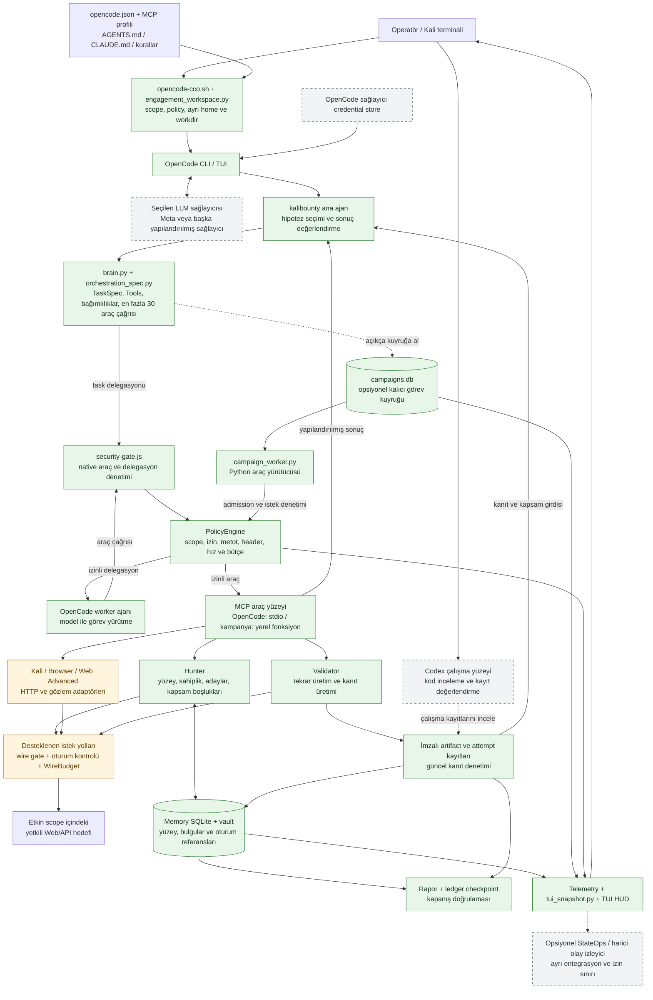
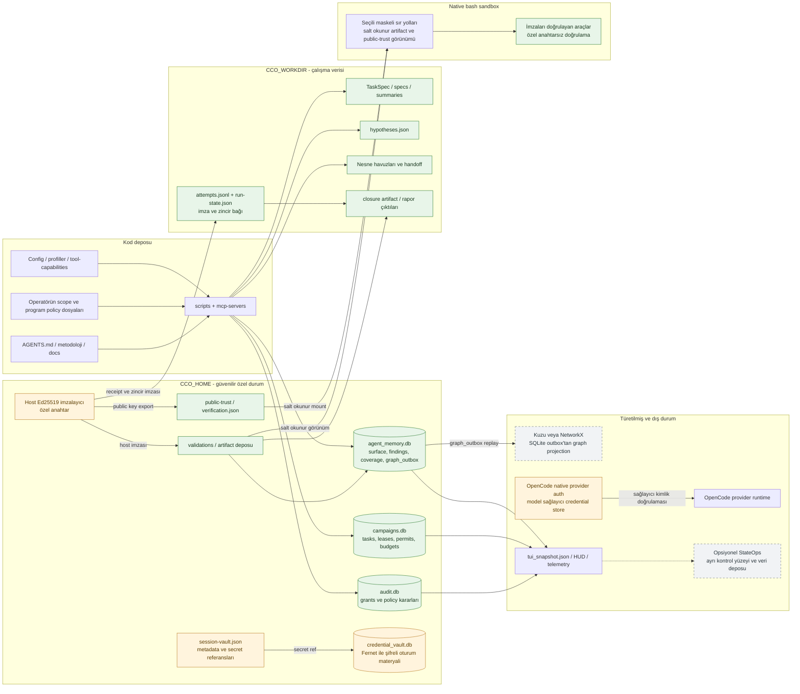
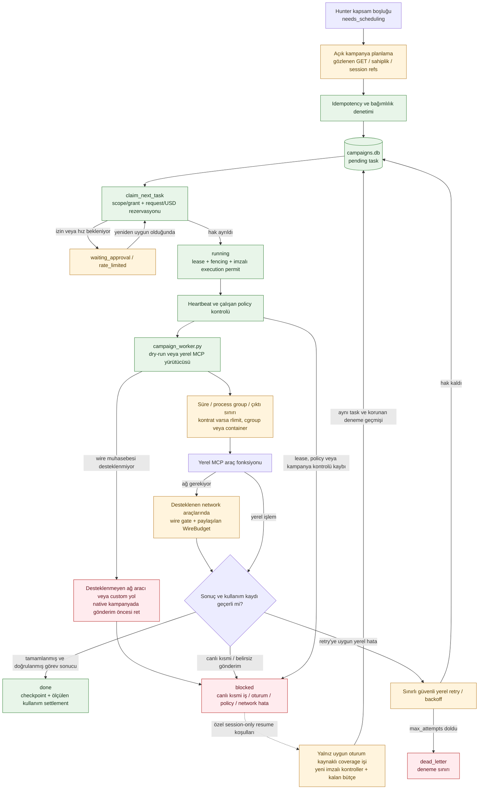
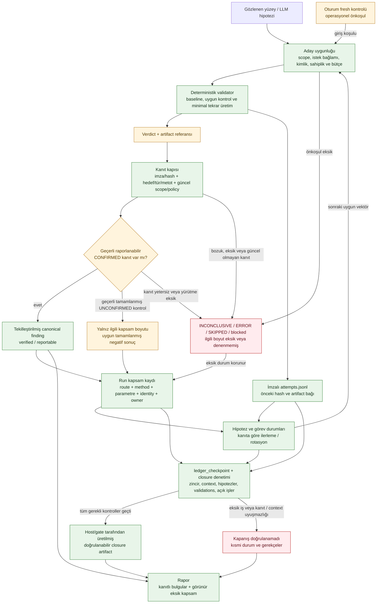

**Hackagent–OpenCode sistem mimarisi — Mermaid**

Kaynak ağacının 2 Kasım 2026 tarihli görünümü. Bu belge mevcut kod yollarını, koşullu entegrasyonları ve güven sınırlarını gösterir. Canlı lab başarısı veya bütün araçlar için uçtan uca kabul sonucu bildirmez.

OpenCode asıl çalışma orkestratörüdür. Codex, operatörle birlikte kodu ve çalışma kayıtlarını inceleyen ayrı yüzeydir. OpenCode'un LLM worker'ı ile Python kampanya worker'ı farklı yürütücülerdir: birincisi modelle karar verir; ikincisi kuyruğa alınan belirli yerel araç fonksiyonunu çalıştırabilir.

Kaynak ağacındaki opencode.json varsayılan modeli **bai-chat/mimo-v2.6-pro** olarak tanımlar. Önceki konuşmada seçilen **meta/muse-spark-1.3-contributor**, çalışma overlay'i üzerinden kullanılan ayrı bir seçimdir. Önceki Meta koşusunun /tmp başlatıcı ve gözlemci dosyaları bu çalışma alanında bulunmuyor. Aşağıdaki LLM kutusu değiştirilebilir sağlayıcı katmanıdır; bu belge model ayarını değiştirmez.

Yeşil kutu koda bağlı mevcut bileşeni, turuncu koşullu veya kısmi yolu, gri opsiyonel dış entegrasyonu, kırmızı kapalı canlı yolu gösterir. Kesikli bağlantılar opsiyonel akıştır.

**1. Genel bileşen haritası.** Kullanıcı başlatmayı ve kapsamı sağlar. Ana ajan hipotez seçer; deterministik planlayıcı görev sözleşmesini üretir. Araç çalıştırma, güvenlik denetimi ve kanıt saklama ayrı katmanlardır.

<!-- diagram: 01-components -->


Kampanya yolu security-gate.js'e bağımlı değildir; CampaignRuntime ve yürütücü PolicyEngine'i doğrudan çağırır. OpenCode worker delegasyonu ve worker'ın sonraki araç çağrıları ise plugin yolundan geçer. Aktif MCP listesi profil ve çalışma overlay'ine bağlıdır. Bir sunucunun enabled olması, içindeki her canlı yolun açık veya doğrulanmış olduğu anlamına gelmez.

Reasoning ve opsiyonel RAG, ana ajan ve Hunter'a planlama girdisi sağlar. Araç içindeki ayrı LLM çağrıları, OpenCode ana/worker model seçiminden bağımsız yapılandırılabilir. Dersler, graph bağlantıları ve RAG sonuçları test yapılmışlığına veya doğrulanmış bulguya dönüşmez.

**2. Bir araç çağrısının güvenlik akışı.** Bu sıra, desteklenen HTTP/Hunter/validator/browser yollarını gösterir. İstek denetimi uygulama adaptörlerinde yapılır; bütün süreçlerin önünde duran tek bir şeffaf ağ proxy'si değildir.

<!-- diagram: 02-security -->
```mermaid
sequenceDiagram
    autonumber
    participant W as OpenCode worker
    participant G as security-gate.js
    participant P as PolicyEngine
    participant A as audit.db
    participant T as MCP araç / adaptör
    participant S as Oturum kasası API
    participant B as WireBudget
    participant H as Scope içi hedef

    W->>G: tool adı + yapılandırılmış argümanlar
    G->>P: validate_tool_invocation
    Note over P: Kayıtlı araç, TaskSpec, secret path, exact scope,<br/>grant, HTTP metodu, zorunlu header, hız, süre ve tekrar freni
    P->>A: Maskeli karar ve gerekçe kaydı

    alt Araç çağrısı reddedildi
        P-->>G: allowed=false + reason_code
        G-->>W: blocked / partial için hata
    else Çağrı kabul edildi
        P-->>G: allowed=true
        opt Çağrı native bash ise
            Note over G: Bubblewrap ile komut yeniden yazılır;<br/>tanımlı sır yolları maskelenir, public-trust salt okunurdur
        end
        G->>T: İzinli araç çağrısını çalıştır
        T->>S: Gerekliyse hesap/origin oturum referansını çöz
        S-->>T: Araç içinde kullanılacak oturum + doğrulama bilgisi

        loop Her gerçek HTTP isteği ve redirect hop'u
            T->>P: validate_wire_invocation(method, URL, headers)
            P-->>T: Güncel scope/policy/grant kararı
            T->>B: Desteklenen kampanya yolunda hakkı tüket
            B-->>T: Kalan hak veya stop reason
            alt Policy, oturum veya bütçe engeli
                Note over T: İstek gönderilmez; ilgili iş durdurulur
            else İstek için hak ve izin var
                T->>H: Sınırlı HTTP isteği
                H-->>T: Status + sınırlı yanıt
                Note over T: 401, login redirect, 429 ve taşıma hatası<br/>ilgili otomatik devam yolunu durdurur
            end
        end

        T-->>G: Sonuç + artifact referansları + kullanım bilgisi
        G-->>W: Gereken çıktılarda UNTRUSTED anotasyonu
    end
```

Kaynak/skill metadata gibi LOCAL_SAFE_TOOLS işlemleri plugin içinde ayrı ele alınır. read/glob/grep ve task bu istisna listesinde değildir. Bir araç çağrısının kabulü, sonraki redirect'e veya değişmiş policy altında yeni isteğe otomatik izin vermez.

Bubblewrap native bash yoluna uygulanır; MCP sunucularının tamamının aynı sandbox içinde çalıştığı varsayılmaz. Mevcut plugin önce capabilities'i düşürüp **CAP_NET_RAW** ekler. Ağ amacı taşımayan bash komutlarında network namespace ayrılır; ağ komutlarında network namespace korunur ve policy denetimine dayanılır. Fiziksel süreç sınırları ile hedefe gönderim bütçesi ayrı garantilerdir.

**3. Demo oturumundan hesaplar arası erişim adayına.** member_login aracı opt-in program kuralı, izinli sentetik hesap ve exact-origin ister. Giriş sırasında oluşan çerez araç belleğinde kalır; kasaya şifreli olarak aktarılır.

<!-- diagram: 03-authentication -->
```mermaid
sequenceDiagram
    autonumber
    participant W as Worker
    participant L as kali-tools_member_login
    participant P as Policy + wire gate
    participant H as Yetkili lab
    participant V as Session store + Fernet vault
    participant C as validator_session_vault_check
    participant D as Hunter blind_discovery
    participant X as Authz validator

    W->>L: target + member-a veya member-b
    L->>P: Opt-in rule, hesap, origin ve grant denetimi
    L->>H: Kapıdan geçen GET ile yayımlanmış demo girişi
    H-->>L: Form / seçici / mevcut hesap bağlantısı
    Note over L: Yalnız yayımlanmış normal üye seçilir;<br/>hesap başına bir login denemesi, çağrı başına en fazla 8 istek

    alt Parola gerekiyor veya yayımlanmış akış bulunamadı
        L-->>W: incomplete + credentials_required / reason
    else İzinli demo akışı gözlendi
        L->>P: Exact login URL için gerçek metot denetimi
        L->>H: Yayımlanmış GET veya dar POST login
        H-->>L: Araç belleğinde cookie + profil yönlendirmesi
        L->>H: Hesap profili ve anonim karşılaştırma GET'leri
        H-->>L: Hesap işareti ve oturum gözlemi
        L->>V: Şifreli oturum + origin + kimlik + check metadata
        V-->>L: Maskeli metadata
        L-->>W: Durum ve hesap referansı

        W->>C: Her iki hesap için güncel kontrol
        C->>H: Scope/grant denetimli profil GET'i
        H-->>C: Hesap işareti ve status
        C->>V: Güncel imzalı oturum kontrolü

        W->>D: Referanslı session_bindings + blind_discovery
        D->>V: Yakın tarihli kontrol ve farklı hesapları doğrula
        D->>H: Gözlenmiş, scope içi GET bağlantılarını izle
        H-->>D: JSON / HTML / inert application-json metadata
        Note over D: Aynı kayıttaki owner ve object ID,<br/>gözlenen URL ve current-user ile eşleştirilir

        alt Sahiplik veya özel erişim beklentisi eksik
            D-->>W: incomplete / uygun authz adayı yok
        else Sahiplik kanıtı ve özel test nesnesi politikası var
            D->>X: Kaynak + sahip A + karşı hesap B + istek bağlamı
            X->>V: Her istekte doğru ve güncel oturum
            X->>H: A ve B ile sınırlı GET karşılaştırmaları
            H-->>X: Kaynağa bağlı yanıt ve kontrol gözlemleri
            X-->>W: Verdict + doğrulama artifact referansı
        end
    end
```

Bu yol genel parola/MFA/CAPTCHA otomasyonu değildir. Üye giriş yardımcısının paylaşılan pacer'ı aynı home altında 2 rps uygular; program kuralları daha sıkı sınırlar koyabilir. POST istisnası yalnız yapılandırılmış demo login URL'sinin gerçek wire denetimindedir.

Oturum sağlığı operasyonel önkoşuldur. Bir fresh sonucu güvenlik açığı sayılmaz. Sahiplik keşfi açık metaveriye bağlıdır; görünen kullanıcı adı ve nesne bağlantısı yeterli olmaz. Mevcut kör keşif kısa sayısal nesne kimliklerini ve bütün uygulama şemalarını genel olarak çözmez. Formlar veya metaveri eksikse kimlik ve sahiplik tahmin edilmez.

**4. Veri, anahtar ve imza sınırları.** Kod repoda, çalışma verisi CCO_WORKDIR altında, özel durum CCO_HOME altında tutulur. Ayrı engagement launcher yerel MCP ortamlarını aynı izole home/workdir/scope ile eşitler.

<!-- diagram: 04-data-trust -->


SQLite ana kayıt kaynağıdır; graph yeniden üretilebilir türetilmiş görünümüdür. Ayrı home kullanımı programlar arası izolasyonun mevcut yoludur. Credential, endpoint ve graph tablolarının tek paylaşımlı veritabanında evrensel satır bazlı engagement izolasyonu tamamlanmış kabul edilmez.

Yeni referanslı session store ile scripts/session_store.py'nin geçmiş session-jar yolu farklı saklama yollarıdır. Bu şema ikisini otomatik birleşmiş veya geçmiş tüm kayıtları şifrelenmiş göstermez. Kasadaki oturum sırları LLM görev özetine taşınmaz; araç bunları güvenilir API üzerinden çözer.

Ed25519 kanıt/attempt imzaları ile kampanyanın HMAC yürütme permit'i farklı güven mekanizmalarıdır. Sandbox yalnız public-trust ile doğrulama yapar; yeni doğrulama imzası host tarafından üretilir. Harici StateOps, Memory MCP'nin agent_memory.db dosyasıyla aynı depo değildir.

**5. Kalıcı kuyruğun ve yürütücünün yaşam döngüsü.** Kuyruk açıkça kullanılmalıdır. CLI kampanya worker'ının varsayılanı dry-run'dır; gerçek yerel araç yürütmesi seçilen yürütücü ve izin koşullarına bağlıdır.

<!-- diagram: 05-campaign -->


Araç çağrı bütçesi, gerçek istek denemesi bütçesi ve kaynak/süre sınırı ayrı sayaçlardır. Belirsiz network tüketiminde muhasebe muhafazakâr yapılır; tamamlanmamış canlı Hunter işi done yapılmaz. Her başarısız canlı iş için kör otomatik retry yoktur.

Custom executor kontratı kod hash'i, izinli ortam değişkenleri, giriş/çıkış limitleri ve process/container izolasyon seçimini bağlar. cgroup best_effort ile required farklı garantilerdir. ResourceLimits tek başına genel network muhasebesi sağlamaz. Native kampanyada sayaca bağlanmamış network araçları reddedilir; doğrudan bütün MCP istemcilerine aynı fiziksel çıkış garantisi tamamlanmış değildir.

Uygun hedefli coverage görevinde session-only resume vardır; bütün çok aşamalı koşuların genel devam mekanizması olarak kullanılmaz. Kuyruk durumları, LLM hipotez defteri ve bulgu durumları birbirinden ayrıdır.

**6. Bulgudan raporlanabilir kanıta ve koşu kapanışına.** Teknik sinyal, validator sonucu, raporlanabilir bulgu ve tam koşu kapanışı farklı kararlar gerektirir.

<!-- diagram: 06-evidence-closure -->


Bir fresh oturum kaydı veya worker'ın olumlu metni güvenlik bulgusu oluşturmaz. Bir endpoint'in test edilmesi başka endpoint/parametre/kimlik boyutunu kapatmaz. Eski kanıtın imzasının doğru olması, yeni scope/policy altında raporlanabilirliğe otomatik dönüşmez.

Kısmi rapor eksikleri gösterebilir; bu raporun üretilmesi tam koşunun kapandığı iddiası değildir. Closure doğrulaması mevcut defter, attempt zinciri, context ve validation bağlarını yeniden karşılaştırır. Elle yazılmış closure JSON'u veya süreç exit_code=0 bu kontrolün yerine geçmez.

Closure payload'u gerekçeli not_tested alanlarını da içerir. Kapanış doğrulaması, bildirilen kapsam ve kanıtın tutarlılığını denetler; bütün olası güvenlik tekniklerinin denenmiş olduğunu göstermez.

**Kaynak eşlemesi.** Diyagramdaki bileşenler aşağıdaki kaynak yollarına dayanır; geçmiş test belgelerindeki başlangıç eksikleri güncel kod durumuyla karıştırılmamalıdır.

| Bileşen | Kaynak |
|---|---|
| OpenCode giriş ve model/profil ayarı | [opencode.json](../opencode.json), [opencode-cco.sh](../scripts/opencode-cco.sh), [profile_manager.py](../scripts/profile_manager.py) |
| Ayrı çalışma ortamı | [engagement_workspace.py](../scripts/engagement_workspace.py) |
| Ana ajan / LLM worker | [kalibounty.md](../.opencode/agents/kalibounty.md), [worker.md](../.opencode/agents/worker.md) |
| Deterministik görev sözleşmesi | [brain.py](../scripts/brain.py), [orchestration_spec.py](../scripts/orchestration_spec.py) |
| Güvenlik ve bash sınırı | [security-gate.js](../.opencode/plugins/security-gate.js), [policy_engine.py](../scripts/policy_engine.py), [policy_gate_cli.py](../scripts/policy_gate_cli.py), [tool-capabilities.json](../config/tool-capabilities.json) |
| Hunter ve sahiplik | [loop.py](../mcp-servers/mcp-hunter/cco_hunter_core/loop.py), [blind_discovery.py](../mcp-servers/mcp-hunter/cco_hunter_core/blind_discovery.py), [request_context.py](../mcp-servers/mcp-hunter/cco_hunter_core/request_context.py) |
| Demo login ve şifreli oturum | [member_login.py](../scripts/member_login.py), [session_store.py](../mcp-servers/mcp-memory-server/cco_surface_core/session_store.py), [credential_vault.py](../mcp-servers/mcp-memory-server/credential_vault.py) |
| Kuyruk, permit, yürütücü ve bütçe | [campaign_runtime.py](../scripts/campaign_runtime.py), [campaign_worker.py](../scripts/campaign_worker.py), [wire_budget.py](../scripts/wire_budget.py), [executor_isolation.py](../scripts/executor_isolation.py) |
| Hafıza ve graph projection | [Memory server](../mcp-servers/mcp-memory-server/server.py), [graph_backend.py](../mcp-servers/mcp-memory-server/graph_backend.py), [surface store.py](../mcp-servers/mcp-memory-server/cco_surface_core/store.py) |
| Validator ve gerçek istek kapısı | [Validator server](../mcp-servers/mcp-validator/server.py), [egress.py](../mcp-servers/mcp-validator/cco_validator_core/egress.py), [evidence.py](../mcp-servers/mcp-validator/cco_validator_core/evidence.py) |
| Host imzası ve kanıt defteri | [evidence_trust.py](../scripts/evidence_trust.py), [attempt_ledger.py](../scripts/attempt_ledger.py), [hypothesis_ledger.py](../scripts/hypothesis_ledger.py), [object_identity.py](../scripts/object_identity.py) |
| Gözlem ve TUI | [tui_snapshot.py](../scripts/tui_snapshot.py), [Telemetry server](../mcp-servers/mcp-telemetry/server.py), [kb-hud.tui.js](../.opencode/tui/kb-hud.tui.js) |
| Koşullu iş mantığı zinciri | [workflow_compiler.py](../scripts/workflow_compiler.py), [chain_executor.py](../scripts/chain_executor.py), [chain_transport.py](../scripts/chain_transport.py) |

Canlı ZAP ve agent-browser yolları gerekli istek/policy entegrasyonu tamamlanana kadar kapalıdır. ZAP snapshot içeri alma offline bir yoldur. Karmaşık iş mantığı, yazma gerektiren upload/stored XSS, genel otomatik oturum yenileme ve kaynak atfı doğrulanmış OOB kolektörü bu şemada tamamlanmış uçtan uca yetenek olarak gösterilmez.

Lab için hız, fuzz miktarı, metotlar ve toplam süre etkin program policy ve başlatıcıdan gelir. Önceki hazırlıktaki 2 rps / 50 fuzz isteği / 20 dakika değerleri bütün programlar için sabit sistem sınırı değildir. Bu belge için canlı hedefe veya model API'sine istek gönderilmedi.
