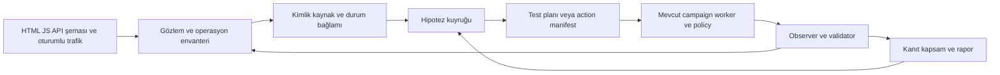

# Web/API Pentest Geliştirme Planı

Tarih: 2026-11-03. Durum: **uygulama sürüyor; P0/P1/P2 ve P4/P5/P6'nın ilk dilimleri işlendi**. Planın tamamı bitmedi; bu belge canlı hedefte test yetkisi vermez. Öncelik, mevcut keşif ve doğrulama parçalarını uygulamanın işlemleri, kimlikleri, kaynakları ve durumları üzerinden birbirine bağlamaktır.

**Uygulama kaydı — P0 ilk dilim, 2026-11-03**

İlk puanlama diliminde `scripts/blind-validate.py`, `blind-score/2` üretmeye başladı; lab ajanı aynı koşunun coverage olaylarını Hunter'ın mevcut imza/artifact denetiminden geçirerek puanlayıcıya aktarır. Yalnız `loop.confirmed`, `UNCONFIRMED` veya `coverage_recorded` beyanı puan kazandırmaz. Hedef origin'i, metot, sınıf ve truth'ta belirtilen actor/owner/parametre bağlamı eşleşir. Genel `broken_access_control` etiketi otomatik authentication bypass sayılmaz.

Negatif sonuçlar `clean`, `not_tested`, `inconclusive`, `blocked`, `false_positive` olarak ayrılır. `clean`, eşleşen bağlamda mevcut validator'ın kanıtlı `tested_clean` sonucunu ifade eder; bütün endpoint'in güvenli olduğu iddiası değildir. Hiç tamamlanmış negatif kontrol yoksa `fp_rate: null` döner. Vaka kanıtlarının validation ID'leri korunur; tekrarlar vaka başarısını artırmaz. Truth dışı veya yanlış kimliğe ait doğrulamalar ayrıca sayılır.

| Seed 20261103, yeni puanlayıcı | Bilinen pozitif | Tamamlanmış negatif | Test edilmemiş negatif | FP oranı | İstek |
| --- | --- | --- | --- | --- | --- |
| Deterministik | 1/8 | 0/8 | 8/8 | Ölçülemedi (`null`) | 66 |
| Deterministik + diferansiyel | 2/8 | 0/8 | 8/8 | Ölçülemedi (`null`) | 118 |

Eski 8/8 `clean` sayımı gerçek doğrulama kapsamını göstermiyordu. Yeni ölçüm, keşif davranışını değiştirmeden bu farkı görünür kılıyor. Diferansiyel koşuda tam vaka/kimlik eşlemesi dışındaki 3 doğrulama ayrıca `unmapped_confirmed` olarak kaldı; ek başarı veya otomatik FP sayılmadı.

Doğrulama: 83 ilgili test geçti. Entegrasyon testi gerçek imzalı coverage kayıtlarını sentetik transport ile üretir; kaydın status'u imza dışında değiştirildiğinde aktarım ve puanlayıcı bu kayda kredi vermez. Ayrıca gerçek loopback lab koşuları iki modda tekrarlandı. Bu sonuçlar tam LLM ajan koşusu değildir.

```bash
python3 -m pytest tests/test_blind_lab.py tests/test_blind_discovery_integration.py tests/test_authenticated_web_api.py -q
python3 scripts/blind-validate.py --seed 20261103 --timeout 90 --report /tmp/cco-p0-blind-20261103.json
python3 scripts/blind-validate.py --seed 20261103 --differential --timeout 90 --report /tmp/cco-p0-blind-differential-20261103.json
```

İlk dilim sonunda P0'ın kalıcı run manifesti, kayıp noktası sınıflaması ve üç solver yolunun ortak kabulü açık kaldı. Sonraki dilimin kaydı aşağıdadır. Eski raporlar yalnız ham loop özeti içeriyorsa yeni kanıtlı puana doğrudan çevrilemez; doğrulanmış coverage kaydı veya yeniden koşu gerekir. Aşağıdaki başlangıç tablosu tarihsel karşılaştırma olarak korunmuştur.

**Uygulama kaydı — P0 kayıp aşamaları ve P2 yerel OpenAPI referansları, 2026-11-03**

Puanlayıcı sürümü `blind-score/3` oldu. Her vakada `loss_stage` ve `pipeline` bulunur; pozitif vakaların kayıp aşamaları `positive_loss_stages` içinde sayılır. Derlenen yüzey, kimlik keşfinin gözlenen operasyonları, üretilen aday, bağlanan doğrulama kuyruğu, çağrılan validator ve doğrulanmış coverage ayrı izlenir. Örneğin aday yokluğu, sonuçsuz doğrulama, doğrulama bütçesi, eksik önkoşul ve eksik kanıt birbirine karıştırılmaz. Telemetri tanı içindir; kanıtsız verdict hâlâ başarı puanı kazandırmaz. Vaka kapsamı dışında kalan actor/owner doğrulamaları da ayrı teşhis edilir.

Lab ajanı başlangıçta yüzey envanterinin boş olduğunu kontrol eder, aynı koşunun örnek değer içermeyen envanterini çıkarır ve snapshot tamamlığını belirtir. Önceki koşu veya eksik snapshot, "operasyon keşfedilmedi" sonucunu desteklemez. Rapor `run_id` ve daha ayrıntılı ajan çıktısının `agent_artifact` yolunu taşır. Bu, kalıcı ve bütün çalışma yollarını kapsayan bir manifest yerine geçmez. `surface_observed`, derlenen envanter veya kimlik keşfi operasyonunda görünmeyi belirtir; bütün HTTP trafiğinin eksiksiz gözlem kaydı değildir.

| Seed 20261103, ikinci dilim | Bilinen pozitif | İstek | Tamamlanmış negatif | FP oranı |
| --- | --- | --- | --- | --- |
| Deterministik | 1/8 | 66 | 0/8 | Ölçülemedi (`null`) |
| Deterministik + diferansiyel | 2/8 | 118 | 0/8 | Ölçülemedi (`null`) |

Bulgu sayısı önceki dilimle aynı kaldı. Yeni tanı, sonraki geliştirmeyi somutlaştırdı:

| Bilinen pozitif | Yeni raporda görünen kayıp |
| --- | --- |
| SQLi `/item`, traversal `/file` | Yüzey bulundu ve prob üretildi; validator adayı çıkmadı (`probe_no_candidate`) |
| XSS `/search` | Validator çağrıldı; doğrulanmış sonuç `inconclusive` |
| SSTI `/hello`, authentication bypass `/account/statement` | Yüzey bulundu; ilgili sınıf için aday üretilmedi |
| BFLA `/admin/export` | Aday üretildi; test kimliği/nesnesi bağlama önkoşulu karşılanmadı |
| BOLA test nesnesi | Deterministik keşifte yok; diferansiyel kimlik keşfiyle kanıtlandı |
| Redirect `/go` | İki modda da kanıtlandı |

OpenAPI parser, ayrı ve ağ isteği yapmayan `cco_surface_core/openapi.py` üzerinden yerel JSON Pointer referanslarını çözer. `requestBody`, parameter, schema ve path item referansları; path düzeyinden parametre mirası; operasyonun aynı `(name, carrier)` parametresini geçersiz kılması; `allOf` alanları ve iç içe JSON yolları desteklenir. Integer/boolean örnekleri, `required` ve örnek kaynağı normalizasyon ile SQLite depolamasından geçer. Aynı isimdeki query/header/body alanları birlikte tutulur. XHR gibi gözlem kaynaklarının değerleri, şema örnekleriyle birleştirilirken öncelikli kalır.

Referans zinciri, şema derinliği ve alan sayısı sınırlıdır. Çözülemeyen veya döngüsel alanlar `<unavailable>` ve `schema_unresolved` ile işaretlenir; hassas örnekler redakte edilir. `sample_source`, gerçek API gözlemiyle OpenAPI example/default/enum veya türetilen örneği ayırır. Türetilen örnek bütün JSON Schema kısıtlarına uygun istek garantisi değildir. Harici referansları getirme, alternatif `oneOf`/`anyOf` gövdeleri, bütün serileştirme stilleri ve root array gövdeleri bu dilimde tamamlanmadı.

Doğrulama: **227 ilgili offline test ve 7 loopback entegrasyon testi geçti**. Inline ve `$ref` eşdeğerliği, iç içe JSON canary'sinde integer/boolean kardeş alanların korunması, referans ve örnek değer döngüleri, taşıyıcı çakışması, gerçek gözlem önceliği, imza değiştirildiğinde kredi kaybı ve doğrulama bütçesi ayrımı kontrol edildi. SPA labı **13/13 rota, 18/18 parametre** kapsamını korudu. `git diff --check` ve `check_repo_layout.py` geçti.

```bash
python3 scripts/blind-validate.py --seed 20261103 --timeout 90 --report /tmp/cco-p0p2-blind-20261103.json
python3 scripts/blind-validate.py --seed 20261103 --differential --timeout 90 --report /tmp/cco-p0p2-blind-differential-20261103.json
python3 scripts/spa-validate.py --timeout 90 --report /tmp/cco-p0p2-spa-20261103.json
```

P0 ve P2 bütünüyle kapanmadı. Sıradaki dilim P1 operasyon/gözlem kimliği ile P2 geçerli istek bağlamının tamamlanmasıdır; aday üretimi ve BFLA test nesnesi bağlamı yeni ölçümün somut öncelikleridir. Kalıcı manifest ve ortak tam ajan kabul ölçümü ayrıca açıktır. LLM ve tarayıcı keşfi kapalı kör benchmark, ürünün tam ajan kabiliyet skoru olarak kullanılmamalıdır.

**Uygulama kaydı — P1 operasyon/gözlem kimliği ve P2 istek bağlamı, 2026-11-03**

Yüzey sözleşmesi `attack-surface/1.1` oldu. Yeni `cco_surface_core/operation.py`, origin'in scheme/host/port'unu, HTTP metodunu ve yolu içeren `operation_id` üretir. GraphQL'de seçilen operasyon ile bağlı fragment'ların normalize edilmiş token özeti eklenir; whitespace, yorum veya ilgisiz operasyon tanımı değişikliği seçilen işlemi değiştirmez. `operationName`, query/mutation/subscription ayrımı ve variable tipleri korunur. Çoklu belirsiz seçim, eksik fragment ve sınırlara takılma açıkça bilinmeyen bağlam olarak kalır. Bu sınırlı parser tam GraphQL semantik doğrulayıcısı veya şema sürümü bağlama mekanizması değildir; ham doküman descriptor içinde tutulmaz.

Mevcut SQLite `attack_surface` tablosuna eklemeli operasyon kolonları ve `latest_observation_id`, ilişkili `surface_observations` tablosuna güvenli yakalama özeti ve kaynak ilişkisi eklendi. Aynı işlemin farklı örnek değerleri ayrı gözlemler olur; aynı yakalama tekrarında gözlem kimliği korunur, kaynaklar birleşir ve son yakalama referansı güncellenir. Böylece A → B → A yakalamasında A'nın örnek değerleri B'nin gözlem kimliğiyle bağlanmaz. Şema örneği gözlenen isteğin yerini almaz; required/type bilgisiyle zenginleştirir. Eski kayıtlar okunur ve `legacy_unknown` olarak kalır; kaybolmuş operasyon bilgisi veya eski tested/clean sonucu yeni operasyonlara aktarılmaz.

Browser/XHR ve JS keşfi aynı URL'deki farklı GraphQL işlemlerini birlikte tutar; JS variable bilgisi çağrılar arasında karışmaz. POST yakalamasında query, JSON/form gövde ve hassas olmayan header alanları birlikte korunur. Canary kurulurken sibling alanların tipleri, query varsayılanları, form boolean serileştirmesi ve temel header/cookie/path bağları korunur. GraphQL query/operationName/envelope alanları canary parametresi yapılmaz; mutation/subscription/belirsiz işlem ertelenir. GET metodu POST'a çevrilmez. Inline GraphQL string değerleri ve hassas GET variable zarfı, örnek değerlerin yanında saklanan URL ve gözlem özetinden de temizlenir; kullanılamayan değerler uydurulmaz.

Hunter'ın kısa ömürlü özel request referansı, operasyon/gözlem kimliği ve header bağlamının hash'iyle scope/policy revizyonuna bağlandı. Validator'a farklı oturum, tenant, işlem, gözlem veya scope/policy geldiğinde ağ isteği göndermeden `INCONCLUSIVE` döner. Operatör header'ı yakalamadan gelen eski header tarafından ezilmez. Eksik required örnek ve GraphQL variable açık önkoşul oluşturur. HTTP 200 içindeki GraphQL `errors`, eksik `data`, geçersiz JSON ve açık REST hata zarfları baseline başarısı sayılmaz; prob/oracle'a geçilmez. Bu kontrol bütün uygulamalarda işlevin veya test nesnesinin beklenen başarı durumunu kanıtlamaz. XML için baseline uydurulmaz. Metadata, mevcut Hunter salt-okunur wire gate'inin izinlerini genişletmez; POST yürütme yetkisi eklenmedi.

Operasyon ve gözlem kimlikleri validator kuyruğu, imzalı coverage bağlamı ve kalıcı gap/campaign anahtarlarına taşındı. Aynı endpoint'teki ikinci işlem queue dedup sırasında kaybolmaz. Eski veya başka operasyona ait coverage kaydı yeni işlemi kapatmaz; önceki yakalamanın kanıtı yeni gözlemi test edilmiş göstermez. Bilinmeyen kimlikli eski gap anahtarları uyumlu kalır.

Doğrulama: **346 ilgili test geçti**; bunlar bütün repo testlerinin veya ürünün keşif başarısının ölçümü değildir. Gerçek eski şema geçişi, iki GraphQL operasyonu, fragment/variable ayrımı, port/taşıyıcı ayrımı, A → B → A yakalaması, gözlem üzerine şema import'u, hassas GET/POST örneklerinin saklanmaması, eksik önkoşullar, uygulama hata baseline'ı, bağlam değişince validator'ın çağrılmaması, imzalı coverage ve campaign/gap regresyonları kontrol edildi. SPA labı **13/13 rota, 18/18 parametre** kapsamını korudu. `git diff --check` ve `check_repo_layout.py` geçti.

| Seed 20261103, üçüncü dilim (`blind-score/3`) | Bilinen pozitif | İstek | Tamamlanmış negatif | FP oranı |
| --- | --- | --- | --- | --- |
| Deterministik | 1/8 | 66 | 0/8 | Ölçülemedi (`null`) |
| Deterministik + diferansiyel | 2/8 | 118 | 0/8 | Ölçülemedi (`null`) |

Bulgu sayısı artmadı; bu dilim istek ve kanıt bağlamının karışmasını giderdi. SQLi/traversal probundan aday çıkmaması, SSTI/authentication bypass aday üretimi, XSS oracle belirsizliği ve BFLA test nesnesi önkoşulu açık kaldı. Diferansiyel koşuda kapsam eşlemesi dışındaki 3 doğrulama yine ayrıca sayıldı. Sekiz negatif kontrolün hiçbiri tamamlanmadığı için sıfır FP iddiası kurulamaz. Bu ölçümlerde LLM ve browser keşfi kapalıdır; tam ajan kabulü değildir.

```bash
python3 scripts/blind-validate.py --seed 20261103 --timeout 90 --report /tmp/cco-p1p2-blind-20261103.json
python3 scripts/blind-validate.py --seed 20261103 --differential --timeout 90 --report /tmp/cco-p1p2-blind-differential-20261103.json
python3 scripts/spa-validate.py --timeout 90 --report /tmp/cco-p1p2-spa-20261103.json
```

P1/P2 bütünüyle tamamlanmadı: yakalanmış tam isteğin vault/session ve frontier üzerinden kalıcı bağlanması, alan kümesi birleştirme, bütün serileştirme/GraphQL zarf biçimleri, şema sürümü bağlamı ve uygulamaya özgü baseline semantiği açıktır. P0'ın kalıcı manifesti ve tam ajan kabulü de sürer. Sonraki öncelik P5/P6'daki aday üretimi ve geri bildirim kuyruğudur; BFLA için P4'ün somut test kaynağı bağlamı birlikte ele alınacaktır.

**Uygulama kaydı — P4 erişim önkoşulları ve P5/P6 aday/geri bildirim kuyruğu, 2026-11-03**

SQLi'nin yeni SQLite hata sinyali ve geçerli baseline'lı SQLi/SSTI/traversal probları için en fazla 4 adaylık örnekleme eklendi. Canary'ler operasyonlar, validator işleri sınıflar arasında sırayla ilerler; kaynak/alan/taşıyıcı/kimlik/gözlem dedup'ta korunur. SSTI metin alanlarından, authentication bypass koruma/rota metadata'sından hipotez üretebilir. Hipotez, erişim kuralı veya doğrulanmış bulgu sayılmaz.

BFLA, explicit fonksiyon test kaynağı ve yasaklı rol kuralına; authentication bypass, bir yetkili test kimliğinin explicit korumalı kaynağına bağlanır. Marker ve kaynak beyanı yoksa onarım planı üretilir. Eski `objects` listesi ve yalnız farklı roller BFLA için yeterli değildir. Kalıcı, yürütülmeyen geri bildirim kuyruğu; eksik önkoşul/bütçe/sonuçsuz test ayrımını ve imzalı kanıta bağlı kapanışı tutar. Önbellekteki terminal sonuç okunurken mevcut artifact yeniden denetlenir. MCP imzaları, OpenCode, campaign lease ve salt-okunur wire sınırı korunur.

Yeni sözleşme paketindeki 25 test dahil, toplam 395 ilgili offline test geçti; socket kullanan 7 test seçilmedi. Değiştirilmemiş kör labın sentetik transport regresyonunda deterministik 3/8, diferansiyel 4/8 vaka aynı koşunun imzalı coverage kanıtıyla eşleşti; iki mod da 159 adaptör isteği kullandı. SQLi/SSTI doğrulamaya ulaştı, traversal kaybı `validation_inconclusive` aşamasına ilerledi. BFLA/auth bypass kör akışta kaynak beyanı önkoşulunda kaldı; beyanlı ayrı entegrasyon imzalı doğrulamayı geçti. Negatif kontrol kapsamı 0/8, FP oranı `null`. Bunlar yeni gerçek loopback veya tam ajan benchmark'ı değildir; ortam socket açmayı engelliyor.

Sözleşme, örnekler ve kalan işler: [aday/geri bildirim dilimi](candidate-feedback-2026-11-03.md). P4/P5/P6 bütünü kapanmadı; kalıcı kaynak bağlama, önkoşul düzelince sınırlı yeniden planlama, negatif kontroller ve gerçek loopback/tam ajan kabulü açık.

**Uygulama kaydı — P4/P5/P6 kalıcı test kaynağı ve campaign devamı, 2026-11-04**

BFLA fonksiyon ve authentication bypass korumalı kaynak beyanları mevcut şifreli oturuma bağlandı. Metadata aracı `validator_session_vault_bind_resources` scope denetimiyle çalışır; beyan değişikliği yeni oturum kontrolü gerektirir. Kaynak/marker/rol kuralı `access_rule_hash` ile görev ve imzalı coverage boyutunda korunur. Eksik bağlamlı imzalı aday, önkoşul sağlanınca sınırlı campaign görevine bağlanır. Kaynak aynıysa bloktan sonra bütün bağlı hesapların yeni doğrulamaları, mevcut görev kimliği ve kalan bütçeyle devam etmeyi sağlar. Normal web döngüsü de vault beyanlarını çözer; authentication bypass için bir yetkili kimlik yeterlidir.

Auth bypass olumsuz kontrolünde eksik request evidence tamamlandı. BFLA test transport'u yasaklı rol ile anonim erişimi ayırır. Transport, 429, sunucu hatası, herkese açık fonksiyon veya belirsiz marker kontrolü terminal başarıya çevrilmez. Sözleşme, tekrar çalıştırma ve doğrulama sınırları: [kalıcı kaynak bağlama dilimi](test-resource-resume-2026-11-04.md).

Doğrulama: **514 ilgili offline test geçti, 7 socket/tarayıcı testi seçilmedi**. Geniş toplamın içinde yeni kaynak/devam paketinin 36 testi var. `git diff --check` ve ilgili Python derleme kontrolleri geçti. Repo düzeni denetimi, kökteki mevcut iki `codex-session-*.md` dosyası nedeniyle başarısız; gerçek loopback veya tam ajan kabulü bu koşuda yürütülmedi.

Bu dilim P4/P5/P6'nın tamamını veya kör lab kabulünü kapatmaz. Sıradaki işler traversal oracle'ı, negatif benchmark kontrolleri ve gerçek loopback/tam ajan kabulüdür.

**1. Hedef ve başlangıç noktası**

İstenen ürün davranışı: başlangıç URL'si, kapsam ve sağlanan test oturumlarından uygulamanın işlevlerini keşfetmek; geçerli istekleri kurmak; kanıta dayalı hipotezler üretmek; izin verilen testleri yürütmek; yeni gözlemlerle planı güncellemek; doğrulanan etkiyi yeniden üretilebilir bir rapora çevirmek.

Başarı yalnız araç sayısı, geçen test sayısı veya CONFIRMED kayıt sayısıyla ölçülmez. Keşfedilen işlevler, denenebilen hipotezler, kaçırılan bilinen açıklar, gerçekten sınanan negatif kontroller, maliyet ve tamamlanma süresi birlikte ölçülür.

2026-11-03 incelemesinin mevcut çalışma ağacındaki başlangıç ölçümleri:

| Ölçüm | Sonuç | Yorum |
| --- | --- | --- |
| Seçili yerel regresyon testleri | 225 geçti | Tüm test paketinin veya araştırma başarısının ölçümü değil |
| Kör deterministik akış, seed 20261103 | 1/8 bilinen açık; 1 aday; 66 istek | LLM ve tarayıcı keşfi kapalı |
| Aynı akış, diferansiyel kimlik keşfi açık | 2/8 bilinen açık; 1 aday; 118 istek | BOLA ekleniyor; truth dışı 2 CONFIRMED kayıt ayrıca var |
| OpenAPI örneği | Inline gövde alanları bulundu; aynı gövde `$ref` ile boş geldi | Kaynak aktarımı sırasında bilgi kaybı |
| GraphQL örneği | Farklı operasyonlar aynı yüzey fingerprint'ini üretti | URL/metot/parametre isimleri operasyon ayrımı için yetersiz |
| Puanlayıcı negatif kontrolü | Sıfır istekli koşuda bile `clean` ve `negatives_evaluated: 1` | Negatif kapsam düzeltilmeden FP oranı başarı kanıtı olamaz |

Ham inceleme çıktıları bu oturumda `/tmp/cco-review-checks-20261103.json`, `/tmp/cco-review-blind-20261103.json` ve `/tmp/cco-review-blind-differential-20261103.json` altında tutuldu. Bunlar geçici dosyalardır; kalıcı kabul koşuları `CCO_WORKDIR` altında sürümlü manifestle yeniden üretilecektir.

Mevcut ilerlemeler korunacak:

- [SPA ölçümü](spa-coverage-2026-11-03.md): özel fixture'da 13/13 rota, 18/18 parametre. Bu başarı genelleme iddiası değildir; yeni keşif çalışmalarının regresyon bazıdır.
- [Kör koşu geçmişi](ws1-blind-recall-2026-11-03.md): deterministik özet üretimiyle tam ajan access aşamasına ulaşmış; belge, uzun süren bir koşuda operatörün yol eşlemesiyle 4/8 raporluyor. Sınıf eşlemesi ve süre sınırı nedeniyle yeni otomatik kabul puanıyla eşdeğer sayılmaz.
- [WS7 yazma çalışması](ws7-sealed-write-set-2026-11-03.md): mühürlü test nesnesi altyapısı var; ajan tarafından uçtan uca kullanımı ve tam ajan ölçümü henüz tamamlanmış değil.
- Session store, sahip olunan nesne havuzu, signed coverage, campaign queue, action manifest ve chain executor yeniden yazılmayacak; eksik sözleşmeleri tamamlanacak.

**2. Mimari kararlar**

Mevcut MCP sunucuları ve Python core modülleri üzerinde ilerlenir. Yeni genel amaçlı planner, validator, graph server veya ikinci bir yürütme kuyruğu kurulmaz. Gereken yeni küçük modüller ilgili mevcut core paketinin sorumluluğunda tutulur.



Üç mevcut sözleşmenin görevi ayrılır:

| Sözleşme | Sorumluluk | Yapılacak iş |
| --- | --- | --- |
| `TaskSpec` / `orchestration_spec.py` | Görevlendirme, araçlar, süre ve özet | Operasyon/hipotez referanslarını taşımak |
| `cco-test-plan/1` | Sınırlı temel istek ve varyant deneyleri | Geçerli istek bağlamına bağlamak; gözlem çıktısı üretmek |
| `action-manifest/1.0` | Bağımlı adımlar, veri çıkarımı ve koşullu ilerleme | Tipli giriş/çıkış ve önkoşul referansları eklemek |

`scripts/task_spec.py` gibi diğer girişlerin çağrı noktaları envanterlenir ve bu sözleşmelere adaptörle bağlanır. Bütün biçimleri tek büyük şemada birleştirmek bu planın önkoşulu değildir. LLM planı önerir; geçerlilik, izin, bütçe ve bulgu kararı mevcut deterministik katmanlarda kalır.

**3. Ortak veri sözleşmesi**

P1'de aşağıdaki kavramlar mevcut depolara eklenecek. Alanlar tasarım önerisidir; kaynak doğruluğu ve uyumluluk testleriyle kesinleştirilir.

| Kayıt | Asgari içerik | Kimlik ve anlam |
| --- | --- | --- |
| Observation | Kaynak artifact/request referansı, zaman, run, işlem, oturum sürümü | Gerçekten ne görüldü; ham sırların kopyası değil |
| Operation | Origin, HTTP metodu, yol şablonu, protokol, operasyon ayracı, giriş/çıkış şeması | Aynı endpoint üzerindeki farklı API işlemlerini ayırır |
| Request binding | Operation + yakalanmış istek + session reference + gerekli alan bağları | Test için kullanılabilir başlangıç isteği |
| Principal | Sentetik kimlik etiketi, beyan edilmiş/gözlenmiş rol ve tenant referansı | Token/cookie yerine vault/session referansı |
| Resource | Tür, opaque ID, origin/tenant bağlamı, sahiplik kanıtı, test nesnesi referansı | UUID, bileşik ID ve sayısal ID korunur |
| Hypothesis | Soru, operasyon, actor/owner, kaynak, durum, önkoşullar, test/oracle, köken | Çalışılacak en küçük araştırma birimi |
| Outcome | Planlanan/gönderilen istekler, kontrol sonuçları, kanıt, sonuç ve engel nedeni | Denenmeyen iş ile temiz test ayrılır |
| Relation | Kaynak/hedef referansları, ilişki türü, kanıt, geçerlilik bağlamı | Gözlemden zincir oluşturmaya taşınır |

Operasyon kimliği scheme/host/port ve işlem semantiğini korur. GraphQL için operationName tek başına yeterli değildir; seçilen operasyonun normalize edilmiş yapısı ve şema bağlamı da kullanılır. Farklı değerler aynı operasyonun request binding'leri olabilir; bu değerlerden türeyen kaynak ve hipotezler ayrıca ayrılır. Kimlik, tenant ve run boyutları coverage anahtarında bulunur.

Kanonik envanter adresi HTTP isteğinin yerine geçirilmez. İmzalı URL, query sırası, tekrarlanan parametre ve özgün gövde gerektiğinde güvenilir yakalama referansından alınır. Bir URL şablonu, çalıştırılabilir veya sahip olunan nesne adresi sayılmaz.

Köken etiketleri en az `observed`, `schema_declared`, `inferred`, `operator_supplied` olarak ayrılır. Sahiplik ile erişimin yalnız sahibine ait olması iki ayrı iddiadır. Model veya API dokümanı tarafından öne sürülen ilişki, gözlenmiş kanıt gibi yazılmaz.

**4. İş paketleri ve bağımlılıklar**

P kodları bu planın iş paketleridir; önceki belgelerdeki WS numaralarının yerine geçmez. Her paket kendi kapsamındaki dosyalardan sorumludur; paylaşılan dosyalar küçük, sıralı PR'larla değiştirilir.

| Paket | Teslimat | Bağımlılık |
| --- | --- | --- |
| P0 | Doğru puanlama ve tekrarlanabilir baz | Yok |
| P1 | Operasyon/gözlem ve hipotez referansı sözleşmesi | P0 |
| P2 | Şemadan geçerli API isteğine dönüşüm | P1 |
| P3 | İşlev ve oturum durumuna göre keşif | P1; şema kolunda P2 |
| P4 | Kimlik, tenant ve test nesnesi matrisi | P1; kaynak keşfinde P2/P3 |
| P5 | İnce ayrıntılı, geri bildirim kullanan hipotez kuyruğu | P0/P1; P2/P4 ile genişler |
| P6 | Hipotezden uygun web/API deneyine yönlendirme | P2/P5; authz için P4 |
| P7 | Uygulamaya bağlı iş mantığı testleri | P4/P5/P6 |
| P8 | Kanıt ve veri akışından zincir oluşturma | P5/P6; durumlu zincirler için P7 |
| P9 | Ana ajan akışına entegrasyon ve sürüm kabulü | Her dilimde; son kabul P0–P8 |

**P0 — Puanlama ve başarısızlık teşhisi**

Amaç: ilerlemeyi doğru saymak ve bir açığın nerede kaybedildiğini göstermek.

Yapılacaklar:

- Negatif kontrol için gerçek test yürütmesi, gerekli kontrol adımları ve oracle sonucu aranır. Eksik kontrol `not_tested`/`inconclusive` olur; `clean` olmaz.
- Eşleşme yalnız path'e dayanmaz: metot, operasyon, sınıf eşanlamları, actor/owner ve durum önkoşulları gerektiğinde birlikte kontrol edilir. Sınıf eşanlamları dar ve sürümlüdür; her authz sonucu tek sınıfa eritilmez.
- Aynı vakanın farklı kimliklerle tekrar doğrulanması benzersiz başarı sayısını artırmaz. Truth dışı sonuçlar ayrı inceleme listesine gider.
- Her bilinen pozitif için kayıp noktası kaydedilir: keşfedilmedi, geçerli istek kurulamadı, aday üretilmedi, seçilmedi, çalıştırılamadı, oracle sonuçlandıramadı veya rapora taşınamadı.
- Koşu manifesti: commit + çalışma ağacı fark özeti/hash'i, lab sürümü, solver türü, model/sürüm varsa, scope/policy hash'i, istek/süre/maliyet bütçesi, seed referansı ve artifact dizini. Manifest sır içermez.
- Deterministik, deterministik+diferansiyel ve tam OpenCode ajan koşuları ayrı ürün yolları olarak ölçülür. Hepsi aynı karar/evidence sözleşmesini kullanır.

Dosya sorumluluğu: `scripts/blind-validate.py`, `scripts/lab/blind_agent_run.py`, `scripts/spa-validate.py`, `tests/test_blind_lab.py`; ortak değerlendirme yardımcısı gerekiyorsa mevcut benchmark araçlarıyla paylaşılır.

Kabul: sıfır istekli koşu hiçbir negatifi temiz göstermez; yanlış kimlik/operasyon eşleşmesi başarı sayılmaz; yinelenen kayıt sayımı değişmez; eski koşular yeni puanlayıcı sürümü belirtilerek yeniden değerlendirilir. HTTP sayacı ile yetkilendirme/gönderim sayaçlarının farkı açıklanır; üçü birbirinin yerine kullanılmaz.

**P1 — Operasyon ve gözlem envanteri**

Amaç: REST/GraphQL işlemlerinin, gerçek istek bağlamının ve kaynak kimliklerinin sonraki aşamalarda kaybolmaması.

Yapılacaklar:

- `attack_surface` mevcut kayıtları ve dış API'leri korunarak operasyon ayracı ve observation ilişkileri eklenir. Gerekiyorsa ilişkili tablo kullanılır; raw trafik ve graph yeni birer system-of-record olmaz.
- GraphQL'de farklı operasyonlar ayrılır; REST'te aynı isimli query/header/body alanları taşıyıcılarıyla korunur. Bileşik ve opaque kaynak kimlikleri sayı komşuluğuna indirgenmez.
- Request binding, session sürümü ve scope/policy bağlamına bağlıdır. Kullanılabilir başlangıç isteği ile sadece şeması bilinen işlem ayrılır.
- İçe aktarım kaynakları aynı sözleşmeye normalize edilir: HTML, JS, OpenAPI, browser/XHR, proxy ve tarihsel URL.
- Eski özet/fingerprint kayıtlarından kaybolmuş operasyon bilgisi uydurulmaz. Backfill yalnız yeterli kaynak artifact varsa yapılır; diğerleri `legacy_unknown` olarak işaretlenir.

Dosya sorumluluğu: `mcp-servers/mcp-memory-server/cco_surface_core/{schema,normalize,store,parsers}.py`, `scripts/{target_identity,object_identity,workflow_compiler}.py`; Hunter coverage/gap anahtarları.

Kabul: aynı `/graphql` üzerindeki iki farklı operasyon iki kayıt olur; aynı operasyonun iki yakalaması kaynak ilişkileri korunarak birleşir; aynı hostun farklı portları karışmaz; şema ve geçiş testleri eski veriyi okuyabilir. Eski CONFIRMED/clean sonucu, yeni operasyonlara topluca kopyalanmaz.

**P2 — API şeması ve geçerli başlangıç isteği**

Amaç: endpoint bulunmasının ardından yanlış veya eksik gövdeyle yapılan verimsiz denemeleri azaltmak.

Yapılacaklar:

- OpenAPI yerel `$ref`, path-level parametreler, requestBody/content-type, required, type, enum, format, nullable, nested object ve array bilgileri çözülür. `allOf` birleşimleri ve `oneOf`/`anyOf` alternatifleri açık biçimde temsil edilir.
- Döngüsel/aşırı derin referanslar sınırlanır; çözülemeyen alanlar sessizce düşürülmez. Harici `$ref` otomatik scope genişletmez; kapsamı uygun kaynak veya operatörün sağladığı yerel kopya gerekir.
- İşlem için önce yakalanmış geçerli request binding seçilir. Yoksa şemadan bir plan üretilebilir; gerçek izin ve gerekli oturum/nesne verisi olmadan çalıştırılabilir sayılmaz.
- Hassas veya tek kullanımlık alanlar vault/session bağlamından tamamlanır; rastgele token veya sahiplik ID'si uydurulmaz.
- GraphQL operasyonları, variable tipleri, fragments ve query/mutation ayrımı korunur. Salt okunur olduğu iddiası isimden çıkarılmaz; POST veya şema bildirimi tek başına izin oluşturmaz.
- Geçerli baseline kontrolü HTTP 2xx'e indirgenmez: GraphQL `errors`, JSON hata zarfı ve beklenen test kaynağı da kontrol edilir. 400/422 şema tamirine, doğrulanmış oturum kaybı oturum kurtarmaya yönlenir.

Dosya sorumluluğu: surface `parsers.py`/`extract.py`, `mcp-kali-tools/cco_js_core`, `mcp-hunter/cco_hunter_core/request_context.py`, `scripts/workflow_compiler.py`, ilgili facade'lar.

Kabul: aynı şemanın inline ve `$ref` sürümü eşdeğer alanları üretir; integer/boolean/nested alanlar korunur; required alan eksikse gerekçeli plan üretilir; ilgisiz sibling alanlar mutasyonda değişmez; GraphQL hata yanıtı geçerli başarı sayılmaz. Mevcut 13/13 rota, 18/18 parametre fixture'ı gerilemez.

**P3 — İşlev odaklı keşif**

Amaç: bağlantı listesini, uygulamada kullanılabilen ekran/işlem haritasına dönüştürmek.

Yapılacaklar:

- `web` başlangıç planında HTTP ve uygulama bağlamı öne alınır; tam TCP taraması web görevinin otomatik ilk adımı olmaktan çıkar, `host` akışında korunur.
- Kaynak frontier'i birleştirilir: bağlantılar, JS çağrıları, API şemaları, yakalanmış trafik ve izinli tarihsel kaynaklar. Yeni host kaynak olarak kaydedilebilir; aktif scope'a kendiliğinden eklenmez.
- Mevcut browser session araçlarıyla güvenli gezinme adımları, rol/tenant ve ekran durumu bazında izlenir. Menü, sekme ve filtre gibi işlevlerin oluşturduğu istekler ilişkilendirilir; etkisi bilinmeyen form/tuş otomatik işletilmez.
- `sayfa × kimlik × ekran durumu` ziyaret anahtarı ve işlem getirisi kullanılır. Aynı shell sayfası defalarca ziyaret edilerek bütçe tüketilmez.
- İlk 16 bundle/ilk N rota gibi kesmeler görünür bir devam kuyruğuna dönüşür. Lazy-loaded bundle ve runtime XHR'den bulunan yeni işlemler aynı frontier'e girer.
- Bir endpoint'in beklenen 401/403 sonucu ile birincil oturumun gerçekten sona ermesi ayrılır. İkincisi doğrulanmış kontrolle ele alınır; 429/degradasyon gibi genel durma nedenleri korunur.

Dosya sorumluluğu: surface `crawl.py`/`extract.py`, `mcp-browser/cco_browser_core/session.py`, `mcp-browser/server.py`, `scripts/{agent_browse,js_route_queue,brain}.py`, `mcp-kali-tools/server.py`.

Kabul: birbirinden farklı en az iki ek lab biçiminde menü/sekme arkasındaki işlem bulunur; kimlikli ve anonim yüzeyler ayrılır; tek korumalı endpoint tüm bağımsız keşfi yanlışlıkla öldürmez; geçersiz oturum da sağlıklı sanılmaz. Salt statik SPA fixture başarısı runtime keşif başarısı olarak sunulmaz.

**P4 — Kimlik, tenant ve kaynak matrisi**

Amaç: BOLA/BFLA ve alan düzeyindeki erişim hipotezlerinin somut, izinli test kaynaklarına bağlanması.

Yapılacaklar:

- Sağlanan test hesaplarıyla principal/rol/tenant haritası kurulur. İki farklı token'ın iki farklı kişi veya tenant olduğu otomatik varsayılmaz.
- Mevcut sahiplik beyanı, response metadata ve diferansiyel liste keşfi korunur; kaynakları ve güven düzeyleri ayrı yazılır. Sahiplik, herkese kapalı erişim iddiası yerine kullanılmaz.
- Liste → detay → indirme/export ilişkilerinde aynı kaynak referansı izlenir. Bir UUID'nin hangi route parametresine bağlanacağı kanıttan çıkarılır.
- Matris, mevcut kimlikler ölçüsünde owner, aynı tenant başka kullanıcı, başka tenant test kullanıcısı, farklı rol ve anonim kontrolleri kapsar. Eksik kimlikler sentetik olarak var sayılmaz; eksik kapsam gösterilir.
- İzinli test nesnesi hazırlığı P7'deki lab akışıyla bağlanır. Hesap oluşturma veya üçüncü taraf hesaplarına erişim bu planla kendiliğinden yetkilendirilmez.

Dosya sorumluluğu: Hunter `blind_discovery.py`, `identity_pool.py`, `loop.py` ve `server.py`; `scripts/{object_identity,identity_provision,session_store}.py`; surface session store ve ledger handoff araçları.

Kabul: opaque ve bileşik ID'ler kaybolmaz; aynı ID farklı tenant'ta karışmaz; public/shared kaynak false BOLA üretmez; eksik ikinci kimlik tüm diğer testleri durdurmaz; oturum yenilenince sadece ona bağlı işler yeniden uygun hale gelir. Yetki oracle'ı mevcut uygulamadan kullanılır.

**P5 — Ayrıntılı hipotez ve geri bildirim kuyruğu**

Amaç: sekiz kategori arasında dolaşan planı, yeni gözlemden yeni araştırma işi çıkaran bir döngüye dönüştürmek.

Yapılacaklar:

- Hipotez anahtarı operasyon, taşıyıcı/alan, actor/owner, kaynak veya kaynak ailesi, durum ve hipotez türünü kapsar. Eski vektörler raporlama grubu olarak kalır.
- Durumlar en az `proposed`, `ready`, `running`, `blocked`, `inconclusive`, `tested_no_violation`, `confirmed` olarak ayrılır. Kuyruk görevinin bitmesi ile hipotezin doğrulanması farklıdır.
- Bir BOLA doğrulaması başka operasyonların BOLA hipotezlerini kapatmaz. Negatif sonuç yalnız denenen varyant/bağlam için geçerlidir.
- Engelin giderilmesiyle yeniden açma, yeni kanıt/context sürümüne dayanır. Aynı başarısız görevi döndürmek yerine eksik önkoşulu sağlayan sınırlı görev oluşturulur.
- Öncelik: önkoşul hazır oluşu, gözlem kalitesi, kapsama katkısı, olası etki ve tahmini istek/süre maliyeti. İlk sürümde açıklanabilir kurallar kullanılır; skorlar kalibre olasılık diye sunulmaz.
- Keşif, deney ve doğrulamaya ayrılan bütçe görünürdür. Hazır yüksek değerli adaylar büyük bir crawl/fuzz turunun bitmesini zorunlu beklemez.
- Hafif oracle'ın LIKELY üretmesi doğrulamanın tek giriş koşulu olmaz. Uygun yüzey ve geçerli baseline bulunan ancak hafif sinyal üretmeyen sınıflara sınırlı örnekleme bütçesi ayrılır; bu P0'daki SQLi/SSTI/path-traversal kayıplarıyla ölçülür.

Dosya sorumluluğu: `scripts/{hypothesis_ledger,brain,campaign_runtime,autonomous_bounty}.py`, reasoning `hypotheses.py`, Hunter `gap_queue.py`/`campaign_gaps.py`/`replan.py`/`loop.py`.

Kabul: bir sınıfın ilk başarısı diğer kaynakları kapatmaz; aynı gözlem yinelenen görev üretmez; yeni observation uygun yeni hipotezi doğurur; sadece session bekleyen işler session düzelince açılır; bütçe bitimi `tested_no_violation` üretmez. Claim/lease ve imzalı kapanış sözleşmeleri korunur.

**P6 — Web/API deney üretimi ve araç yönlendirmesi**

Amaç: hipotezleri uygun baseline, varyant, kontrol ve oracle kombinasyonuna çevirmek.

Yapılacaklar:

- Baseline → tek değişkenli deney → negatif kontrol → oracle → kanıt akışı mevcut test planı/manifest üzerinden kurulur. Varsayılan race adımı veya ilgisiz jenerik `value` alanı üretilmez.
- SQLi, SSTI, path traversal, redirect, XSS, SSRF ve authz gibi mevcut sınıflar için yüzey/taşıyıcı/izin/kanıt gereksinimleri ortak yönlendirme tablosunda tanımlanır.
- Cookie/header/path/query/JSON/form taşıyıcılarının gerekli bağlamı kaybolmaz. Tür değiştirme ve nested/array varyantları yalnız izinli ve tekrar üretilebilir başlangıçtan türetilir.
- GraphQL için operasyon/field/variable erişimi; REST için nesne/fonksiyon/alan yetkisi ve sürüm farkları önceliklenir. JWT/OAuth incelemesi ilgili oturum/akış gözlenince aday üretir; protokol adı tek başına aktif probe başlatmaz.
- İleri araçların durumu ayrı gösterilir: `available`, `applicable`, `runnable`, `executed`, `validated`. Main loop'ta kapalı hook olması raporda otomatik tamamlanmış görünmez.
- XSS yansıması ile browser execution ayrımı ve SSRF callback provenance gerekliliği korunur. Gerekli browser/OOB önkoşulu yoksa özel neden döner.
- WebSocket/gRPC, cache/smuggling gibi daha özel veya daha riskli katmanlar önce operasyon/envanter adaptörü olarak eklenir; ilk teslimin kapsamı büyütülmez. Aktif deneyleri ayrı fixture ve mevcut izin koşullarıyla daha sonraki dilime bırakılır.

Dosya sorumluluğu: Hunter `testplan.py`/`loop.py`/`variants.py`/`server.py`, surface `fuzz.py`, `mcp-web-advanced/server.py`, ilgili validator router; `config/tool-capabilities.json` ve `mcp_inventory.py` yalnız gerekli kayıt uyumu için.

Kabul: gözlenmemiş endpoint veya body alanı gerçek bağlam gibi üretilmez; bir vardiya testinde seçilen alan dışındaki gerekli alanlar korunur; izinli salt okunur POST deneyleri yöntemin adına göre yanlış sınıflanmaz, fakat şema/LLM beyanı genel POST izni sağlamaz; unavailable araç anlaşılır kapsam boşluğu üretir. Aynı operasyonu etkileyen kimlik ve içerik varyantları ayrı kanıtla kapanır.

**P7 — İş mantığı ve kontrollü lab nesneleri**

Amaç: URL/parametre kelimelerinden üretilen senaryoları gözlenmiş iş kuralına bağlamak.

Yapılacaklar:

- `generate_abuse_cases` ve testplan başlangıçları tarafından üretilen sentetik yanıt/gövde, gerçek uygulama gözlemi gibi kullanılmaz. Bunlar açıkça taslak hipotezdir; gerçek bağlamla doldurulmadan yürütülemez.
- Observer eşlemesi aynı resource ID, response→request veri ilişkisi ve yakalanmış iş akışından yapılır. İlgisiz aynı-host GET fallback'i kaldırılır; eşleşme bulunmazsa eksik önkoşul gösterilir.
- Her deney beklenen iş kuralı ve alternatif açıklamayı taşır: toplamın azalması tek başına ihlal sayılmaz; ilgili işlemin meşru etkisi ve negatif kontrolü de gerekir.
- İlk lab senaryoları: nesne yazma yetkisi, read-only alan bağlama, tek kullanımlık işlemin tekrarı, adım atlama ve paylaşım/durum geçişinin erişime etkisi. Eşzamanlılık ayrı, sınırlı ve açık izinli deney olarak tutulur.
- WS7 geliştirmeleri başlangıç kabulüyle gözden geçirilir: nesne/run/session/origin bağları, süre, test hesabı beyanı ve çapraz koşu reddi. Mevcut dokümandaki iddialar yeni entegrasyonun kanıtı sayılmaz.
- İzole lab fixture'larında hazırlama → sahiplik bağlama → ön durum → deney → son durum → fixture yaşam döngüsünü kapatma uçtan uca işler. Temizlenemeyen veya durumu belirsiz fixture görünür bırakılır; otomatik geri alma başarısı varsayılmaz.

Dosya sorumluluğu: `scripts/{workflow_compiler,chain_executor,write_set}.py`, Hunter abuse-case/testplan yolları, `scripts/write-validate.py`, `tests/test_browser_workflow_bridge.py`, `tests/test_write_set.py` ve lab fixture'ları.

Kabul: yanlış observer seçimi test üretmez; normal iş akışı negatif kontrolde geçer; sadece status 200 ile business-logic CONFIRMED oluşmaz; farklı run'ın test nesnesi kullanılamaz. Bu paketin mutasyon kabulü izole labdadır. Gerçek hedefte yazma, silme veya başka yasaklı işlem için bu plan istisna ya da onay sağlamaz.

**P8 — Kanıtla bağlı zincir oluşturma**

Amaç: statik teknik sıraları yerine hedefte gözlenen veri ve durum ilişkilerinden test zinciri üretmek.

Yapılacaklar:

- Mevcut graph/outbox üzerinde `produces_reference`, `consumes_reference`, `reads_resource`, `requires_identity`, `changes_state`, `validated_effect` gibi ilişkiler tanımlanır. Yeni kalıcı graph servisi açılmaz.
- Her ilişki kaynak kanıtına, origin/tenant/oturum bağlamına ve geçerlilik süresine bağlıdır. Semantik isim benzerliği ile kanıtlı veri akışı ayrılır.
- Statik `CHAIN_RULES` aday üretmeye yardımcı olur; doğrulanmamış kenarlar plan üzerinde açık kalır. Zincirin olası terminal etkisi bulgu severity'sine otomatik yansıtılmaz.
- Planner, bir adımın çıktısını sonraki adımın tipli girişine ve önkoşuluna bağlar. Scope, kimlik, test nesnesi ve izin uyuşmazlığı zinciri çalıştırılabilir olmaktan çıkarır.
- Önkoşul hatasında tüm araştırma iptal edilmez; etkilenen zincir bloklanır. Yeni doğrulanmış referans/state, bağlı hipotezleri yeniden değerlendirir.
- İlk gösterim: A'nın test kaynağında gözlenen referansın farklı bir okuma/indirme işleminde tüketilmesi ve B test kimliği için erişim farkının doğrulanması. Nihai etki yalnız izinli sentetik veriyle gösterilir.

Dosya sorumluluğu: `mcp-reasoning/server.py` ve `cco_reasoning_core/chain_data.py`, memory `server.py`/`graph_backend.py`, `scripts/{action_manifest,chain_executor,workflow_compiler}.py`.

Kabul: iki doğru tekil gözlem bağlanamıyorsa zincir CONFIRMED değildir; referans/tenant uyuşmazlığı reddedilir; bir kenarın kanıtı eskirse bağımlı işler geçersizleşir; güvenli ikizde bağlantı mevcut olsa bile yetki ihlali doğrulanmaz. Tamamlanan zincir kanıtları uçtan uca tekrar oynatılabilir.

**P9 — Ana ajan entegrasyonu ve operatör deneyimi**

Amaç: yeni yeteneklerin ayrı yardımcı araçlarda kalmaması ve tam ajan koşusunun gereksiz sözleşme onarımlarında zaman kaybetmemesi.

Yapılacaklar:

- P0'dan itibaren küçük bir uçtan uca senaryo CI/ölçüm yolunda korunur. P1–P8'in her teslimi aynı ana akışa bağlanır; entegrasyon son haftaya bırakılmaz.
- `brain.py` ve campaign girişleri aynı operasyon/hipotez referanslarını taşır. `run_web_loop` ve manifest görevleri aynı outcome biçimine normalize edilir.
- Mevcut `summary scaffold/validate`, handoff ve host checkpoint araçları kullanılır. Geçersiz görevi üretildikten sonra LLM'e defalarca onartmak yerine gönderimden önce yerel doğrulama yapılır; azami bir yapılandırılmış onarım denemesi ve sonra açık engel nedeni vardır.
- Prompt, skill ve aktif agent dosyaları uygulanan kodla uyumlanır. Eski runtime ifadeleri veya gereksiz manuel JSON talimatları yeni bir paralel metodoloji oluşturmaz.
- HUD/rapor; keşfedilen operasyon, runnable hipotez, bekleyen önkoşul, tested/inconclusive/confirmed, gönderilen istek ve kalan bütçeyi gösterir. Görev tamamlanması, koşu kapanması ve kapsam tamamlanması ayrı alanlardır.
- Artifact/dedup gate, scope/policy ve request budget kontrolleri bütün girişlerde kalır. Aynı verilere farklı CLI/MCP girişleriyle ulaşmak test kapsamını iki kez saydırmaz.

Dosya sorumluluğu: `scripts/{brain,orchestration_spec,autonomous_bounty,campaign_runtime,campaign_worker,tui_snapshot}.py`, `.opencode/agents/{kalibounty,worker}.md`, `.opencode/tui/kb-hud.tui.js`, ilgili web/API skill'leri, profil ve araç kayıtları.

Kabul: başlangıçtan kanıtlı bulgu ve doğru kapanışa tek akış işler; policy veya oturum engeli modelin sözleşme onarım döngüsüne dönüşmez; bütçe dolunca o ana kadarki kanıt ve eksik kapsam korunur. Belgelerde önerilen komutlar gerçekten kayıtlı araç/sürümlerle eşleşir.

**5. Test ve ölçüm programı**

| Katman | Kapsam | Başarı nasıl değerlendirilir? |
| --- | --- | --- |
| Saf birim testleri | Normalizasyon, ref çözme, plan/kimlik anahtarı, değerlendirme | Küçük karşı örnekler; ağ veya LLM gerekmez |
| Sözleşme/entegrasyon | Surface → hypothesis → task → outcome → coverage | Aynı observation kaybolmadan doğru hücreyi kapatır |
| Yerel HTTP/Chromium | Oturum, SPA, gerçek request/response, kontrol oracle'ları | Gerçek transport ile olumlu ve güvenli ikiz |
| Kör deterministik | Başlangıç URL'si + test hesapları | Truth yalnız değerlendiricide; sabit bütçe |
| Tam OpenCode ajan | Aynı girdiler, gerçek planner/worker/closure | Başarıya ek olarak onarım turları, süre ve LLM maliyeti |
| Ayrı holdout | Farklı uygulama yapısı, rol/alan/yol düzeni | Eğitim/ayar senaryolarından ayrı sürüm kabulü |

İlgili mevcut testler genişletilir: `test_surface.py`, `test_schema_contract.py`, `test_spa_lab.py`, `test_authenticated_web_api.py`, `test_blind_identity_discovery.py`, `test_testplan.py`, `test_hypothesis_wiring.py`, `test_campaign_gap_bridge.py`, `test_browser_workflow_bridge.py`, `test_chain_executor.py`, `test_semantic_oracle.py`, `test_closure_gate.py` ve `test_module_boundaries.py`.

Her PR değişen davranış için uygun alt kümeyi çalıştırır. Entegrasyon kilometre taşlarında repo kalite kapısı ve gerçek transport fixture'ları çalıştırılır. Mock başarı gerçek Chromium, gerçek HTTP veya tam ajan başarısı yerine yazılmaz. Sadece dokümantasyon değişiminde uygulama testleri tekrar koşturulmaz.

Ölçütlerin tanımı:

- **Uçtan uca recall:** doğru kanıtla eşleşen benzersiz pozitif vakalar / bütün pozitif truth vakaları. Blocked/missed vakalar paydadan çıkarılmaz.
- **Koşullu doğrulama başarısı:** geçerli baseline'a ulaşan adayların ne kadarı sonuçlandırıldı; uçtan uca recall'dan ayrı gösterilir.
- **Negatif kontrol kapsamı:** gerekli deney ve kontrolleri tamamlanan negatif vaka / toplam negatif truth vakası. FP oranının yanında mutlaka gösterilir.
- **FP:** tamamlanmış negatif kontrolde yanlış CONFIRMED sayısı / tamamlanmış negatif kontrol sayısı. Payda sıfırsa sonuç 0 değil `N/A`dır.
- **Operasyon keşfi:** keşfedilen benzersiz gerçek işlem / labda erişilebilir gerçek işlem. REST'te metot+yol; GraphQL'de operasyon ayracı korunur.
- **Geçerli istek oranı:** uygun kimlik/veri sağlanan işlemler içinde beklenen başarılı baseline kurulabilenlerin oranı. Sırf 2xx yeterli değildir.
- **Verim:** gönderilen istek, ayrılmış/kullanılmış bütçe, ilk geçerli baseline ve ilk doğrulama süresi, toplam süre, LLM maliyeti, sözleşme onarım turu ve yinelenen iş.

Üretim ortamında gerçek toplam açık/endpoint sayısı bilinmediğinden lab recall veya keşif yüzdesi raporlanmaz. Yalnız gözlenen envanter, planlanan testler, tamamlanan kontroller ve açık kapsam sınırları gösterilir.

Başlangıç kabul hedefleri aşağıdadır; bunlar henüz elde edilmiş sonuçlar değildir. P0 sonunda lab kapasitesi ve bütçeyle birlikte sürümlenip sabitlenir. Başarısız bir sonuçtan sonra payda veya eşik sessizce değiştirilmez.

| Kilometre taşı | Hedef |
| --- | --- |
| M0 — ölçüm doğru | Sıfır-istek/yanlış-eşleme/duplicate/unmapped testleri geçer; üç solver yolu ayrı raporlanır |
| M1 — API girdisi doğru | Şema karşı örneklerinde alan ve tip korunması tam; mevcut SPA fixture'ı gerilemez; GraphQL ayrımı doğrulanır |
| M2 — tekil av akışı | Mevcut 8 pozitif/8 negatif labda en az 6/8 doğru pozitif, 8/8 tamamlanan negatif, sıfır FP; 5 seed ayrı raporlanır |
| M3 — genelleme | En az 3 farklı lab ailesinde toplam en az 24 pozitif + 24 negatif; holdout uçtan uca recall ≥%70, her aile ≥%50; negatif kapsam ≥%90 ve sıfır gözlenen FP |
| M4 — tam ajan ve zincir | Aynı bütçede deterministik baza göre gerileme yok; en az 3 zincir senaryosu ve güvenli ikizleri; geçerli kapanış; süre/istek/maliyet raporu |

2026-11-04 offline campaign kabulünde beş seed'in her biri 6/8 kanıtlı pozitif,
8/8 tamamlanan negatif ve sıfır FP üretti; hazırlık dahil 249 istek kullanıldı.
Vault başlıkları, iki runtime yeniden başlatması, görev/bütçe korunması ve
ertelenen adaylar arasında sınırlı ilerleme sınandı. Sonuçlar ve ölçüm modu
[negatif kontrol kaydında](negative-controls-2026-11-04.md) yer alır. M2'nin
gerçek HTTP/Chromium campaign kabulü de sonraki kullanıcı koşusunda geçti:
37/37 test, beş seed'in her birinde 6/8 kanıtlı pozitif, 8/8 temiz negatif ve
hazırlık/browser dahil 250 istek. Eşlenen vakalarda FP sıfır; seed başına dört
eşlenmeyen doğrulama ve XSS/traversal kayıp aşamaları ayrıca açıktır.
[Gerçek kabul kaydı](http-chromium-acceptance-2026-11-04.md) artifact ve sayım
doğrulamasını içerir. Tam ajan ve holdout kabulü sürer; genelleme bu beş seed
koşusundan türetilmez.

Başlangıç bütçe önerisi: lab uygulaması/koşu başına en fazla 300 HTTP isteği; deterministik koşuda 15 dakika, tam ajan koşusunda 30 dakika. LLM maliyet tavanı kullanılan sağlayıcıya göre P0 manifestinde belirlenir; burada dolar değeri varsayılmaz. Negatif kontroller ve fixture hazırlığı ayrıca sayılır; hedef etkileşimleri sayımdan gizlenmez. Gerçek programın daha dar limiti her zaman üstün gelir.

Seed değiştirmek tek başına bağımsız genelleme kanıtı sayılmaz. Holdout; farklı şema/route biçimi, isimlendirme, auth düzeni ve iş akışı içermeli. Truth ve lab kaynakları tam ajan ortamında okunabilir olmamalı; mevcut aynı-kullanıcı alt süreç ayrımı tek başına güçlü körlük sayılmaz. Aynı app/seed/bütçede diferansiyel keşif, browser keşfi, adaptif seçici ve LLM ayrı ayrı açılarak katkıları ölçülür.

**6. Teslim sırası ve PR sınırları**

| PR dilimi | Kapsam | Bitiş kanıtı |
| --- | --- | --- |
| 01 | Negatif kontrol ve vaka eşlemesi | P0 puanlama karşı örnekleri |
| 02 | Run manifesti ve kayıp noktası çıktısı | Yeni formatta karşılaştırılabilir baz |
| 03 | Operasyon kimliği ve additive şema | P1 geçiş/ayrım testleri |
| 04 | Observation/request binding adaptörleri | Yakalama → envanter → görev roundtrip |
| 05 | OpenAPI ref ve alan/tip koruması | Inline/ref/nested/path-param fixture'ları |
| 06 | Geçerli baseline ve GraphQL operasyonları | P2 olumlu/hata kontrol çiftleri |
| 07 | Hipotez kimliği ve vektör kapanışının ayrılması | İlk bulgu sonrası diğer işlerin sürmesi |
| 08 | Coverage/campaign yeniden planlama | Yeni gözlem/session olayıyla doğru görev |
| 09 | Web başlangıç planı ve frontier | Host/web ayrımı, bütçe/yeniden ziyaret kontrolü |
| 10 | Browser işlev keşfi ve runtime trafik | İki yeni SPA/auth fixture'ı |
| 11 | Principal/resource/tenant bağları | Public/private ve çapraz tenant kontrolleri |
| 12 | Authz matrisi ve mevcut validator bağlantısı | BOLA/BFLA/anon bağlamında doğru kanıt |
| 13 | Baseline/deney/kontrol yönlendirmesi | LIKELY dışı sınırlı aday doğrulama |
| 14 | İleri web/API araçlarının ana akışa bağlanması | Available/runnable/validated ayrımı |
| 15 | İş kuralı/observer eşlemesi | Sentetik bağlam ve yanlış observer reddi |
| 16 | WS7'nin test nesnesi hazırlığına entegrasyonu | İzole labda uçtan uca yazma senaryoları |
| 17 | Graph ilişkileri ve kanıt kökeni | Geçerli/geçersiz ilişki fixture'ları |
| 18 | Tipli zincir üretimi ve yürütme | 3 zincir + güvenli ikiz + yeniden üretim |
| 19 | HUD/aktif talimatlar ve tam ajan kapanışı | Uçtan uca zaman/bütçe/closure ölçümü |
| 20 | Ayrı holdout ve sürüm kabul raporu | M0–M4 sonuçları, açık kalan eksikler |

Bu dilimler PR taslağıdır; büyük bir dilim kendi içinde bölünebilir. Sıra bağımlılıklara göre uygulanır. Örneğin P3/P4 çalışmaları, P1 sözleşmesi oturduktan sonra farklı sorumlularca geliştirilebilir; `server.py`, `brain.py`, `campaign_runtime.py` ve ortak şema değişiklikleri çakıştırılmaz. Mevcut kullanıcı değişiklikleri üzerine çalışılır, geri alınmaz.

**7. Geçiş ve geri dönüş**

- Schema migration ve yeni anahtarlar additive ve sürümlü gelir. Önce eski kayıtları okuyabilme ve yeni kayıtlardan eski görünümü üretme test edilir.
- İlk karşılaştırma modu aynı mevcut observation'ları eski/yeni planlayıcıdan geçirir; ekstra HTTP üretmez. Yeni selector üretime alınmadan önce seçim farkları değerlendirilir.
- Ardından yeni yol yalnız yerel lab koşularında seçilir. Başarılı kilometre taşından sonra varsayılan ana yol yapılır; legacy görünüm uyumluluk için tutulur.
- Eski class-level `confirmed` veya `exhausted`, tüm yeni hipotezlerin sonucu haline dönüştürülmez. İmzalı artifact ve ledger geçmişi değiştirilmez; yeni durumlar sürümlü olaylarla eklenir.
- Yeni seçim yolu kapatılırsa mevcut çalışan yürütücüye dönülebilir; toplanmış yeni evidence silinmez. Eski okuyucunun anlayamadığı bilgi açıkça unknown kalır.
- Metadata/graph geçişi bir scope, grant veya metod iznini genişletmez. Yeni side-effect türü yalnız mevcut politika sözleşmesine açık eşleme ve testle kabul edilir.

**8. Efor ve ilk uygulama dilimi**

Tahmini toplam efor: **50–80 geliştirici günü**, entegrasyon ve holdout ölçümleri dahil. Tek geliştiriciyle yaklaşık 10–16 çalışma haftası; iki geliştiriciyle paylaşılan modül bağımlılıkları nedeniyle yaklaşık 7–11 hafta. Bu aralıklar taahhüt değildir; P0/P1 sonrasında gerçek değişiklik boyutuyla yeniden hesaplanır.

İlk teslim edilebilir kapsam P0 + P1 + P2'nin temel şema yolu + P5'in hipotez kimliği + P6'nın mevcut validator bağlantısı + P9'un küçük uçtan uca akışıdır. Böylece browser/state/chain genişlemelerinden önce REST/API keşfinde ölçülebilir fayda görülür.

İlk yaklaşık 10 geliştirici günü için somut sıra:

1. Puanlayıcıdaki sıfır istek ve yanlış eşleme hatalarını kapat; baz koşuları aynı manifestle kaydet.
2. GraphQL operasyon çakışması ve `$ref` alan kaybı için kırmızı regresyon örneklerini ekle.
3. P1 operasyon kimliğini ve eski kayıt geçişini uygula; coverage anahtarına bağla.
4. OpenAPI yerel ref, ortak parametre, required ve tip korumasını tamamla.
5. Aynı labda yeni/güncel envanteri karşılaştır; bilgi kazancı ve geçerli baseline sayısını raporla.

Bu ilk dilimin kabulü: test edilmemiş negatif temiz sayılmıyor; farklı GraphQL operasyonları ayrı; ref ile tanımlı gövde alanları kaybolmuyor; var olan kayıtlar okunabiliyor; güvenilir baseline'a ulaşma oranı ölçülüyor. Genel av başarısı artışı varsa raporlanır, henüz artmadıysa tamamlanmış gibi sunulmaz.

**9. Başlıca riskler ve karar noktaları**

| Risk | Karar |
| --- | --- |
| Daha çok metadata ve karmaşık şema | P1'de asgari alanlar; büyük response/DOM yerine referans; ikinci state sistemi kurmama |
| Yanlış sahiplik veya public kaynağı özel sanma | Sahiplik ve beklenen erişimi ayrı iddia; uygun anonim/rol kontrolleri |
| Regex isimlerine aşırı uyum | Tip/veri akışı/state sinyalleri; farklı isimlendirmeli holdout |
| Bütçenin keşifte tükenmesi | Hazır hipotezlere erken iş; aşama bütçesi ve kuyruğun kaldığı yerden devamı |
| Hafif oracle'ın açıkları elemesi | Yüzeye dayalı, sınırlı doğrudan validator örneklemesi; sınıf bazında kayıp noktası ölçümü |
| Statik zincirin etkiyi şişirmesi | Her kenarın kanıtı ve son etkinin bağımsız doğrulanması |
| Eski talimat/kod sürtünmesi | Koddan üretilmiş görev/özet; kayıtlı araçlarla sözleşme testleri |
| Test nesnesi hazırlığının hedef verisine taşması | İlk kabul yalnız izole lab; mevcut politika ve açık test nesnesi bağları |
| Tek labda başarıya aşırı uyum | Aynı fixture regresyonu ile ayrı yapıda holdout sonuçlarını ayırma |

Planın tamamlanması, dosyaların yazılmasıyla değil M0–M4 kabul kanıtlarının üretilmesiyle değerlendirilir. Açık kalan sınıf, işlem veya önkoşullar sürüm raporunda görünür tutulur. Bu belgenin hazırlanması sırasında canlı hedef etkileşimi yapılmamıştır.
